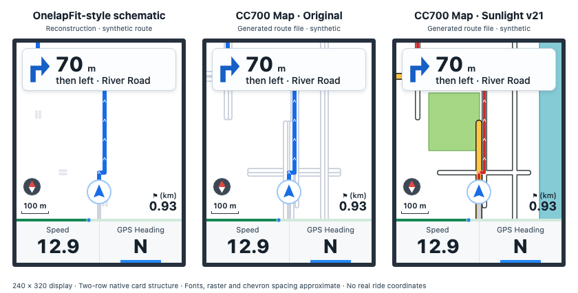
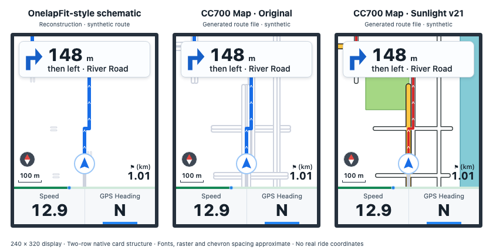
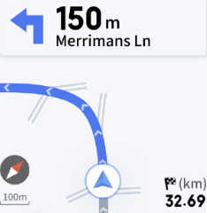

# CC700 Map

This web page makes navigation routes for the GEOID / Magene **CC700** bike computer and sends them over Bluetooth.
Use it in Chrome on Android. Select a GPX file. The page makes the route file and sends it to the device.

## Local development checks

Run the public app checks with Node.js 22 or newer:

```sh
node --test tools/test_preview.mjs tools/test_preview_guidance.mjs tools/test_route_decisions.mjs tools/test_route_captions.mjs tools/test_navsource.mjs tools/test_service_worker.mjs tools/test_map_style.mjs tools/test_surface.mjs tools/test_map_geometry.mjs tools/test_map_labels.mjs tools/test_map_order.mjs tools/test_map_contract.mjs
node tools/test_app_offline.mjs
```

These cover preview/readback, synthetic turn decisions, original OSM source
preservation, the complete offline module cache, and long-route generation.
One executed TODO documents a remaining noisy-track false turn. No private ride
files or device connection are required. See the [app release notes](docs/app-release-2026-11-14.md)
for changes and remaining limitations. [Browser UI checks and artwork reproduction](docs/current-preview-artwork-2026-11-14.md) are documented separately.

## Current preview

The preview follows the supplied CC700 references: a **240 × 320** portrait display,
a two-row turn card (distance and one caption), circular rider marker, compass,
100 m scale, distance-to-finish flag, progress strip, Speed and GPS Heading.
The map retains its **240 × 256** buffer. Fonts, rasterization, route-chevron
spacing and the lower-panel split remain approximations.



These are browser-rendered examples from the current page UI. The middle and
right maps are read back from generated route files. **The left panel is an
OnelapFit-style reconstruction**, with short pale-grey junction marks; it was
not produced by OnelapFit. The right panel uses the v21 profile: v20 map colors
with an opaque red route. No private ride coordinates or ride photos are used.
[Open the interactive app](https://bariskayhan93.github.io/cc700-map/).



The animation advances all three panels through the same synthetic positions,
including a close right/left pair. It is an illustration of on-route progress,
not a GPS or firmware timing simulation.

| Current UI example | View |
|---|---|
| Far from the maneuver: Go straight | [Three panels](docs/comparison/synthetic-far-straight-current-ui.png) |
| Approaching the 300 m threshold | [Three panels](docs/comparison/synthetic-approaching-turn-current-ui.png) |
| Near the first turn | [Three panels](docs/comparison/synthetic-near-turn-current-ui.png) |
| Close pair: one `then left · …` caption | [Three panels](docs/comparison/synthetic-close-pair-current-ui.png) |
| After the first maneuver | [Three panels](docs/comparison/synthetic-second-turn-current-ui.png) |
| Following street | [Three panels](docs/comparison/synthetic-park-street-current-ui.png) |

### Original OnelapFit reference



This supplied image is preserved unchanged and shows **a different route**.
It includes the turn card and map; its bottom metric panel is outside the
supplied image. It is a visual reference, separate from the synthetic
reconstructions above.

The earlier Tour D3 animation and all six comparison panels are retained in the
[historical artwork appendix](docs/comparison/historical-tour-d3.md). They use an
older UI and palette and are not current device captures.

See the [ride review](docs/ride-review-2026-11-14.md),
[display geometry checks](docs/preview-display-geometry-2026-11-14.md),
[guidance behavior and limits](docs/preview-guidance-2026-11-14.md), and
[cycling turn/rejoin assessment](docs/cycling-turn-practices-2026-11-14.md).

## What the page does

- **Maneuver inference** uses track shape and nearby OpenStreetMap junctions. Noisy or sparse tracks can still produce missed or false prompts.
- **Geohash-indexed route points** support progress tracking. Native route arbitration and rejoin behavior still have gaps; an index does not guarantee that a prompt advances in every situation.
- **One caption row** in the top widget, with a `then left · Street` hint when a second turn comes within 50 m.
- **A map around the route.** The CC700 has no map of its own. The page puts OpenStreetMap data into the route file.

## CC700 Map settings

The app starts in **Original (Kreuzungskarte)**. Select **Patch v18 / v19 / v20 / v21 (farbige Sunlight-Karte)** only if
your CC700 has the v18, v19, v20 or v21 patch for firmware V1.414. The preview updates from the generated route file.
Choose **Abspielen** to replay the route at 1×, 4×, or 8× the speed set in **Einstellungen**.
The slider lets you move to any point during playback. The ride preview shows the next instruction,
distance, heading and route progress using the generated route.

| | Junction map (Original) | Full Sunlight map (Patch) |
|---|---|---|
| Map drawing | connected grey lines with a white core | coloured map |
| Roads | widths vary by road class | main, minor, service, path, cycleway, track |
| Areas | optional grey built-up areas and striped water | built-up, green, water, with outlines |
| Rail and tram | option: long dash | rail, tram lines, tram stops |
| Bridges, tunnels | no | black edge for bridges, dashed edge for tunnels |
| Street names on the map | no | yes |
| Traffic signals | no | yes |
| Route line | blue | red |
| Turn arrow on the map | no | option (off by default), 150 m before the turn |
| Map when off route or riding backwards | can disappear | can stay visible within the area stored in the route file |

For the patched firmware, these layers are options: street names, traffic signals, tram stops, tram lines, rough
tracks, footways and paths, park paths and cycle tracks next to streets, separate carriageways, turn arrow.

## How to use

1. Open https://bariskayhan93.github.io/cc700-map/ in Chrome on Android.
2. Select the firmware installed on your CC700. Open **Einstellungen** to change the optional map layers.
3. Select a GPX file, or share it to the page from another app. The page makes the route immediately.
   For a new region, the page needs internet.
4. Close OnelapFit, because it holds the Bluetooth connection. Stop the navigation on the CC700.
5. Push "An CC700 senden". The route menu of the CC700 shows the GPX name.

## How it works

| File | Function |
|---|---|
| `js/route.js` | GPX to route file: sections, turns, name images, geohash index, header |
| `js/osm.js` | OpenStreetMap data from Overpass, one query for each grid cell (about 5.5 km). The phone keeps the cells for 30 days. |
| `js/mapsec.js` | map layer: connected junction segments (stock) or styled entries (patch) |
| `js/ble.js` | Bluetooth file transfer, CRC-16/XMODEM |
| `js/preview.js` | preview from the finished file |
| `tools/test_route.mjs` | makes a route file in Node with the page code |

The GPX stays on the phone. The Overpass server sees only the grid cells, not the route.

The route file is nanopb 0.3 protobuf (firmware 1.414). Name images are LVGL `INDEXED_2BIT`.

## Patched firmware

The v18/v19/v20/v21 patch changes the map drawing of firmware V1.414. It is not part of this repository.
Route files for the patched firmware do not show a usable map on the original firmware.

## Legal

- This is an unofficial and independent project, for interoperability with a device that you own. Magene, GEOID
  and Onelap do not support or approve it. Product names only identify the device.
- The page contains no firmware, app code, icons, fonts or map data from the manufacturer. The file format and the
  Bluetooth protocol come from the owner's own device and its traffic. The only copied bytes are format constants
  in the route header template (`js/route.js`).
- Add `?debug` to the page address to see the Bluetooth log.
- Use it at your own risk. A bad route file can stop the navigation. Then delete the route or send a new one.

## License

- Code: MIT, see `LICENSE`.
- Map data: © OpenStreetMap contributors, Open Database License 1.0 (https://www.openstreetmap.org/copyright).
  A route file from this page contains OpenStreetMap data. Keep the attribution "© OpenStreetMap contributors"
  when you share it. The pictures in `docs/` also contain OpenStreetMap data.

See [the rendering release](docs/rendering-release-2026-11-14.md) for v19 fill, label, geometry and style improvements, compatibility, tests and remaining measurement limits. Select the preview profile matching the firmware actually installed on your device.

The [v21 release](docs/v21-caption-opacity-2026-11-14.md) adds an opaque red route to the [v20 water/cycleway styling](docs/water-cycleway-v20-2026-11-14.md): light-blue waterways and 2 px violet cycleways. Earlier profiles remain selectable.
