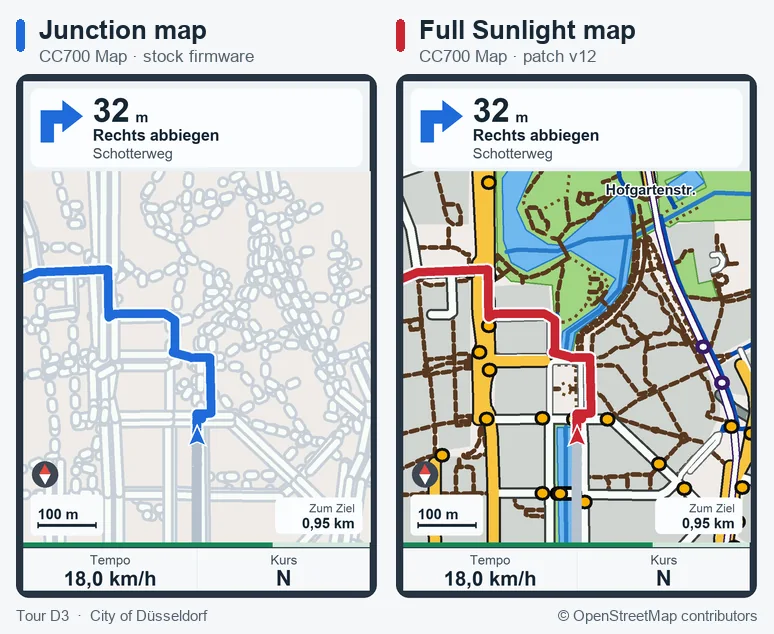
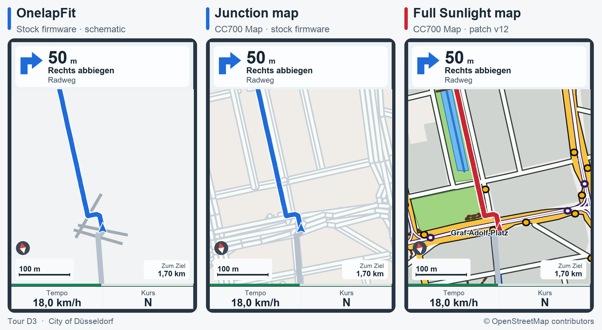
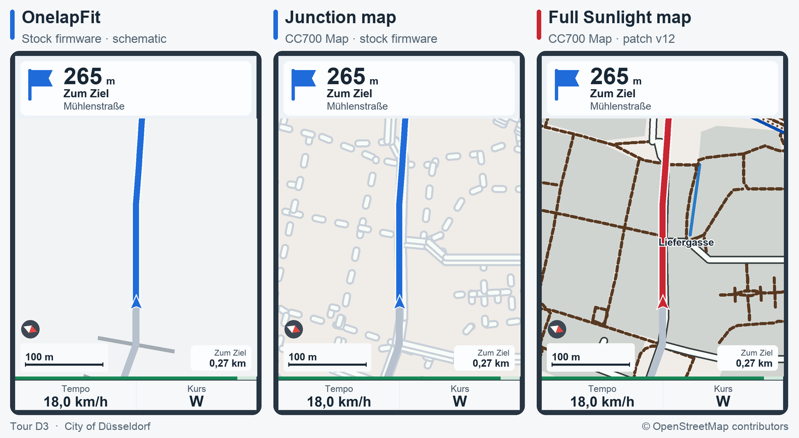
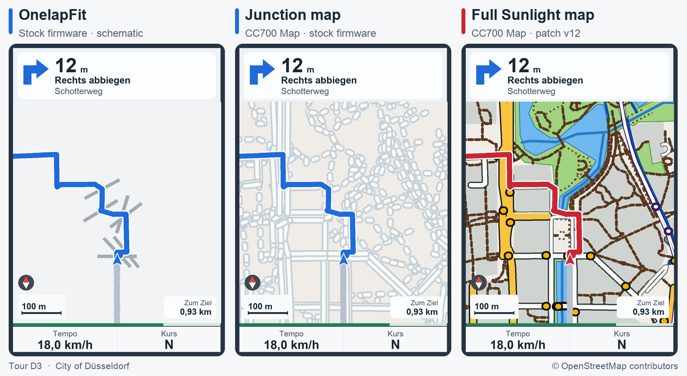
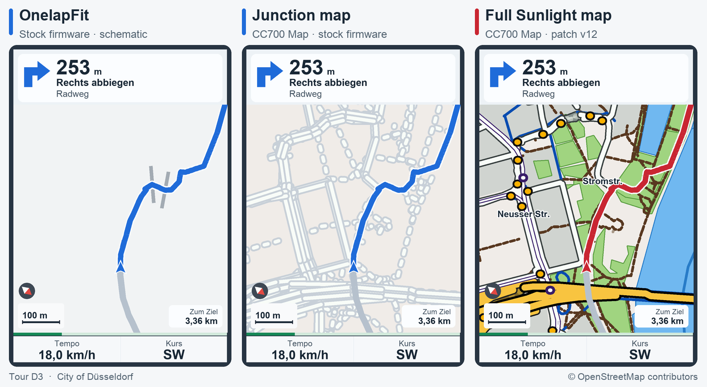
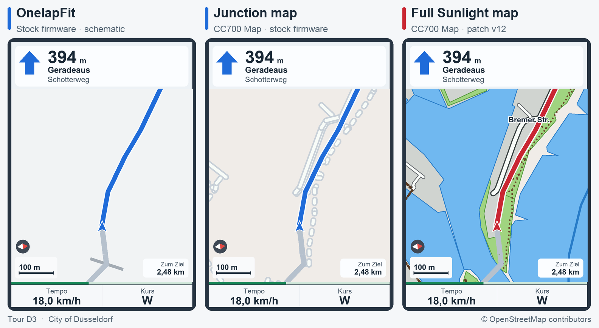

# CC700 Map

This web page makes navigation routes for the GEOID / Magene **CC700** bike computer and sends them over Bluetooth.
Use it in Chrome on Android. Select a GPX file. The page makes the route file and sends it to the device.

## Watch the ride preview

The Junction and Sunlight maps replay the same section of Düsseldorf’s public Tour D3 at 4× speed.
The turn card, heading and distance to the finish update as the maps move.
[Open the interactive CC700 Map app](https://bariskayhan93.github.io/cc700-map/)

## Compare the three navigation views

Five heading-up scenes from Tour D3. The rider’s direction of travel points toward the top of the
screen, and the compass shows where north is. Each excerpt is generated as its own route file.
All three panels in a scene share the same position, heading, scale and guidance. Open any image to zoom in.
[City of Düsseldorf Tour D3 and GPX](https://www.duesseldorf.de/radverkehr/fahrradtouren/tour-d)

| Navigation mode | What the CC700 displays |
|---|---|
| **OnelapFit with stock firmware** | Blue route line and straight grey junction hints about 100 m long. The hints have no road curves or surrounding map. |
| **CC700 Map Junction map with stock firmware** | Blue route line over a grey and white road network. The web app encodes OpenStreetMap road shapes as connected segments that the stock firmware can draw. |
| **CC700 Map Full Sunlight map with patched firmware** | Red route line over a colour map with distinct road classes, outlined green areas and water, and optional street names, tram layers and amber traffic signals. |

The OnelapFit panel illustrates the stock junction hints. The Junction and Sunlight panels are
desktop renders of CC700 Map route files. Blue or red marks the route ahead, and grey marks the
part already ridden.

### Graf-Adolf-Platz

The route turns at a wide junction where tram tracks and traffic signals cross the Königsallee corridor.

### Altstadt near Liefergasse

Connected side streets and bends show the shape of the Old Town street network.

### Hofgarten and the Landskrone pond

The park paths, water edge and city streets meet near the Kö-Bogen.

### Rhine at Rheinkniebrücke

The river, promenade and bridge approach are visible together at the riverbank.

### MedienHafen

The harbour entrance puts the path between two water edges, making the shape of the waterfront visible.

## What the page does

- **Turn prompts at real decision points.** The page finds the junctions in the OpenStreetMap road network. It
  gives a prompt only where the rider must choose a road. A bend without a junction is not a turn.
- **Turn prompts that move forward.** Each route record has a geohash index. The CC700 uses this index to find the
  rider on the route. Without it, the CC700 stays on the first section and shows "Go straight" for the full route.
- **Street names** in the top widget, with a "dann links" hint when a second turn comes within 50 m.
- **A map around the route.** The CC700 has no map of its own. The page puts OpenStreetMap data into the route file.

## CC700 Map settings

The app starts in **Original (Kreuzungskarte)**. Select **Patch v12 (farbige Sunlight-Karte)** only if
your CC700 has the v12 patch for firmware V1.414. The preview updates from the generated route file.
Choose **Abspielen** to replay the route at 1×, 4×, or 8× the speed set in **Einstellungen**.
The slider lets you move to any point during playback. The ride preview shows the next instruction,
distance, heading and route progress using the generated route.

| | Junction map (Original) | Full Sunlight map (Patch) |
|---|---|---|
| Map drawing | connected grey lines with a white core | coloured map |
| Roads | widths vary by road class | main, minor, service, path, cycleway, track |
| Areas | optional grey built-up areas and striped water | built-up, green, water, with outlines |
| Rail and tram | option: long dash | rail, tram lines, tram stops |
| Bridges, tunnels | no | black edge for bridges, dashed edge for tunnels |
| Street names on the map | no | yes |
| Traffic signals | no | yes |
| Route line | blue | red |
| Turn arrow on the map | no | yes, 150 m before the turn |
| Map when off route or riding backwards | can disappear | can stay visible within the area stored in the route file |

For the patched firmware, these layers are options: street names, traffic signals, tram stops, tram lines, rough
tracks, footways and paths.

## How to use

1. Open https://bariskayhan93.github.io/cc700-map/ in Chrome on Android.
2. Select the firmware installed on your CC700. Open **Einstellungen** to change the optional map layers.
3. Select a GPX file, or share it to the page from another app. The page makes the route immediately.
   For a new region, the page needs internet.
4. Close OnelapFit, because it holds the Bluetooth connection. Stop the navigation on the CC700.
5. Push "An CC700 senden". The route menu of the CC700 shows the GPX name.

## How it works

| File | Function |
|---|---|
| `js/route.js` | GPX to route file: sections, turns, name images, geohash index, header |
| `js/osm.js` | OpenStreetMap data from Overpass, one query for each grid cell (about 5.5 km). The phone keeps the cells for 30 days. |
| `js/mapsec.js` | map layer: connected junction segments (stock) or styled entries (patch) |
| `js/ble.js` | Bluetooth file transfer, CRC-16/XMODEM |
| `js/preview.js` | preview from the finished file |
| `tools/test_route.mjs` | makes a route file in Node with the page code |

The GPX stays on the phone. The Overpass server sees only the grid cells, not the route.

The route file is nanopb 0.3 protobuf (firmware 1.414). Name images are LVGL `INDEXED_2BIT`.

## Patched firmware

The v12 patch changes the map drawing of firmware V1.414. It is not part of this repository.
Route files for the patched firmware do not show a usable map on the original firmware.

## Legal

- This is an unofficial and independent project, for interoperability with a device that you own. Magene, GEOID
  and Onelap do not support or approve it. Product names only identify the device.
- The page contains no firmware, app code, icons, fonts or map data from the manufacturer. The file format and the
  Bluetooth protocol come from the owner's own device and its traffic. The only copied bytes are format constants
  in the route header template (`js/route.js`).
- Add `?debug` to the page address to see the Bluetooth log.
- Use it at your own risk. A bad route file can stop the navigation. Then delete the route or send a new one.

## License

- Code: MIT, see `LICENSE`.
- Map data: © OpenStreetMap contributors, Open Database License 1.0 (https://www.openstreetmap.org/copyright).
  A route file from this page contains OpenStreetMap data. Keep the attribution "© OpenStreetMap contributors"
  when you share it. The pictures in `docs/` also contain OpenStreetMap data.
