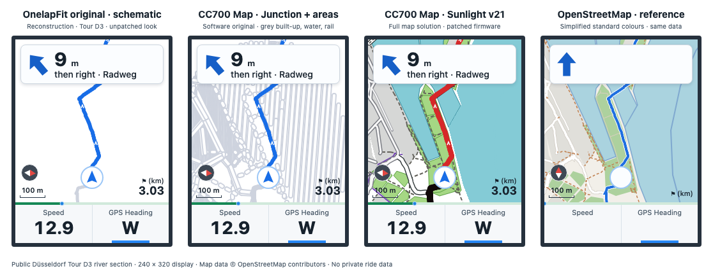
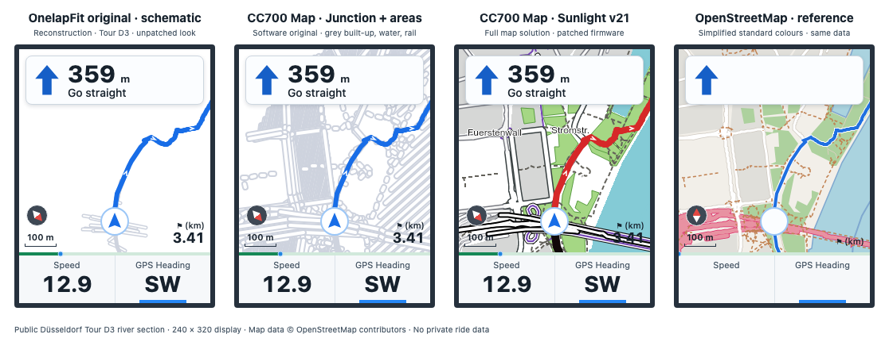
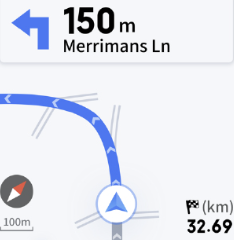
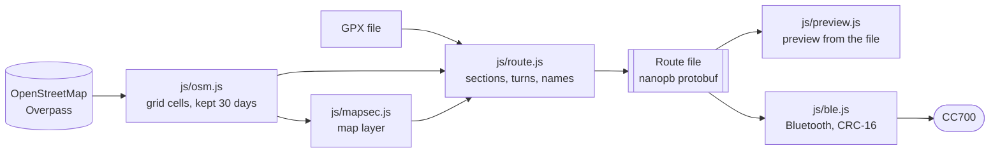
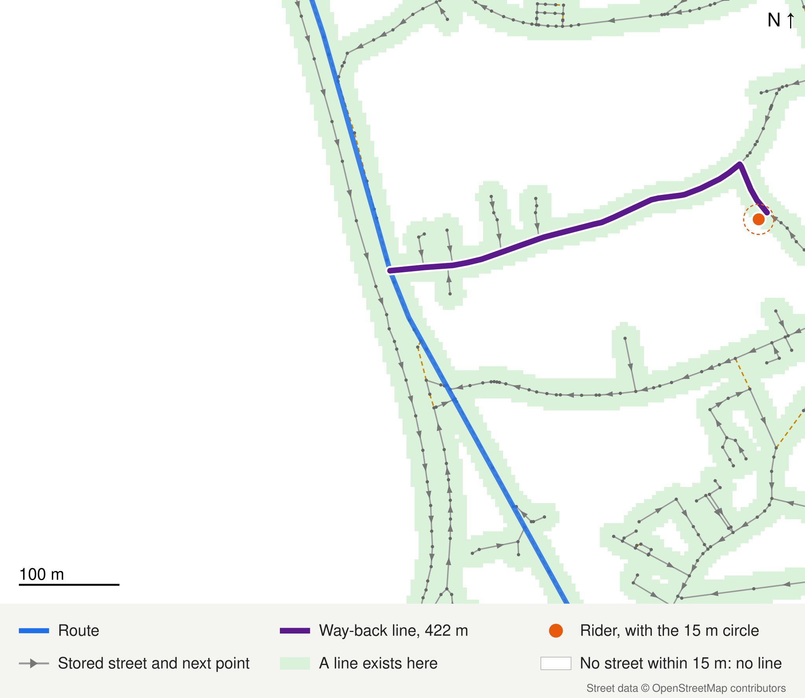

# CC700 Map

This web page makes navigation routes for the GEOID / Magene **CC700** bike computer and sends them over Bluetooth.
The CC700 has no map of its own. The page puts OpenStreetMap data into the route file.

| | |
|---|---|
| **Use the page** | https://bariskayhan93.github.io/cc700-map/ (Chrome on Android) |
| **Visual guide** | [readme.html](https://bariskayhan93.github.io/cc700-map/readme.html): this README with all diagrams on one page |
| **Current state** | [docs/STATUS.md](docs/STATUS.md): what is installed, what is verified, what is open |

**Contents:** [1. What you get](#1-what-you-get) · [2. How to use](#2-how-to-use) · [3. Settings](#3-settings) · [4. How it works](#4-how-it-works) · [5. Way-back line (test)](#5-way-back-line-test) · [6. Status and limits](#6-status-and-limits) · [7. Documents](#7-documents) · [8. Development checks](#8-development-checks) · [9. Legal and license](#9-legal-and-license)

## 1. What you get



The picture shows the same position on four maps, from left to right:

| Panel | Map | Firmware | Source of the picture |
|---|---|---|---|
| 1 | **OnelapFit original**: thick blue route, small chevrons, about 200 m of each road that crosses the route | original | A reconstruction. OnelapFit did not make it. |
| 2 | **Junction map**: grey built-up rows, striped water, dashed rail | original | Read back from a route file of this page |
| 3 | **Sunlight v21 map**: coloured map, opaque red route | patched | Read back from a route file of this page |
| 4 | **OpenStreetMap reference**: the same data in simplified standard colours | none | Reference only |

- The route is the public [Düsseldorf Tour D3](https://www.duesseldorf.de/radverkehr/fahrradtouren/tour-d), river section. No private ride coordinates or ride photos are used.
- The pictures come from the page preview in a browser. They are not device captures.
- The preview shows a **240 × 320** display with a **240 × 256** map. Fonts, rasterization, chevron spacing and the lower panel are approximations.
- Route widths follow the device. The red route is an 8 px core on a near-black edge. The blue route is a 6 px core with a light casing.

### The same four maps along the route



The animation moves all four panels through the same route positions. It shows progress. It is not a GPS or firmware timing simulation.
The dense Altstadt part of the tour exceeds the protected block budget of the generator and is not shown. The river section passes all checks.

| Moment | Picture |
|---|---|
| Far from the turn: go straight | [Four panels](docs/comparison/tourd3-far-straight-current-ui.png) |
| Near the 300 m threshold | [Four panels](docs/comparison/tourd3-approaching-turn-current-ui.png) |
| Near the turn | [Four panels](docs/comparison/tourd3-near-turn-current-ui.png) |
| At the turn | [Four panels](docs/comparison/tourd3-at-turn-current-ui.png) |
| After the turn | [Four panels](docs/comparison/tourd3-after-turn-current-ui.png) |
| On the next street | [Four panels](docs/comparison/tourd3-following-current-ui.png) |

### Original OnelapFit reference



This supplied picture is unchanged and shows **a different route**. It has the turn card and the map, but not the bottom panel.
It is a visual reference only. The older Tour D3 animation and panels are in the [historical artwork appendix](docs/comparison/historical-tour-d3.md). They use an older UI and palette.

### What the page adds to a GPX track

- **Turn prompts.** The page finds turns from the track shape and from OpenStreetMap junctions near the track. A noisy or sparse track can still give a missed or false prompt.
- **One caption row** in the top widget, with a `then left · Street` hint when a second turn comes within 50 m.
- **Geohash-indexed route points** for progress tracking. The native rejoin behaviour still has gaps. The index does not make sure that a prompt advances in every situation.
- **A map around the route**, stored in the route file.

## 2. How to use

1. Open https://bariskayhan93.github.io/cc700-map/ in Chrome on Android.
2. Select the firmware that is on your CC700. Open **Einstellungen** to change the optional map layers.
3. Select a GPX file, or share it to the page from a different app. The page makes the route immediately. For a new region, the page needs internet.
4. Close OnelapFit, because it holds the Bluetooth connection. Stop the navigation on the CC700.
5. Push **An CC700 senden**. The route menu of the CC700 shows the GPX name.

Push **Abspielen** to replay the route at 1×, 4× or 8× the speed set in **Einstellungen**. The slider moves to any point of the route.

## 3. Settings

The page starts in **Original (Kreuzungskarte)**. Select **Patch v18 / v19 / v20 / v21 (farbige Sunlight-Karte)** only if your CC700 has that patch for firmware V1.414.
Select the profile of the firmware that is on your device.

| | Junction map (Original) | Full Sunlight map (Patch) |
|---|---|---|
| Map drawing | connected grey lines with a white core | coloured map |
| Roads | widths vary by road class | main, minor, service, path, cycleway, track |
| Areas | optional grey built-up areas and striped water | built-up, green, water, with outlines |
| Rail and tram | option: long dash | rail, tram lines, tram stops |
| Bridges, tunnels | no | black edge for bridges, dashed edge for tunnels |
| Street names on the map | no | yes |
| Traffic signals | no | yes |
| Route line | blue | red |
| Turn arrow on the map | no | option (off by default), 150 m before the turn |
| Map when off route or riding backwards | can disappear | can stay visible within the area stored in the route file |

Optional layers for the patched firmware: street names, traffic signals, tram stops, tram lines, rough tracks, footways and paths, park paths and cycle tracks next to streets, separate carriageways, turn arrow.

**Map coverage.** The styled map uses separate byte, allocation and drawing-work budgets. Geometry near the route keeps its resolution. A sparse block can hold context up to 1 km. A dense block limits distant lines, down to a minimum of 300 m. Area windows keep at least 600 m. Make the route again to use this. Files that are on the device do not change. Details: [adaptive map budget](docs/research/adaptive-map-budget-2026-11-14.md).

## 4. How it works



| File | Function |
|---|---|
| `js/route.js` | GPX to route file: sections, turns, name images, geohash index, header |
| `js/osm.js` | OpenStreetMap data from Overpass, one query for each grid cell (about 5.5 km). The phone keeps the cells for 30 days. |
| `js/mapsec.js` | Map layer: connected junction segments (original) or styled entries (patch) |
| `js/ble.js` | Bluetooth file transfer, CRC-16/XMODEM |
| `js/preview.js` | Preview from the finished file |
| `js/wayback.js` | Optional way-back data (test), see section 5 |
| `tools/test_route.mjs` | Makes a route file in Node with the page code |

- **Privacy.** The GPX stays on the phone. The Overpass server sees only the grid cells, not the route. With the way-back option on, the server also sees one box around the full route.
- **Format.** The route file is nanopb 0.3 protobuf (firmware 1.414). Name images are LVGL `INDEXED_2BIT`.
- **Patched firmware.** The v18 to v21 patch changes the map drawing of firmware V1.414. It is not part of this repository. Route files for the patched firmware do not show a usable map on the original firmware.

## 5. Way-back line (test)

When the rider leaves the route, the original firmware shows only a direct arrow. The way-back test shows a line along the streets to the route.



**[Open the interactive drawing](https://bariskayhan93.github.io/cc700-map/docs/way-back-demo.html)**: move the pointer, and the page shows the line for that position. The answers come from the real device code, run on a PC for each 4 m square.

| Step | Where | What occurs |
|---|---|---|
| 1 | Page or PC | For each street point within 2 km of the route, calculate the shortest permitted street way to the route. Each point stores only its next point and its distance. |
| 2 | Device | Find the stored street piece nearest to the rider. It must be within 15 m. |
| 3 | Device | Start the line at the nearest point on that piece. Go from point to next point until the route. |

- The heading and the speed of the rider have no effect. The line goes to the nearest route point by street. This point can be behind the rider.
- No stored street within 15 m (yard, field, building, bad GPS): no line. The original arrow stays.
- The page option is **Rückweg-Linie (Test)**. The default is off, and the route file is then unchanged. Only the way-back test firmware reads the data.
- **This is a test.** The test image is on one device. No ride result exists. A long route is not measured.

Details: [firmware/wayback/README.md](firmware/wayback/README.md) (behaviour, admission, fallback, restoration) and the [design study](docs/research/way-back-tree-2026-11-16.md).

## 6. Status and limits

The full record is [docs/STATUS.md](docs/STATUS.md). Summary of 17 Nov 2026:

| Item | State |
|---|---|
| Page with junction map and Sunlight map | Deployed |
| Map patch v18 to v21 | Each version rebuilds exactly. The sources are in a private repository. |
| cc22 and cc23 guidance firmware | Rebuild byte for byte. cc23 has an open gap: after a restart, a stationary route still shows grey. |
| cc24 diagnostic | Not installed. It was rejected after a restart in the map view. The cause is not established. |
| Way-back line | Test image on the test device. No ride result. |
| Recovery packages (routing from up to 3 km) | Host research only. Not on the device. |
| Turns on noisy or sparse tracks | Some cases still fail. |

## 7. Documents

Start with [docs/README.md](docs/README.md). It lists each document with one line.

| Topic | Read this |
|---|---|
| **Rules** | [Implementation rules](AGENTS.md) · [research focus](docs/current/research-focus-2026-11-15.md) · [map reliability contract](docs/current/map-reliability-contract.md) |
| **Page releases** | [App release](docs/releases/app-release-2026-11-14.md) · [rendering release (v19)](docs/releases/rendering-release-2026-11-14.md) · [v20 water and cycleway](docs/releases/water-cycleway-v20-2026-11-14.md) · [v21 captions and opaque route](docs/releases/v21-caption-opacity-2026-11-14.md) |
| **Preview** | [Artwork and browser checks](docs/releases/current-preview-artwork-2026-11-14.md) · [display geometry](docs/releases/preview-display-geometry-2026-11-14.md) · [guidance behaviour and limits](docs/releases/preview-guidance-2026-11-14.md) |
| **Firmware releases** | [cc22](docs/releases/cc22-release-2026-11-15.md) · [cc23 loop and turn fixes, rejected cc24](docs/releases/loop-and-turn-fixes-2026-11-15.md) |
| **Reports** | [Project status 14 Nov](docs/reports/project-status-2026-11-14.md) · [ride review](docs/reports/ride-review-2026-11-14.md) · [map evaluation](docs/reports/map-evaluation-report-2026-11-15.md) · [implementation phase](docs/reports/implementation-phase-2026-11-15.md) · [firmware study](docs/reports/firmware-mining-2026-11-13.md) |
| **Map research** | [Adaptive map budget](docs/research/adaptive-map-budget-2026-11-14.md) · [map limits](docs/current/map-limits.md) · [budget plan](docs/current/budget-plan-2026-11-16.md) |
| **Turn research** | [Cycling turn and rejoin practices](docs/research/cycling-turn-practices-2026-11-14.md) |
| **Recovery research** | [Recovery study](docs/research/recovery-study-2026-11-15.md) · [routing source capture](docs/research/routing-snapshot-2026-11-15.md) · [way-back tree](docs/research/way-back-tree-2026-11-16.md) · [way-back plan](docs/current/way-back-tree-plan-2026-11-16.md) |

## 8. Development checks

Run the public page checks with Node.js 22 or newer:

```sh
node --test tools/test_preview.mjs tools/test_preview_guidance.mjs tools/test_route_decisions.mjs tools/test_route_captions.mjs tools/test_navsource.mjs tools/test_service_worker.mjs tools/test_map_style.mjs tools/test_surface.mjs tools/test_map_geometry.mjs tools/test_map_labels.mjs tools/test_map_order.mjs tools/test_map_contract.mjs tools/test_wayback_page.mjs
node tools/test_app_offline.mjs
```

- The checks cover the preview and readback, synthetic turn decisions, the OSM source, the offline module cache, long-route generation and the way-back page path.
- One executed TODO records a false turn on a noisy track that is still open.
- No private ride file and no device connection are necessary.
- Add `?debug` to the page address to see the Bluetooth log.

## 9. Legal and license

- This is an unofficial and independent project, for interoperability with a device that you own. Magene, GEOID and Onelap do not support or approve it. Product names only identify the device.
- The page contains no firmware, app code, icons, fonts or map data from the manufacturer. The file format and the Bluetooth protocol come from the owner's own device and its traffic. The only copied bytes are format constants in the route header template (`js/route.js`).
- Use it at your own risk. A bad route file can stop the navigation. Then delete the route or send a new one.
- **Code:** MIT, see `LICENSE`.
- **Map data:** © OpenStreetMap contributors, Open Database License 1.0 (https://www.openstreetmap.org/copyright). A route file from this page contains OpenStreetMap data. Keep the attribution "© OpenStreetMap contributors" when you share it. The pictures in `docs/` also contain OpenStreetMap data.
