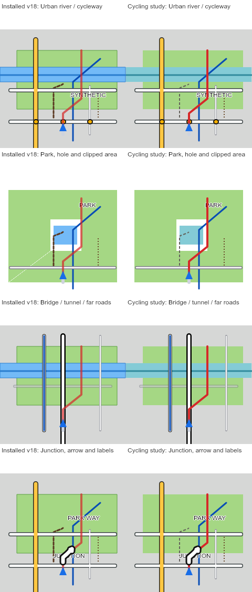

# Map app update — 2026-11-14

The app identifies the current Sunlight firmware as Patch v18 for V1.414.
The firmware itself is distributed separately. This update does not flash a device.

## Changes

- Turn detection rejects an isolated road's own forward/backward arms as a junction.
- Heading probes are averaged to reduce recording jitter without altering encoded route geometry.
- Sharp bends below 160 degrees require a junction choice when matched to a road.
- Cached map cells retain original OSM highway node IDs, coordinates and raw tags separately from generalized display lines. Conflicting or missing observations are marked incomplete; this is not a routing graph or a new path matcher.
- Existing cached regions remain usable offline, including older cell formats. Missing optional signal/stop overlays no longer initiate requests while offline.
- App cache v4 includes the new navigation-source module so a fresh installation can load the full module graph offline.

## Updating an installed app

Open the app with internet available, then reload after the updated service worker
has installed. The patched firmware option and preview title now say **Patch v18**.
Previously cached map regions remain available. Existing route files on the CC700
are not regenerated automatically; choose the GPX again to generate a new file.

## Validation and limits

The public Node tests exercise route decisions, preview/readback, OSM source
preservation and an actual service-worker installation with network disabled.
Offline app probes also generate and decode 70 km routes in both firmware modes.

One executed TODO remains for a noisy track near a side street. Historical private
fixtures also retain noisy and sparse turn-count failures; this release does not
claim those are solved. Hardware frame times, heap headroom, Bluetooth transfer
and physical navigation acceptance are separate from these host checks.

## Native-resolution preview and cycling study

The updated preview uses a 240 × 256 map canvas at native resolution and RGB565
palette precision and the firmware’s opaque white canvas background. Polygon scanlines and dashed segments follow the patch's
integer rules; arrows use their encoded polylines rather than reconstructed
section corners. Label eligibility uses the firmware's character-count box.
Browser font glyphs, line rasterization, projection/heading and navigation state
remain approximations. This is not a pixel-exact full-device simulator.

The default appearance represents installed v18, including its requested route
opacity of 180/255. A separate **Radkarten-Studie (nur Vorschau)** uses cyan water,
blue cycleways, neutral ordinary paths and an opaque red route. Existing green
and grey colors are retained. The study changes neither downloaded files' color
palette nor installed firmware; these styles are firmware-defined.

The cycling hierarchy is informed by [CyclOSM](https://www.cyclosm.org/legend.html)
and [OsmAnd](https://osmand.net/docs/user/map-legend/osmand/), adapted to the small
screen. Unknown track surface no longer implies roughness or a gravel road name.
Positive surface evidence drives rough road/route markings. Original cached OSM
observations repair older flags when available; cells without that evidence do
not invent it. Map cells refresh to version 9 online; cached regions remain usable
offline. App cache v5 includes all new drawing/style modules.

Artificial area clipping edges remain unoutlined using the encoded no-outline
flag. True and clipped edges are not separately encoded yet; no new border
geometry, block size, firmware allocation or device drawing passes are added.

The study evaluates the whole navigation hierarchy: road borders and interiors at all distances and
bridge/tunnel cues remain; area outlines
are omitted, and ordinary path dashes use two pixels so round caps do not close
the short gaps. Green/grey fills and stored geometry remain unchanged. Labels
are drawn before the route and arrows, as on the device. These study changes
reduce preview drawing operations, not measured device frame time. Adopting them
in firmware remains a separate change.

Road casings are the wide outer stroke under a narrower road stroke, not a
second filled polygon. Replacing them with polygon geometry could increase
stored vertices and loading cost. Sharper area filling cannot by itself replace
junction separation or bridge/tunnel cues.

The study also normalizes polygon-edge intersections and cancels coincident
crossings. This removes the false diagonal seam that can appear along the doubled
join into a polygon hole. The installed-v18 profile intentionally retains the
existing fill arithmetic so the comparison remains honest.

These are generated map-canvas fixtures, not device photographs or whole-device
emulation. They exercise river/cycleway separation, polygon holes and clipping,
bridges/tunnels, and crowded junction labels/arrows. Native Canvas rendering was
inspected locally; the browser-control host was unavailable for an interactive
browser acceptance check. Fewer drawing operations are not a readability criterion. The earlier study’s
single grey strokes for distant streets were rejected and removed; normal road
borders and interiors are retained in both profiles.

## Street readability correction

The cycling study no longer replaces distant streets with single grey lines.
Both profiles retain the same road borders, interiors, widths and crossing cues.
This correction addresses user feedback that the simplified streets were worse.
Cache v6 includes the corrected preview. No device firmware changed.
