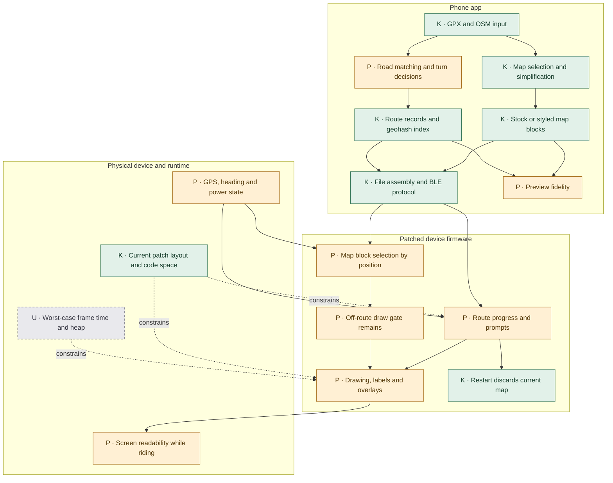
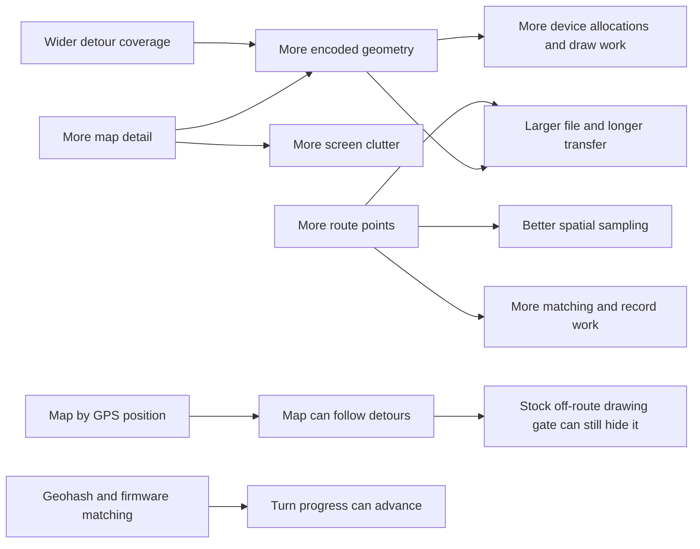

# CC700 exploration map

Current entry point: [mining closure and validation order](../reports/mining-closure.md),
including recovered edge-suite results, geometry/reset/replay follow-ups,
sensor arrival latches and the preserved v16 baseline.

Snapshot: 2026-11-13, app `24b8617`, saved patch v16. Based on local code,
build artifacts, imported notes, and the later Claude session. Current device
state has a sparse [USB JTAG baseline](../reports/remaining-extraction-and-device.md)
and later active-navigation [popup/sensor observations](../reports/popup-and-sensor-followup.md).
Replay was inactive in those samples. See [technical context](technical-context.md) for
evidence, numeric limits, source locations, and corrections to older notes.

Updated after [offline firmware mining](../reports/firmware-mining-2026-11-13.md). The map
now includes an uncovered off-route drawing gate and separate section-count CPU cost.
The later [live popup/sensor investigation](../reports/popup-and-sensor-followup.md)
establishes that a startup warning can remain while the current matcher is
on-route; confirmed physical rotation did not demonstrate magnetic activity.

Read this map along three independent axes:

1. **Knowledge:** how well we understand the mechanism.
2. **Validation:** where it has actually been tested.
3. **Capacity:** which resources it consumes and how much room is established.

An implemented feature may still be unvalidated. An absent feature may have a
well-understood reason. Neither means that the whole area is unexplored.

## The territory

Green **K** = mechanism substantially understood for the current version.
Amber **P** = partly understood or important behavior still unvalidated.
Grey **U** = key mechanism or budget still unknown.
These are qualitative assessments, not completion percentages.

The two device paths matter: **correct map selection and correct navigation
progress are separate mechanisms**. A visible map does not prove that the next
turn prompt is correct. A correct preview does not prove device performance.

## Lit areas, uncertain edges, and dark areas

| Layer | What we have illuminated | Uncertain edge or dark area | Next evidence that would help |
|---|---|---|---|
| Input and cache | GPX parsing, OSM queries, cell schema, cache policy | Missing/stale offline cells; dense downloads; corridor at cell boundaries | Offline/missing-cell and boundary fixtures; phone memory/timing measurements |
| Turn decisions | Junction-based prompts, close-turn text, dense points near turns | Historical noisy-GPX and sparse-GPX failures; broader route variety | Recover edge suite and run current generator on representative inputs |
| Route format | Record schema, bearings, geohash requirement, offsets, name images | Exact count boundaries; climb/via-point fields not fully decoded | Targeted static tracing and boundary files; suitable reference samples |
| Map content | Classes, style bits, draw order, detail options, bridges/tunnels | Complex areas, stacked crossings, omissions under density and range limits | Encoded fixtures for holes, crossings, dense parks, tunnels and long routes |
| Transfer/storage | BLE commands, CRC, chunks, fresh-storage workflow | Route-slot discrepancy; interruptions; present free storage | Controlled list/transfer checks and current storage accounting |
| Firmware navigation | [Matching/persistence](../research/route-state-extraction.md), [planning](../research/rejoin-planning-extraction.md), [position/restart](../research/navigation-runtime-extraction.md), [progress/arrival](../research/progress-arrival-extraction.md); [road arbitration, planner limits and replay grammar](../reports/remaining-extraction-and-device.md) | Complete geometry/transport contracts, malformed inputs and runtime interleavings | Extract remaining helpers; obtain awake-device timing, freshness and failure observations |
| Firmware map selection | Nearest-section chord, hysteresis, final-block clamp | Crossings, parallel routes and curved sections selecting the wrong block | Position replays with known expected blocks, followed by device confirmation |
| Heading and sensors | Magnetic packet/processing path, GPS units and local heading-selector branches; replay reaches heading getter and queued position snapshot; raw fix differs from position qualification | Physical magnetometer activity, complete GNSS/inertial filtering, cache lifecycle and calibration | Continue [behavior extraction](../research/navigation-behavior-extraction.md); validate actual sensor and publication activity |
| Drawing and screen | Palette, layer passes, allocation paths, font metrics, nominal ~1 s map cadence | Off-route draw gate still suppresses the map; actual redraw time and sunlight contrast | Isolated gate reproduction, timing/heap observations and device photos |
| Patch integration | Current sources reproduced saved v16 byte-for-byte; hooks and code envelope known | Porting to another firmware; durable latest-source/artifact preservation | Preserve the proven build inputs and rollback materials |
| Optional extensions | Smaller accented fonts, light accessor and zoom logic; ordinary restart explicitly frees current map allocations | Safe integration, light calibration, zoom transitions, independent map retention across reroute | Focused tracing and validation before implementation |

## Where we have room

There is no single “free space” number. A feature must fit every budget it uses.

| Budget | Established room or boundary | What we must not infer |
|---|---|---|
| Patch code/constants | Saved v16 leaves **9064 bytes** in the current mapped tail | Other free flash is automatically executable patch space |
| Persistent patch state | Current linker permits **zero writable globals** | A small stateful feature fits merely because its code is small |
| Internal RAM | Historical **internal DMA/byte-accessible** sample around **48 KB free** | This accounts for every internal heap, or PSRAM can replace these allocations |
| External/general heap | Historical navigation free heap around **1.44–1.50 MB** | This is v16 worst-case headroom or a safe allocation allowance |
| Planner policies | Below **2 MiB** free heap: cache cleanup; below **1 MiB**: search abort; elapsed limit **15 seconds** in its clock representation | These are reserved buffers, measured headroom, or observed completion times |
| Device storage | Partition **0x79e000 bytes**; present free space unknown | Old free-space readings remain current |
| Route file | App guard **4,000,000 bytes/file** | This proves reliable loading near the guard |
| Map entries | Styled grouping target **1150**; app default guard **1200**; historical draw **1346** | Targets are hard generator caps, or 1346 is a reliable moving-load ceiling |
| Frame time | No trustworthy worst-case measurement recovered | Spare memory implies spare rendering time |
| Section traversal | Nearest-section scan follows about **(n - 1)²** linked-list links | The map-entry guard also bounds long-route CPU cost |
| Visual space | Small canvas; labels intentionally restricted; overlays consume map area | More features produce a more usable screen |
| Geographic coverage | Different ranges per layer, roughly **300–1000 m** | Every layer remains available throughout a detour |
| Phone/network/BLE | Cache and transfer mechanisms understood; current worst-case costs unknown | Device capacity alone determines acceptable route size or build time |

There is established code space for more work. Useful headroom in RAM,
rendering time, and the screen is much less certain. New detail spends several
budgets together: OSM processing, file bytes, transfer time, entries, heap,
drawing time, and visual attention.

## Problems that cross layer boundaries

For example, “map disappeared” can originate in data coverage, the encoded
block/index, firmware block selection, allocation, or drawing. The symptom alone
does not identify the layer. The old stuck-index failure crossed several layers
and was initially mixed with bearing and power-state hypotheses.

## Best places to shine the next light

This is a proposed investigation order, not authorization to touch the device.

1. **Preserve the baseline:** reproducibility and v16 identity are now checked;
   preserve those sources, inputs, and rollback materials outside temporary storage.
2. **Close known logic gaps:** recover the old edge suite, test current HEAD, and
   add representative crossing/loop/block-selection cases where evidence is missing.
3. **Measure the budgets:** establish frame time and both heap budgets on dense
   moving maps, including section traversal and allocation turnover. Isolate the
   off-route drawing gate before treating detour visibility as complete.
4. **Validate the ride:** observe prompts, map selection, close turns, detours,
   finish behavior, and sunlight readability together, recording each separately.
5. **Choose extensions against measured room:** night colors, font, zoom, POIs,
   and reroute retention each need their own value/cost assessment.

## Keeping the map honest

For each newly explored area, record: mechanism, implementation version,
evidence location, test environment, known failure, resource cost, and the next
unanswered question. Promote an area only as far as its evidence supports.

Current checks: five preview tests pass; the recovered edge suite passes 10/12
with noisy/sparse input failures still present; actual nearest-section C policy
passes nine host probes. Preserved v16 sources rebuild to matching ELF/image
bytes. Moving-runtime budgets and a v16 ride remain unvalidated. See the
[local audit](../reports/local-validation-audit.md) for precise test boundaries.
