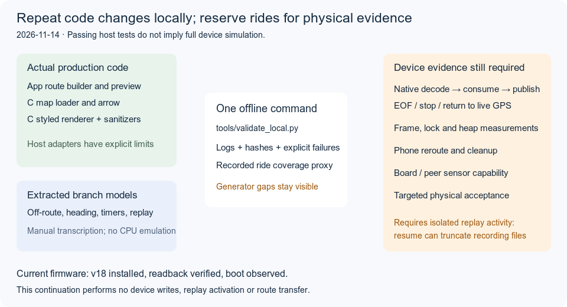

# Repeatable validation and remaining device boundary

**Next continuation, 2026-11-14:** the development loop now also preserves
original navigation source separately from the display map and tests a fresh
service-worker installation offline. The current combined run has 100 Python
passes, 32 Node passes plus the same executed noise TODO, seven offline app
probes, historical 10/12 and the unchanged ride proxy. No device was accessed.
The previous observation totals below retain their earlier run date.
Latest private logs: `.local/validation/20261114T101817898754Z/`;
the sanitized [observation record](../mining/repeatable-validation-observation.json)
contains the aggregate results. The runner also fingerprints the service worker
and marks skipped private-input checks incomplete.

[Source preservation and the recovered short-turn topology](../research/route-association-investigation.md),
[native collector design](../research/native-replay-capture-design.md), and
[bounded full-firmware emulator experiment](../research/local-firmware-emulation.md)
record the new findings. The emulator boots real firmware but stalls before GUI
initialization at an LCD completion wait; it is not a ready board simulator.
Native collector code and allocator hooks are being prepared privately and are
not installed or represented as complete replay instrumentation.

2026-11-14. Routine changes can now run one offline command:

```sh
python3 -I tools/validate_local.py
```

It runs Python contracts and actual patch C tests, labelled synthetic junctions,
preview readback, offline cache/long-route checks, the historical generator cases,
and the acquired ride through the complete v18 loader. It writes timestamped
logs, source/input hashes and `report.json` under ignored `.local/validation/`.
It never opens a device, writes firmware/storage or fetches map data.

## Using this loop for feature work

The owner clarified that smart coverage should enable feature development,
rather than make whole-board emulation a prerequisite. For each feature, add
its concrete scenarios to the layer that executes the relevant code, implement
the change, then run the combined baseline. Investigate a missing firmware
boundary when that feature depends on it. Do not restart broad mining for every
change.

| Feature area | Primary local check | Device check when needed |
| --- | --- | --- |
| Route encoding, directions, map blocks | Actual builder + labelled junctions + decoded route + recorded track | Route opening and final navigation acceptance |
| Map styles and patch selection | Actual renderer/loader/arrow C, memory guards and regression frames | Real display rendering and measured frame cost |
| Heading/off-route/timer decisions | Explicit extracted contracts and threshold/sequence fixtures | Physical inputs or timing/concurrency changes |
| App changes and cached data | Preview, raw-source integrity and offline installation/module graph | Browser/BLE interaction crossing the device boundary |

Existing noisy/sparse failures stay visible while unrelated work proceeds.
Changing their measured results requires explicit review, not automatic
allowlisting. Bundle physical acceptance around meaningful milestones and
interface changes; routine code edits do not each require a ride. The separate
experimental collector and blocked full-firmware emulator do not become
mandatory dependencies of the host checks.

Exit 0 means the local checks passed, 1 means an unexpected failure, and 2 means
known failures or absent private fixtures remain. Target acceptance has a
separate status. An expected failure is not a pass. The two historical cases are
recognized only for their known turn-count mismatch; format/readback exceptions
still fail. Changes to the known 25/15 and 3/15 metrics also require review;
they cannot be silently hidden under the old failure labels. A synthetic TODO
executes its unchanged assertion and stays visible.



[Vector diagram](../mining/17-repeatable-validation.svg).

Final observed run: **88 Python tests pass; 18 public Node tests pass and one
executes as a known failing TODO; six offline app probes pass; historical
10/12 pass; acquired ride loader proxy 0/576 absent**. Combined exit code is 2,
correctly reporting incomplete local acceptance. Private logs are in
`.local/validation/20261114T054830993680Z/`. The fresh review's five material
reporting/false-success findings were reproduced and corrected with regressions
before this run. No target acceptance is implied by these totals.

## What is executable

| Layer | Tests execute | Practical limit |
| --- | --- | --- |
| Route generation | Actual JavaScript; independent synthetic turn directions and locations, preview round-trip, offline failure paths and historical variants | General noisy and sparse inputs still fail; [bounded generator changes](../research/generator-closure-2026-11-14.md) disclose the results |
| Map block and arrow | Actual `blk.c`/`arrow.c` compiled for host, including file-local resolution fixtures, teardown/replacement, busy navigation lock and dense scanning | Stock resolver implementation, task scheduling and display are adapters, not firmware instruction execution |
| Firmware state branches | [27 extracted-contract tests](behavior-contract-harness.md) for off-route decision/persistence, heading, timer arithmetic and replay wrapper/ride calls | Manually transcribed from checked disassembly; geometry, callbacks and concurrency are excluded |
| Styled map | Actual unchanged `map.c` under AddressSanitizer and UndefinedBehaviorSanitizer | Projection and line rasterizer are fixtures; HOST street text is a no-op |
| Native replay observation | Record lineage, submitted/consumed payload hashes, publication generation, measured latency budgets, EOF and explicit deactivation | A checker for future telemetry; no real decode/delivery trace has been captured |

Renderer fixtures exercise all 16 classes at five levels, bridge/tunnel flags,
three repeated frames, empty/unloaded blocks, allocation failure, 1,201/4,000
entries, 60-point geometry and a failed-projection prefix. Allocator and canvas
guards check release, peak temporary bytes and out-of-bounds access. These are
specific host fixtures, not a universal malformed-map validator or a target
memory/performance measurement. Dense fixture temporary buffer is 40 bytes;
60-point fixture is 488 bytes. Neither includes decoded map allocations or task
stacks, and neither defines a safe device capacity.

The acquired ride still produces zero absent vertex-coverage samples out of 576
through the v18 loader, with three block switches and zero indexed point lookups.
This remains a vertex-coverage proxy, with held log progress and a single-file
resolver fixture. It does not establish rendered visibility or emulate the
stock matcher. The runner preserves these limits in its report.

## Native replay: the additional finding

Starting a new ordinary ride deactivates replay. The successful LOADING/resume
path activates it only after `ResumeFitRealSession` returns zero. That recovery
operation is not confined to reading a replay file:

| Stock path | Extracted consequence |
| --- | --- |
| `0x420cb929..0x420cb952` | Stat recovery file, allocate 468 bytes, reject a reported size below 468 |
| `0x420cb9fe..0x420cbaf8` | Read trailing words and compare final marker with `0xaa555aa5`; on accepted marker read the 468-byte recovery structure |
| `0x420cba81..0x420cba98` | Pass recovered word `+0` and offset `+456` to recording helper `0x420c96c4` |
| `0x420c96d5..0x420c9807` | Form `/littlefs/FITS/FIT/%lu.fit`; when the existing file is longer than offset +18, reach the truncation call with that length |
| `0x420cbe33..0x420cbe3d` | Call `ResumeTruncateLapFile`, using recovery byte +64 and word +12 plus epoch offset |
| `0x420c89c1..0x420c8aab` | Form `/littlefs/FITS/LAP/%lu.lap`; when longer than the recovered lap count ×12, open `r+` and reach the truncation call |

The wrapper also has deletion paths for undersized/invalid recovery files and
restores recording/calculation state. A magic word and file length alone cannot
establish a suitable isolated recovery session. Allocation-failure safety and
every restored field are not proven here.

This pass checked 1,030 reached instructions across the three functions against
GNU Xtensa instruction boundaries/direct branch targets, with zero discrepancies;
the ranges match stock and the installed v18 image byte for byte. The sanitized
[evidence manifest](../mining/replay-resume-side-effects.json) records hashes and
ranges. Private extraction script and traces are under
`.local/native-replay-analysis/`. These are static findings, not observed file
changes. No device operation occurred in this continuation.

Consequently, native replay needs a deliberately disposable recording session
and its matching recovery/FIT/lap files. Reusing an unfinished personal activity
is unsuitable. The old synthetic route near the equator remains removed;
neither it nor fake GPS was reinstalled. No forced activation or recovery-file
fabrication has been implemented.

## Required observation contract

`tools/replay_observation.py trace.json` returns 0 for the bounded delivery
contract, 1 for a contradiction/budget failure and 2 for incomplete evidence.
`tools/validate_local.py --observation trace.json` includes that separate result
and propagates failures. It cannot turn a delivery pass into full target
acceptance. The JSON schema is demonstrated by the **invented unit traces** in
`tools/test_replay_observation.py`; those are not device observations.

The trace has `origin`, `firmware_sha256`, `fixture_sha256`, `records`, `events`
and explicit `limits`. Each fixture record has a unique `id` and `sha256`
fingerprint of its agreed canonical source representation. Duplicate timestamps
must retain separate IDs. The collector must carry this lineage from the decode
ordinal; it cannot infer it merely from timestamp/coordinate equality. Decode
and submit events retain this identity. Submit and consume additionally hash the
**actual 52 GPS bytes** as `payload_sha256`, with the consume hash taken when
the type-8 adapter reads them. Source fingerprints and GPS payload hashes serve
different purposes; conversion does not preserve raw byte equality.

Events use one unwrapped monotonic `ms` clock. The lifecycle is activate, decode,
submit, consume, correlated calculation snapshot, EOF, explicit deactivation,
capture end. Reuse of a decoded record is allowed; submission IDs are unique.
Queue result 1 means accepted; 0/2 fail the no-loss fixture. A calculation may
follow several consumed descriptors. The final consumed input must have an
observed publication; one old snapshot cannot satisfy a whole run. Snapshot
generation is an instrumentation counter, not an invented firmware field.
Deactivation must observe both active false and GPS redirection false. Capture
end must establish zero pending descriptors and zero lost trace events.

`limits.queue_latency_ms` and `limits.snapshot_latency_ms` are explicit chosen
acceptance budgets. Missing budgets are incomplete, not silently assigned safe
values. Timings are submit-to-consume and submit-to-publication. Target tracing
must separately account for its own overhead and preserve record identity
through pointer reuse. Ordinary device logs do not contain this full schema;
there is no collector claiming otherwise.

## Finite remaining work

The public hardware cross-check does not close the compass gap. GEOID's
[CC700 product specifications](https://geoid.com/products/geoid-cc700-bike-computer)
list a barometer and light sensor but do not establish a magnetometer. Absence
from that list is not proof that the component is absent. The official
[CC700 manual landing page](https://geoid.com/pages/cc700-instruction-manual)
currently links its English and German downloads to PDFs titled **CC700 Pro**:
[English PDF](https://cdn.shopify.com/s/files/1/0665/5197/1945/files/CC700_Pro-US-20260105.pdf?v=1777275437),
[German PDF](https://cdn.shopify.com/s/files/1/0665/5197/1945/files/CC700_Pro-DE-20251230.pdf?v=1777275440).
Those model-specific capabilities and navigation thresholds were deliberately
excluded from the CC700/V1.414 oracle. Links inspected 2026-11-14.

1. **Generator correctness:** retain the labelled regressions; solve the remaining
   side-street noise decision with a path-association policy that preserves real
   close turns. Sparse chords have lost route geometry; count parity cannot
   reconstruct it. The current generator changes are bounded improvements.
2. **Native target run:** establish a disposable recoverable activity and a
   collector at the extracted decode/queue/adapter/publication boundaries. Run
   deterministic forward, threshold/invalid fixes, detour/rejoin, crossing,
   duplicate/gapped timestamps, EOF/stop and replacement cases. No result is
   marked passed merely because a fixture initialized.
3. **Measured device budgets:** frame and lock duration, heap/largest allocation
   block, queue freshness and route/reroute cleanup under dense load. Host
   sanitizer success and host timing cannot supply these numbers.
4. **External/physical acceptance:** actual compass capability still needs
   board/peer evidence or observed sensor traffic. Live phone reroute needs its
   transport/application interaction. One targeted ride is reserved for physical
   GNSS/heading and usability after repeatable tests—not each code change.

v18 remains the verified installed firmware. This pass changes local tooling and
the route generator only; it does not replace firmware or transfer a route.
