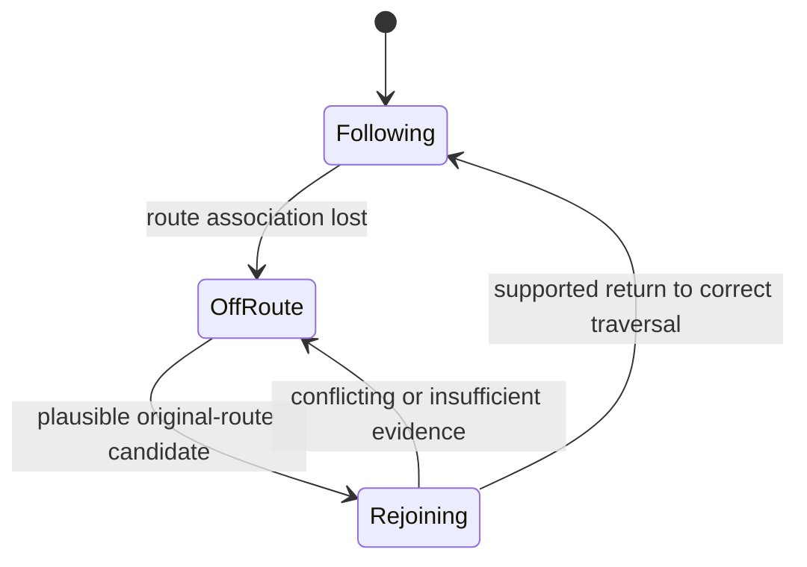

# Cycling turn guidance: comparison for the CC700

Research date: 14 November 2026. This is a design assessment grounded in primary
implementation sources and the [new ride evidence](ride-review-2026-11-14.md),
not a claim that an unimplemented matcher is complete.

**Assessment:** keep the lightweight device renderer and file compatibility.
Improve phone-side route association and the separately identified native rejoin
behaviour before calling guidance reliable on arbitrary imported GPX files.
The current implementation has useful cycling decisions and close-turn support,
but its independent point/heading heuristics do not establish the traversed path.

## What established systems actually do

| Source | Relevant mechanism | Consequence for this project |
|---|---|---|
| [GraphHopper instruction generation](https://github.com/graphhopper/graphhopper/blob/9df847473a5e73e979ce194ca0fc9a0767a5bb36/core/src/main/java/com/graphhopper/routing/InstructionsFromEdges.java) | Instructions are derived from a routed sequence of graph edges. Junction alternatives, road continuity, names/classes and roundabout state affect whether a cue is necessary. A bending road can be followed without a turn cue; forks can warrant one. | The chosen incoming and outgoing edges must be established before classifying a maneuver. A nearby side street cannot justify a direction the rider never takes. Borrow the principle, not road-class or angle constants intended for other profiles. |
| [BRouter voice-hint processing](https://github.com/abrensch/brouter/blob/fed8f185ecdba4c01f4d6913bff7c0fae4576a32/brouter-core/src/main/java/btools/router/VoiceHintProcessor.java) | Processing distinguishes the chosen continuation from alternative ways, considers priority/one-way/roundabout information, and postprocesses nearby maneuvers with transport-specific rules. | Keep genuine 22–27 m left/right connectors. Combining nearby instructions is conditional; it is not a rule to delete every turn within a fixed radius. Parameter names alone are insufficient: the constructor's unused catching-range member coexists with an active postprocessing argument. |
| [OSRM map matching](https://project-osrm.org/docs/v26.4.0/http#match-service) | Returns match confidence, alternative counts and unmatched points; improbable transitions or timestamp gaps can split a trace. | Explicit uncertainty and gaps are normal outputs. Do not silently force every GPS point onto a nearby line, or bridge missing data and call the resulting turn certain. These API semantics do not prove that any particular cycling profile is correct. |
| [OsmAnd GPX navigation](https://osmand.net/docs/user/navigation/setup/gpx-navigation/) | Distinguishes geometry-only tracks from route-enriched tracks. Road attachment supplies information needed for detailed guidance; users can select start versus nearest-track entry. | GPX coordinates alone cannot guarantee accurate junction instructions. Preserve the supplied track, distinguish inferred guidance from source cues, and make start/rejoin policy deliberate. |
| [OsmAnd navigation settings](https://osmand.net/docs/user/navigation/guidance/navigation-settings/) | Deviation-distance and reverse-direction recalculation are separate controls; detailed track guidance uses road attachment. | Lateral distance, reverse travel and accepted route progress should not be collapsed into one angle or nearest-point rule. |
| [Wahoo rejoin behaviour](https://support.wahoofitness.com/hc/en-us/articles/115000485450-ELEMNT-ROAM-v1-2019-Product-Information) | Documents returning to a nearby loaded-route point in the route's direction, separately from routing to the start or retracing a ride. | Rejoin handling should consider direction and traversal history, especially at loops and shared outbound/return sections. This is documented product behaviour, not evidence of Wahoo's internal matching algorithm or perfect outcomes. |

Source snapshots and commit/hash provenance for the two code references are kept
privately in `.local/cycling-guidance-research/manifest.json`. No private ride was
uploaded to an external routing or map-matching service during this research.

## Keep the parts that fit our constraints

The renderer's bounded memory use, integer/RGB565 styles and phone-generated map
blocks suit this device. The latest ride has 17 blocks and no block above 871
entries. The photographed area's 97 polygon masks agree between actual C fill
and preview fill under a shared projection. This is evidence about rendering,
not proof of native navigation correctness or frame-time headroom.

Keep separate navigation and drawing geometry. Simplification and smoothing
that make a road look better must not remove its junction identity or create
connectivity across a bridge. The app already preserves original OSM source
facts separately; the production turn generator does not yet consume them as a
connected, direction-aware traversal.

Keep the two close-turn records and an advance following-turn hint. Keep the
stock 300 m icon behaviour in a preview intended to match the installed device.
Whether another warning schedule is better is a separate device behaviour change;
research does not supply a universal replacement distance for every cycling speed.

## Change the missing decision layer

The following is our proposed adaptation, not code already shipped:

1. **Associate the track with a connected path on the phone.** Retain a bounded
   set of plausible edges across successive observations. Compare position error,
   reliable heading and feasible connected travel. Preserve original GPX geometry;
   an inferred graph path need not silently replace it.
2. **Generate maneuvers from that path.** Evaluate actual exits at the connected
   junction. Use continuity and rider-visible choices, not merely a short chord's
   angle. Require sustained evidence for a U-turn and preserve shallow real forks.
3. **Represent ambiguity.** Missing topology in legacy caches, noisy traces,
   repeated route sections and sparse corner-cutting GPX files must produce an
   explicit uncertain interval. Do not emit precise invented turns. Confidence
   scores need calibration against labelled fixtures; they are not self-validating.
4. **Treat live rejoin as a separate native problem.** The ride shows candidate
   roads 33/68 with accepted outputs 31/61. Reproduce that arbitration before
   overriding accepted progress. Accepting the globally nearest pass everywhere
   would exchange one failure for wrong-pass jumps at crossings and route finish.
5. **Keep display confidence honest.** Stock code intentionally formats remaining
   distance as unavailable while off-route. Better rejoin handling can restore
   the number sooner when justified. A retained stale number must not masquerade
   as a current estimate. Trip distance remains an independent recorded metric.

A complete router/database on the CC700 is not required for the phone-side
improvements above. Local graph size, generation time and matching bounds must
be benchmarked before choosing an algorithm or shipping it. Full live detour
routing still requires a usable road graph and coverage; the map drawing entries
are not automatically such a graph.

## Acceptance cases before another release

Use independently labelled paths and cue locations, not a target turn count:

- straight riding with several noise seeds, including side streets;
- obvious road bends versus genuine shallow forks;
- 22 m and 27 m opposing turns, real U-turns and roundabouts;
- parallel cycleways, bridges/tunnels and route crossings;
- start/finish overlap and shared outbound/return stretches;
- skipped turn followed by forward rejoin, deliberate reverse travel and a
  substantial detour such as the captured 910 m excursion;
- pauses, GPS gaps, and missing original topology;
- remaining-distance validity and restoration independently of the trip counter.

Run these through generation/readback and the relevant extracted native branches.
The existing capture supplies regression material without requiring another full
ride for every change. Host models still cannot certify physical GPS, native
scheduling, screen smoothness or live phone reroute delivery.

The next engineering priority is confidence in path association and rejoining.
Additional angle smoothing, more map detail or raising a turn threshold does not
address that missing information.

## Detour UX brainstorm for this device

The owner reports normal-looking route instructions persisting during a detour.
Recovered examples support a stale instruction/countdown: around 17:47:10 the
output road remains 13 and `StrghtDst` remains 210 while the ride is hundreds of
metres from the original line. This differs from the intended map behaviour:
keeping the basemap and original route visible provides context, but does not
make the retained instruction a valid maneuver from the current position.

The v17–v20 workaround bypasses the basemap's off-route gate. The patch source
and hook audit do not show that gate controlling instruction generation. Thus
we should not restore map disappearance to conceal the instruction problem.

| Approach | Visible behaviour | Cost and limitation |
|---|---|---|
| A. State-aware presentation | Keep map and original course; replace normal maneuver panel with persistent off-route status. Clearly mark route-distance unavailable; stop presenting stale turn arrows as current instructions. | Smallest conceptual scope. Requires tracing actual widget/update hooks and coherent navigation-state reads. Does not fix native association or supply detour directions. |
| B. Progress-aware rejoin | While off-route, evaluate nearby original-route candidates against last accepted traversal, reliable movement direction and continued evidence. Use a rejoining state before resuming normal cues. | Recommended second stage. No regional router is inherently required to recognise a return to the original course, but crossings/shared passes, route windows and deliberate reverse travel need explicit policies and regression proof. |
| C. Routed return | Calculate a cycling-accessible path to a selected rejoin point; show verified detour maneuvers, then resume the original course. | Requires a connected routable graph and sufficient map coverage, or a phone service. Drawing entries alone cannot establish a legal/accesssible path. Existing native planner data and lifecycle are not yet validated for this use. |

### Proposed display contract

This is a proposed UX state machine, not an extraction of the existing native
state enumeration. Apply its transitions using appropriately qualified inputs;
a configurable number of GPS samples alone is not proof of a correct path.

- **Following:** normal next-maneuver distance and instruction.
- **Off route:** map/current position/original route remain visible. Persistent
  status takes precedence over the normal maneuver card. Trip distance and speed
  remain ordinary recording metrics; route remaining distance can be unavailable.
- **Rejoining:** indicate that route association is being checked. Do not switch
  to a contradictory turn on every candidate change or prematurely declare arrival.
- **Routed return, when implemented:** distinguish verified temporary directions
  from the original course and from an unrouted geometric bearing.

Do not label the stock selected-point distance as distance to the closest route:
the new ride has a 173 m selected-point reading at a FIT position less than 1 m
from the original line. A displayed geometric route distance needs its own
validated computation and coordinate freshness. Similarly, a straight arrow
or line to a rejoin point is not a cycling route across a river, fence or highway.

Our call is **A, then B**, preserving C as a separate routing capability. Avoid
choosing fixed new radii or dwell times before replaying the captured holds and
wrong-pass candidates. Rejoin may legitimately advance far along a course after
a shortcut; unconditional nearest-pass selection and a rigid small forward
window can both fail. Route order, movement direction and start/finish overlap
must be considered together.
