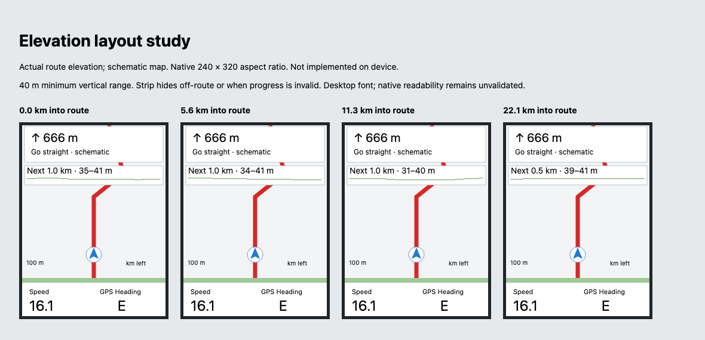

# Elevation strip: bounded PC prototype

The [prototype](../tools/elevation_study.mjs) reads native route point field 3
as signed centimetres and field 5 as route distance in centimetres. It builds
an upcoming 1 km elevation envelope, clipped at the route end. This is a PC
spike: no route bytes, production app code or firmware were changed.



The elevation is from the existing ridden route. Map geometry, instruction and
metrics in this image are schematic, not a simulation or device screenshot.
Desktop fonts are used. There is no claim of native raster/font parity.

## Findings from the existing route

The 22,561.29 m route contains 2,197 encoded samples, including repeated section
endpoints. Elevation fields are present throughout, none are zero, and their
overall range is 31.25–46.50 m. These are file contents, not validated terrain
measurements or barometer comparisons. Results and input identity are in the
[sanitized measurements](mining/elevation-study-20261115.json).

| Route progress | Upcoming distance | Elevation range | Intersecting segments | Column visits | Profile raster pixels |
|---|---:|---:|---:|---:|---:|
| 0 m | 1,000 m | 34.75–41.00 m | 119 | 342 | 229 |
| 5,640 m | 1,000 m | 33.75–40.95 m | 113 | 336 | 227 |
| 11,281 m | 1,000 m | 31.25–40.41 m | 184 | 406 | 229 |
| 22,061 m | 500.29 m | 39.05–41.00 m | 89 | 312 | 225 |

All four sampled windows have 224 valid columns and no missing columns under a
250 m maximum interpolation gap. This is four windows, not exhaustive route
validation. Synthetic checks cover peaks, missing fields, large gaps, negative
elevation, duplicate/conflicting endpoints and unavailable navigation states.

## Separate costs and UI limits

- A 224 × 16 profile stores two bytes per column: **448 actual bytes** of
  quantized top/bottom values, with 255 as a missing-column marker. This is a
  study format, not a selected device format. It excludes distance/domain/header
  metadata and any container overhead.
- The PC implementation scans all 2,197 input samples for each requested window.
  Its JavaScript allocations do not model target RAM. A complete precomputed
  route table would multiply storage by the number of windows; 448 bytes is not
  the entire route's feature cost.
- Profile raster pixels above count only the one-pixel-wide envelope strokes.
  Background clearing, borders, text, compositing, and firmware call overhead
  are additional work. No device frame time, stack or heap peak was measured.
- Proposed overlay: x=4, y=68, width=232, height=32. It covers **7,424 pixels**,
  about **12.1% of the 240 × 256 map**. It is below the 62 px turn card and above
  the normal rider/compass/remaining-distance area. It still obscures distant
  roads. This is a real tradeoff, not free HUD space.
- The first visual used an 8 px caption, which was too small. The saved version
  uses a 14 px desktop caption to explore the mined font-height constraint;
  actual native glyph widths, readability and layout remain unvalidated.

## Behaviour and fallback

Normal: sample the next kilometre by ordered route distance and retain narrow
peaks with a per-column minimum/maximum envelope. Use at least 40 m of vertical
range so this flat ride does not look mountainous. This is an engineer-chosen
prototype threshold, not a measured optimal UX setting. Scale stability during
continuous movement is not yet tested.

Admission: explicit trusted progress, on-route state, ordered finite distances,
at most 100,000 source samples, width at most 240 and height at most 128.
The prototype does not derive trusted progress from GPS or fix native matching.

Unavailable: hide the strip for off-route/stale/unknown progress, finish/outside
route, absent data, or insufficient contiguous elevation. Never bridge missing
values, conflicting section endpoints or gaps over 250 m. Duplicate identical
endpoints are harmless. An all-zero route is ambiguous unless explicitly
confirmed. Mixed missing elevations previously encoded as zero cannot be
identified reliably from this file format alone; future generation must retain
validity evidence before exposing reliable elevation guidance.

Restoration: recompute only after valid route progress and usable elevation
return. The study model does this statelessly; native show/hide/redraw behaviour
still needs implementation. Ordinary map/guidance are the fallback contract,
not behaviour verified on the target by this spike.

## Decision

The profile representation is small enough to keep investigating. It does not
justify an always-visible strip: on this flat ride it conveys little while
covering 12.1% of the map. Keep it an optional candidate; next elevation work
should compare a hilly public route, fixed/hysteretic vertical scaling, and
native-font/drawing costs. A device implementation also needs access to the
upcoming route samples across section boundaries and a safe draw hook. Neither
is proven here, and the unresolved cc24 native drawing crash remains separate.

## Verification and reproduction

```sh
node --test tools/test_elevation_study.mjs tools/test_recovery_study.mjs tools/test_routing_snapshot.mjs
node tools/elevation_study.mjs --route ROUTE.bin --output NEW_DIRECTORY
```

The CLI refuses an existing directory. It writes per-window binary buffers,
`report.json`, and a local `preview.html`. Outputs contain no map coordinates.
38 focused tests pass (9 elevation, 29 recovery/snapshot). Two extra elevation
tests first exposed truncated-varint acceptance and an argument-stack overflow
at the admitted dense-input bound; both failed before the fixes and pass now.
The HTML was rendered in headless Chromium and its PNG visually inspected.
No new ride, flashing, deployment or production resource increase was required.

## Recovery acquisition status

One resumed POST and one GET against the saved main endpoint both returned
HTTP 406. The identical query identity and private receipts/error responses were
retained. No usable source snapshot exists yet; this does not diagnose the
provider or establish whether a different request would succeed. Acquisition
stopped rather than repeatedly retrying. The [acquisition report](mining/routing-snapshot-acquisition.json)
now includes this resumption. Real detour connectivity and 3 km recovery remain
unvalidated; the PC elevation spike is independent progress, not their replacement.
