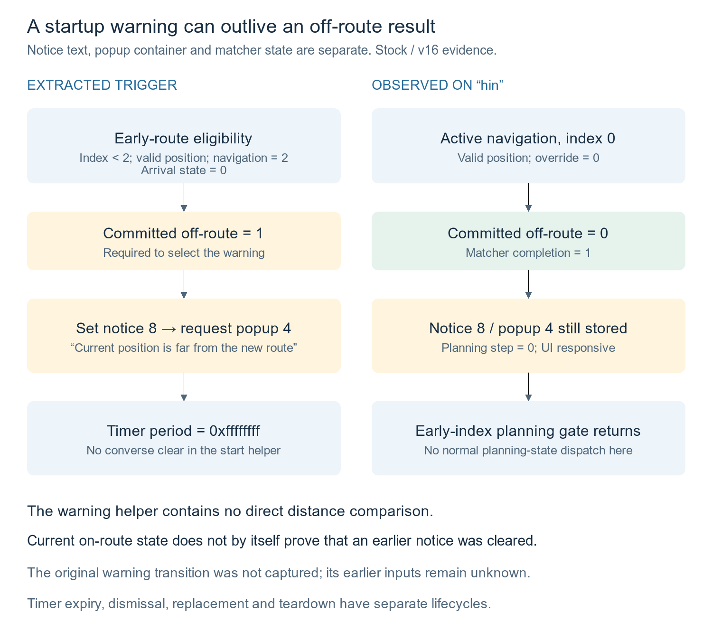

# CC700 startup warning and stationary sensor observations

Subsequent [lifecycle audit](lifecycle-audit.md) resolves the nominal timer unit,
max-period modular comparison and several dismissal/reset paths. The
[sensor boundary audit](sensor-boundary-audit.md) adds UART startup, the downstream
IMU file gate and confirms all three sampled arrival latches were zero.

Evidence date: 2026-11-13. Stock V1.414 and saved v16 extraction, followed by
sparse USB JTAG observations with the user-selected “hin” route active.
This follows the [connected baseline](remaining-extraction-and-device.md).

## The warning is notice 8 inside popup 4

The exact English message is at `0x3c31e579`. Its language-table slot is
`0x3c332178`, with language-zero base `0x3c332174`. At
`0x4204f680..695`, `SetNoticePara(8)` loads the text through
`0x3c330cb4 + 4 * (1328 + language_index)`. It copies the selected string
into notice text via `0x4204e66c` and stores notice type at `0x3fc9fcbc`.

This is **notice type 8**, distinct from **popup type 4**, stored at
`0x3fc9fcd0`. Popup type 4 builds the notice UI via `0x42087830`.
The older handoff's “PopUpType 1” attribution is superseded for the observed
warning. Popup 1 instead constructs a direction component through `0x420870f0`.

`IsNavigationSoFarToStart`, `0x420502a8`, emits the warning when:

1. The selected route-point index at result `+108` is less than 2.
2. Calculation position record byte `+4` equals 1.
3. Navigation state is 2.
4. Arrival state at `0x3fc9fcd4` is 0.
5. Committed off-route byte `result +145` equals 1.

On this path it calls `SetNoticePara(8)`, then sends popup request
`(period = 0xffffffff, popup_type = 4)` through `0x4204e884` and GUI event 87.
The ride UI callback consumes the event and invokes `CreateNavigtionPopUp`.
The latter creates the notice UI and timer. Its timer callback is
`0x4204f6b0`, which deletes the timer, resets popup type, destroys the popup,
and clears notice/dialog parameters.

The start helper itself performs **no direct distance comparison**. It consumes
the previously computed off-route state. Its name and displayed message must
not be interpreted as a separate, newly established “distance from route start”
threshold. The general matcher's distance/angle decisions remain documented in
the [route-state extraction](route-state-extraction.md).

The timer constructor stores the supplied 32-bit period. This report preserves
the literal `0xffffffff`; it does not claim a measured infinite lifetime or a
particular wall-clock expiry. The creator also skips requests for the popup
type already stored, so requesting type 4 again is not automatically a refresh.

## Why the warning can coexist with an on-route result

The start helper has no converse branch that clears notice 8 when off-route
changes to 0. Meanwhile `NavigationRideYawTip` returns before its main state
machine when selected index is below 2 and override byte `0x3c389354` is zero.
This check precedes its normal position/display updates and state dispatch.

The live observation was:

| Field | Sampled value |
|---|---|
| Popup type | 4 |
| Notice type | 8 |
| Selected route-point index | 0 |
| Distance field `+112` | 20; this is not a newly measured popup distance |
| Committed off-route | 0 |
| Matcher normal-completion byte | 1 |
| Notice/planning step | 0 |
| Early-index override | 0 |
| Navigation state | 2 |

This directly establishes that notice 8 remained present while the current
matcher result was on-route. The extracted branch ordering explains why these
states need not clear together at index 0. It does not reconstruct the earlier
moment that originally set the warning: no trace of that transition was captured.
Other user actions, popup replacement and teardown can also change UI state.

This is a concrete lifetime boundary for any simulator: warning visibility,
matcher off-route state, planning step and popup timer are separate state.

## Rotation did not produce magnetic input in the sampled records

The user confirmed gently rotating the awake device. Afterward the records still
showed zero raw magnetic axes, zero magnetic angles, status 4 and magnetic
initialization byte 0. The magnetic parameter pointer at `0x3fca2c9c` was null.
The UART2 driver pointer was nonnull. The general IMU context and all three of
its allocation pointers were nonnull, with context state `+20` equal to 2.
A subsequent sample found the two raw inertial records and processed gyro and
acceleration vectors zero as well.

There is an important initialization distinction:

- `ImuDataInit`, `0x421414d4`, allocates the general 24-byte context and its
  60/480/480-byte buffers. The F1 packet handler calls this **before** selecting
  its subpacket type. A general IMU allocation therefore does not by itself
  prove that magnetic, acceleration or gyro samples arrived.
- F1 subpacket 0 packs the magnetic axes and auxiliary parameter bytes, calls
  `SetMagnOtpData`, then calls the magnetic input wrapper `0x42142160`.
- `SetMagnOtpData` allocates its two-byte parameter buffer only when all three
  raw axis words are nonzero and the parameter pointer is null.
- The magnetic input wrapper stores raw axes **before** testing that pointer.
  With a null pointer it returns before magnetic initialization and processing.
- Raw inertial input wrappers likewise store their packed input before their
  context/buffer checks. Zero processed vectors alone are weaker evidence than
  inspecting these raw records too.

The observations do not demonstrate functioning magnetic input, even after a
physical orientation change. They narrow the missing behavior to the
data-delivery/initialization boundary rather than merely the final map-heading
setter. They do **not** distinguish absent hardware, unsupported peer output,
disabled sampling, missing/invalid packets or every possible initialization
failure. No UART FIFO was drained, packet was injected, breakpoint was installed,
or target function was invoked to force sensor activation.

The current [official CC700 specification](https://geoid.com/products/geoid-cc700-bike-computer)
lists a barometer and light sensor, but does not list a compass. This omission
is corroborating context only; it is not proof of the board's component population.

## What this closes and what remains

Resolved: exact warning text selection, its local trigger, popup/notice type
distinction, event dispatch, timer cleanup, coexistence with a current on-route
result, and the sampled magnetic initialization boundary after rotation.

Still open: the exact earlier transition that selected the warning on this
session; full timer scheduling and every dismissal path; sensor model and board
population; peer-side sampling/configuration; and observed magnetic packet flow.
Packet arrival needs observation at that boundary, not assumed magnetic values
in a simulation. No firmware or storage changes were made.

## Verification

The [binary evidence manifest](mining/popup-sensor-evidence.json) records 14
half-open ranges with stock/v16 byte equality. Every reached instruction's
boundary and direct branch target was checked against GNU Xtensa objdump using
the corrected recursive extractor. The translation slot was checked independently
as binary data. Private live logs retain exact sampling records; sanitized fields
are included in the manifest without coordinates, device identifiers or heap
addresses. Sampling sequences completed in 146, 154 and 151 ms, each confirming
both cores running before and after. These durations describe instrumentation,
not normal firmware performance.
