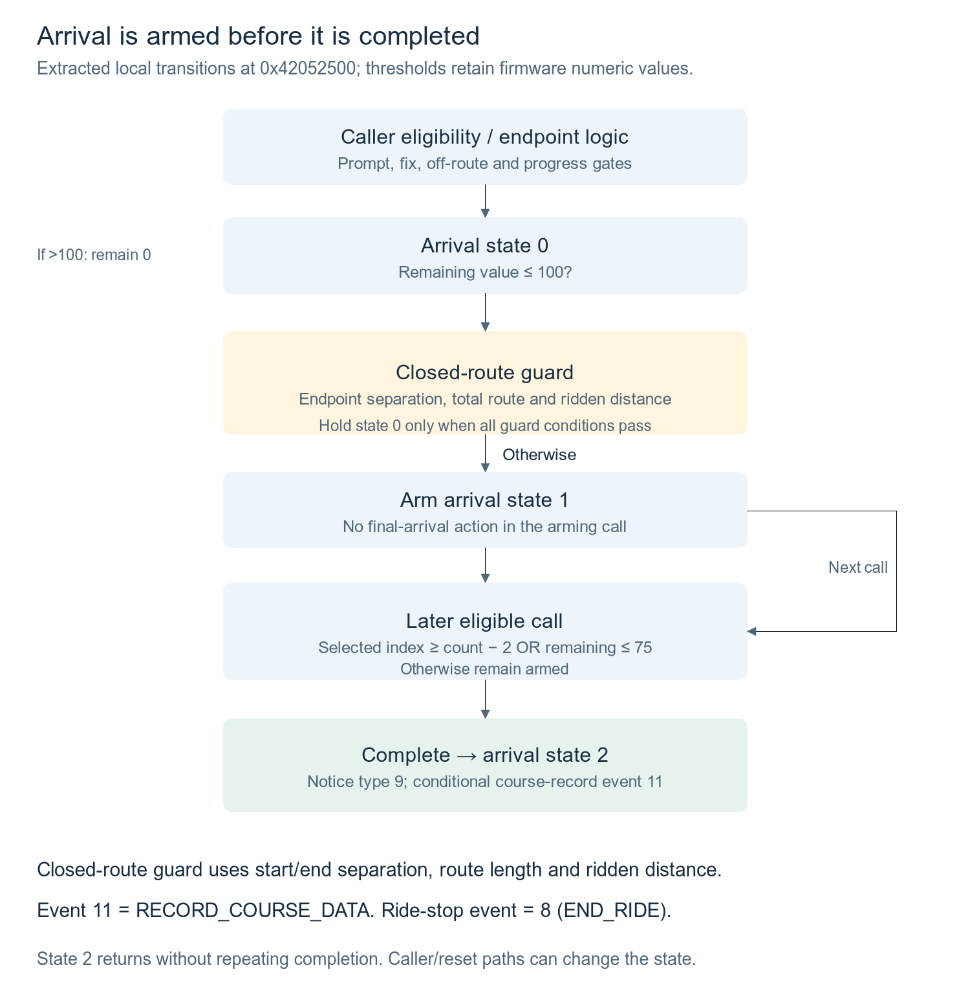

# CC700 progress and arrival extraction

Evidence date: 2026-11-13. Offline stock/v16 extraction. This completes the next
local control-flow pass after [runtime publication and route replacement](navigation-runtime-extraction.md).
“Extracted” here means instructions and branches inspected, not executed on a
device or proven correct for all malformed inputs.



## Progress depends on route slots and connector state

The dispatcher builds a 44-byte next-point record through `0x42050dd0`, then
updates remaining distance at `0x4205485a` → `0x4205100c`. The update is not
a direct subtraction from the nearest-point index.

The route-mode helper at `0x42050be4` reads selector `B = *(uint32_t *)0x3fc9fcc4`
and flags `F/G = ((uint32_t *)0x3fc98a0c)[0/1]`:

| Condition | Returned mode M |
|---|---|
| `B == 0` | 1 if F is nonzero, else 0 |
| `B == 1`, F zero, G zero | 5 |
| `B == 1`, F zero, G nonzero | 4 |
| `B == 1`, F nonzero, G zero | 2 |
| `B == 1`, F nonzero, G nonzero | 3 |
| Other B | 1 |

The path-type resolver at `0x42050ccc` maps a navigation point index into a
numeric file slot and an adjusted index. For ordinary navigation, mode 0 uses
slot 4, mode 1 uses slot 0, and mode 4 concatenates slots 4 then 0. For
navigation states 8/9, there is a leading connector slot (1 when plan type is 1,
otherwise 5); indices beyond it are adjusted by its stored rejoin index before
resolving the following slot. Direction flag and states 10/11 can instead
select slot 2. These branches are at `0x42050ccc..0x42050dcb`.

This resolves the numeric mapping; the complete semantics of every possible
flag combination and every file slot are not inferred from their numbers.

## The 44-byte next-point record

`0x42050dd0` clamps the requested route position to the stored maximum, resolves
its slot/index, and reads that route record. A missing record, a route-record
type field `+116 > 9`, or a null matcher input returns the zero-initialized
output. On the accepted path it sets:

| Output offset | Extracted content |
|---|---|
| `+0`, uint32 | Remaining distance to this point; geometric fallback if calculated result truncates to zero |
| `+4`, uint32 | Route record `+116`, the point/prompt type |
| `+8`, uint32 | Derived next-record information, or zero for a missing/unsupported next record |
| `+12/+16`, float | Route point coordinates converted from stored signed semicircle fields |
| `+20`, float | Unsigned route-record `+84` converted to double, divided by 100, then converted to float |
| `+24`, uint16 | Clamped navigation route position |
| `+28`, uint32 | Route record `+0` |
| `+32`, uint32 | Cached distance word at `0x3c389340` |
| `+36`, uint32 | Route record `+112` |
| `+40`, byte | Valid record flag, set to 1 |

These coordinate conversions are visible at `0x42050e6c..0x42050eb8`.
The current-position input comes from calculation record 15, as traced in the
runtime report.

The local remaining-distance helper `L(i, end)` at `0x420503b4` is:

```c
current = get_navigation_position();
point = get_point(i);               // 0x4204a5fc
if (!point) return 0;
d = distance(current, point.coordinate);
at_point = load_float(point + 12);   // byte offset
if (!(at_point <= end)) return 0;
return end - at_point + d;
```

The geometry is current-to-selected-point plus remaining stored distance;
it is not cumulative ride distance. The exact distance helper is shared with
matching and arrival. Floating conversion/NaN behavior must be retained by any
eventual executable model.

## Main distance update: branch and state table

The output word is `U = *(uint32_t *)0x3c389344`. The four retained words
`R0/R1/R2/R3` begin at `0x3c389328`. Neutral names avoid inventing semantics
for fields that are updated differently in different branches.

Useful source expressions:

Record subscripts in the expressions below denote **byte offsets**, not C array
indices.

- `N(k)`: slot metadata uint16 `+18`, getter `0x420478a0`.
- `T(k)`: slot metadata uint32 `+12`, getter `0x420478d0`.
- `J(k)`: slot metadata uint16 `+44`, getter `0x420478e8`.
- `Q(k,j)`: route record from `0x42047ebc(k,j)`.
- `E(k)`: float conversion of `Q(k,N(k)-1).u32[84] / 100.0`.
- `base(k,Q) = float(T(k)) - float(Q.u32[84] / 100.0) + float(Q.u32[0])`.
- `offset(Q) = unsigned_trunc(float(Q.u32[84] / 100.0) - float(Q.u32[0]))`.
- `p`: matcher uint16 `+108`; `A`: result of access helper
  `0x42050fac(p+1, next_point.position, current_type)`.

The real firmware performs specific double→float conversions before several
of these operations. The expressions below describe data dependencies and
branch writes; they are not substitute bit-exact host code. Arithmetic with
stored unsigned words also needs its original overflow/conversion behavior.

`0x4205100c` first returns for a null/invalid next-point record. If its float
`+20` is zero, it logs `ToStartDis is 0` and invokes the fallback below.
Otherwise it resolves type, writes R3 for supported types, and executes:

| Resolved type / mode | Extracted update |
|---|---|
| 0 | If last slot-0 record exists: `U = R0 = unsigned_trunc(L(p+1,E(0)))`; clear R1 and R2. |
| 1 | Require last slot-1 record. Use `d = float(R1)` when A is 1; otherwise `d = L(p+1,E(1))`. Set `R1 = unsigned_trunc(d)`. If `Q(0,J(1))` exists, set R2 to its offset and `U = R0 = unsigned_trunc(d + base(0,Q))`. Otherwise `U = R0 = unsigned_trunc(d)`, leaving R2 unchanged. |
| 4, M=0 | Require last slot-4 record. `U = R0 = unsigned_trunc(L(p+1,E(4)))`; clear R1 and R2. |
| 4, M=4 | Require last slot-4 record. Retain R1 when A is 1; otherwise set R1 from `L(p+1,E(4))`. Set `U = R0 = R1 + T(0)`; clear R2. |
| 4, other M | `R0 = U`; clear R2; retain R1. |
| 5, M<2 | Require last slot-5 record. Choose d using A and E(5) as above, then store its unsigned truncation in R1. Read `Q(0,J(5))` for M=1, otherwise `Q(4,J(5))`. If present, update R2 and `U = unsigned_trunc(d + base(chosen_slot,Q))`; if absent, `U = unsigned_trunc(d)`. This branch does not update R0. |
| 5, M=4, `J(5) >= N(4)` | Require last slot-5 record and obtain d/R1 as above. Read `Q(0,J(5)-N(4))`. If present, update R2 and `U = R0 = unsigned_trunc(d + base(0,Q))`; if absent, `U = R0 = R1`, leaving R2 unchanged. |
| 5, M=4, `J(5) < N(4)` | Obtain d/R1 as above and read `Q(4,J(5))`. If present, update R2, compute `v = unsigned_trunc(d + base(4,Q))`, set `R1 = v`, then `U = R0 = v + T(0)`. If absent, `U = R0 = unsigned_trunc(d + float(T(0)))`, leaving R2 unchanged. |
| 5, other M | No remaining-distance update after writing R3. |
| Other types | No normal remaining-distance update. |

Last-record lookup failure returns after the early R3 write. Zero output is not
universally equivalent to failure: zero from `L` is consumed as a distance in
these branches. Several paths retain old words. These details are relevant at
rejoin boundaries and when a metadata record is missing.

Addresses: type 0 `0x420511a5..ed`; type 1 `0x42051087..d1` and
`0x420511f1..0x420512e6`; type 4 `0x420512e9..0x420513b6`; type 5
`0x420510d4..0x4205119f`, `0x420513ba..0x42051582`.

### Fallback is also state-dependent

`0x42050c1c` has two branches. Without a valid next-point record, navigation
state 4 leaves U alone; otherwise mode 0 sets U from T(4), mode 1 from T(0),
mode 4 from T(4)+T(0), and other modes leave it alone.

With a valid record, committed off-route state 1 leaves U alone. Otherwise,
with a nonempty route list, U starts from next-point word `+0` and a scan of
later point records adds float `+16` distances according to the current route
position and point type. Type 2 records do not advance the scan's separate
position counter. This is another reason a flat nearest-point subtraction
cannot reproduce the fallback.

## Arrival has an explicit 0 → 1 → 2 state machine

The word previously labelled only “navigation category” at `0x3fc9fcd4` is
passed as the state pointer to `0x42052500`; its log names it `sArriveEndStep`.
It is an **arrival state** in this path. The caller is `0x420528e4`, which
checks prompt validity, position validity, off-route state and route progress
before reaching its arrival call sites. Its general progress path attempts
arrival for next-point field `+36 == 3`, or for nonzero values below 3 when
remaining U lies in 1..99. Arrival is not checked unconditionally on every fix.
For those below-3 nonzero values, a remaining value outside 1..99 instead
resets the arrival word to zero at `0x42052ace..d7`.

Let `r` be the uint32 remaining value passed to the arrival function; `C`, `S`
and `E` be current, start and end coordinates; `dist` be `0x4204aa9c`; `total`
be float at `0x3c389320`; and `ridden` be calculation record 2 float `+8`
minus the baseline float at `0x3c389324`.

| State | Extracted transition |
|---|---|
| 0, `r > 100` | Call notice helper `0x4204fa28(-1,1)` and remain 0. |
| 0, `r <= 100` | Apply the closed-route guard below; otherwise set state 1. No final-arrival action in this call. |
| 1 | If selected point index is below `point_count - 2` **and** `r > 75`, call the same notice helper and remain 1. Otherwise perform completion actions and set state 2. |
| 2 or other values | Return without repeating completion actions. |

The count/index comparison in state 1 is the signed instruction at
`0x4205282f`; there is no independent minimum-two-points guard in this function.

### Closed-route guard

In state 0 with `r <= 100`, hold state 0 only when **all** these are true:

```c
dist(S,E) <= 200
dist(C,S) + dist(C,E) <= dist(S,E) + 200
dist(S,E) + 200 < total
ridden <= dist(S,E) + 100
```

Otherwise arm state 1. This is an extracted condition for routes whose start
and end are close together, not an assumed loop heuristic. Float operations,
ordered comparisons and recorded ride distance are part of the condition.
Addresses: `0x42052759..0x42052810`.

### Completion actions and recording semantics

The completion branch `0x4205283c..0x420528dd`:

1. Marks remaining route-point display state through `0x4204c0f8(...,0xffff)`
   when the point list is nonempty.
2. Clears selector `0x3fc9fcc4`, sets the first word at `0x3fc98a0c` to 1,
   calls `0x42049184(0)` and `0x421d0070()`, then clears through
   `0x4204fe14(0)`.
3. If uint16 flags at `0x3c3892e4 + 36` equal exactly 1, obtains route
   information through `0x4204ee28` and queues ride event 11.
4. Queries the loaded route's flag, sets notice type 9, publishes notice
   arguments `(5000,4)`, writes arrival state 2, clears bit 8 in a navigation
   object flag word, and invokes `0x4203b8bc(3)`.

The event-name table at `0x3fc9891c` identifies 11 as
`RIDE_EVENT_RECORD_COURSE_DATA`; ride stop is event 8,
`RIDE_EVENT_END_RIDE`. The ride-state handler's event-11 branch allocates a
24-byte course-information object and calls a recording helper at
`0x42042863..0x420428bb`. Thus the arrival event must not be interpreted as
the ride-stop event. This does not claim that every possible UI action after
arrival leaves recording running.

Arrival state 2 also gates the earlier planning/notice function. Navigation
end/reset functions write arrival state 0. The state machine, notices,
recording event and reset lifecycle are distinct effects.

## Verification and scope

The [evidence manifest](mining/navigation-runtime-evidence.json) includes the
progress, record-building, type-resolution, remaining-distance and arrival code
ranges. Stock and saved v16 match. The progress kernel's 500 instructions and
arrival function's 370 instructions were checked against GNU Xtensa objdump.
Endpoint getters and the firmware event-name table were read directly.

These findings close local branch extraction for the named progress kernel and
arrival function. They do not establish measured timing, all malformed-file
outcomes, every concurrent writer, or the physical correctness of position
filtering and route matching. Those are separate validations, rather than
substitute constants to insert into a simulator.
