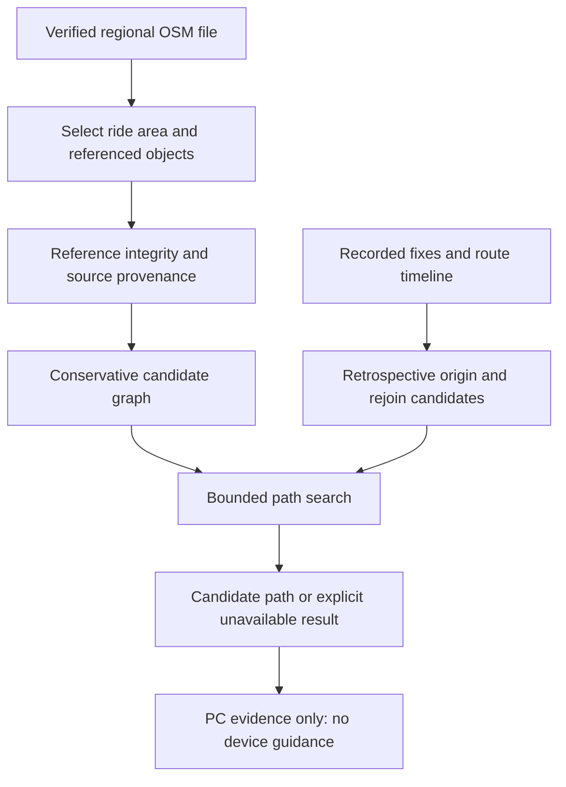

# Regional source acquired; first real-detour structural replay

The source acquisition blocker is resolved. A regional OSM PBF was downloaded
from [Geofabrik's Düsseldorf extract](https://download.geofabrik.de/europe/germany/nordrhein-westfalen/duesseldorf-regbez.html),
checked against the published MD5, and identified by SHA-256. Local filtering
obtained the real ride's bounding rectangle with 3 km padding without another
Overpass request. No device, production app, route or map budget was changed.



## Source evidence

| Measurement | Result |
|---|---:|
| Regional source bytes | 217,413,366 |
| Source replication timestamp | 2026-11-14 21:20:41 UTC |
| Primary highway ways | 45,470 |
| Ways including restriction references | 45,483 |
| Referenced nodes, with original tags | 169,901 |
| Restriction relations | 799 |
| Non-`no` barrier nodes | 6,257 |
| Missing referenced nodes / ways | 0 / 0 |
| Normalized reference integrity | pass, zero issues |

Source SHA-256:
`a6359554bd2114e293241e82b2a14f569f5d584746f76ae64c8ef27443713d50`.

The [offline extractor](../tools/routing_pbf.py) makes independent passes for
in-box nodes, primary highway ways, restrictions referencing those ways, member
ways, and referenced nodes. This preserves identity and tags without building a
location index for the whole regional file or relying on object ordering.
Pyosmium objects are copied while their callbacks are valid, following its
[handler API](https://docs.osmcode.org/pyosmium/latest/reference/Handler-Processing/).
The source timestamp comes from the file header, not the local clock; see the
[header API](https://docs.osmcode.org/pyosmium/latest/reference/IO/).

[Normalization](../tools/routing_pbf_snapshot.mjs) verifies selection bytes and
receipt identity, feeds the existing snapshot validator, and explicitly records
`queryExecuted: false`. The stored query hash is a reference selection identity,
not evidence of an Overpass request. Raw PBF, bounded selection, regional bbox,
snapshot and ride coordinates stay in private `.local/` directories. A passed
reference audit does not establish complete mapping or legal cycling access.
The source timestamp is later than the ride; this is not a historical map proof.

## Conservative topology and measured size

The existing study filter removes 13 outside reference-only ways, 1,207
restriction-member ways and 7,207 ways touching quarantined barrier/via nodes.
That leaves 37,056 ways for the separate access/direction policy, which excludes
another 19,921 ways. The resulting candidate graph has **74,019 nodes and
137,531 directed edges**, with no merge issues.

Its actual UTF-8 JSON is **15,704,430 bytes**. This is a PC evidence format, not a
device codec or a target heap measurement. It is about 240 times the existing
65,536-byte encoded map working target. The full regional graph is therefore
not a drop-in map block. This comparison does not rule out compression,
generation-time recovery legs, or bounded local subgraphs. Those require their
own measured representation comparison.

## What the real ride replay does

The [replay study](../tools/recovery_ride_study.mjs) consumes the existing 4,035
timestamped fixes and their matching timeline. It does not change native route
matching. Two kinds of evidence remain separate:

1. Strict episode audit: requires an unambiguous on-route entry, stops at a
   recording gap over 10 s, and requires five stable unambiguous rejoin samples.
   It found four episodes: three interrupted by gaps and one observed forward
   rejoin. That strict run produced only two trials: one candidate and one
   unassociated origin.
2. Retrospective structural scenarios: sample fixes at least 50 m from the
   original route, once per 30 s plus the maximum-deviation fix. A future
   unambiguous stable rejoin within 30 minutes is used as a reference destination
   only if its route progress is over 25 m beyond the earlier entry. Recording
   gaps are retained as evidence flags, not continuity acceptance. Missing
   entry/destination yields unavailable.

For each scenario, original source nodes within 25 m are geometric association
candidates. Association happens **before** policy exclusions; a blocked road is
not silently replaced with a nearby admitted road. This still does not establish
the correct road, a traversable GPS-to-node connector, or a valid node-to-route
connection. Paths remain structural candidates, never cycling directions.

The later observed rejoin is retrospective knowledge. This is not an online
destination selector, and no future GPS evidence would be available at runtime.
Crossings and start/finish ambiguity flagged by the existing timeline are
excluded as anchor positions. That timeline's ambiguity detector is itself
research evidence, not fully validated route-visit association.

## Results

| Result of the retrospective scenario | Samples |
|---|---:|
| Candidate path | 1 |
| Associated origin absent from filtered graph | 8 |
| No source origin node within 25 m | 1 |
| Associated target absent from filtered graph | 15 |
| No observed stable forward rejoin in the window | 5 |
| Total | 30 |

25 scenarios span recording gaps. The graph-absent associations show the cost of
our conservative policy: five unique origin associations touch quarantined
barrier/via-node ways and four touch road classes requiring explicit bicycle
access. For targets, one unique association is affected by each of those
categories. Categories can overlap; these are unique associations per cause,
not exclusive trial counts or proof that those roads are rideable.

The sole candidate uses six settled nodes, nine relaxed edges and a queue peak
of two. Its complete trial JSON including geometry is 731 bytes. This very small
case cannot establish typical recovery size or CPU cost. Validated cycling
paths: **zero**. Device acceptance: **unvalidated**.

All 30 sampled deviations are under 1 km, so the cumulative 1/2/3 km result
tables are identical. They must not be read as successful 2 or 3 km testing.
The snapshot covers the padded source region, but that is distinct from useful
connected recovery or distant display coverage.

## Decision and next implementation priority

The network/source obstacle is gone. The immediate bottleneck is overly broad
quarantine and an unvalidated regional cycling profile, not proof that the
device needs a larger display budget. The next routing increment should model
barriers at nodes/edges and turn restrictions at transitions while preserving
unknown/conditional cases as unavailable. Regional default cycling access needs
evidence before path/track defaults change. Do not simply turn off filtering to
increase the success count.

Only after those changes should we compare precomputed recovery legs against a
compact connected representation on these real detours and spatially sampled
1/2/3 km cases. Keep GPS/route association uncertainty separate. A useful planner
also needs an online forward-target policy; the retrospective oracle is not one.

Ordinary map and guidance remain the fallback contract. No recovery activation,
distance, instruction or new resource limit has been shipped. cc24 remains
withheld; this PC work provides no new native drawing-crash acceptance evidence.

## Reproduce locally

Install optional `osmium==4.3.2` in a local Python environment. Download/verify a
regional source, then use new output directories:

```sh
python tools/routing_pbf.py --source REGION.osm.pbf --region REGION.json --output SELECTION
node tools/routing_pbf_snapshot.mjs --selection SELECTION --output SNAPSHOT
node tools/recovery_ride_study.mjs --input STUDY.json --output REPLAY
node --test tools/test_recovery_ride_study.mjs tools/test_routing_snapshot.mjs tools/test_recovery_study.mjs
python -m unittest discover -s tools -p test_routing_pbf.py
```

`STUDY.json` contains paths keyed by `snapshot`, `track`, and `timeline`.
The replay writes a sanitized aggregate summary plus private trial/graph files.
Do not publish the latter: graph nodes and trial timestamps can locate a ride.
Acquisition and graph measurements are in
[the aggregate report](mining/regional-recovery-replay-20261115.json).

## Review and verification

Independent review found two important evidence-preservation issues. Differing
duplicates of selected original node/way/restriction IDs now fail extraction
explicitly, including both record orders; exact duplicates are harmless. A
verification scan catches earlier versions that did not qualify for selection.
History inputs are not admitted. The receipt now binds the exact extraction
bbox, and normalization rejects a different bbox. Both findings were reproduced
with failing tests before the fixes. The real source was regenerated afterward.

Focused verification: 36 Node tests and five Python importer tests pass in the
isolated pyosmium environment. Default environments without pyosmium explicitly
skip the importer tests; a skip is not source-import validation. Existing-output
preservation is checked. The first extraction hit a PC-only 750,000 in-box-node
guard because this dense urban bbox includes building geometry as well as roads.
The temporary identity-set admission was raised to three million for PC scans;
retained referenced nodes remain capped at 750,000, ways at 100,000 primary,
restrictions at 10,000, source at 512 MiB, and selection JSON at 64 MiB. No device
budget changed. Failed/private receipts remain preserved.

Deferred review minors: slightly different area constants between Python and
JavaScript near the 600 km² admission boundary; exhaustive selection-limit
fixtures; and an integrated replay fixture beyond the existing helper tests.
The selected bbox is about 121 km², far from that boundary. Refusal-to-overwrite
coverage was added during the same verification pass.
