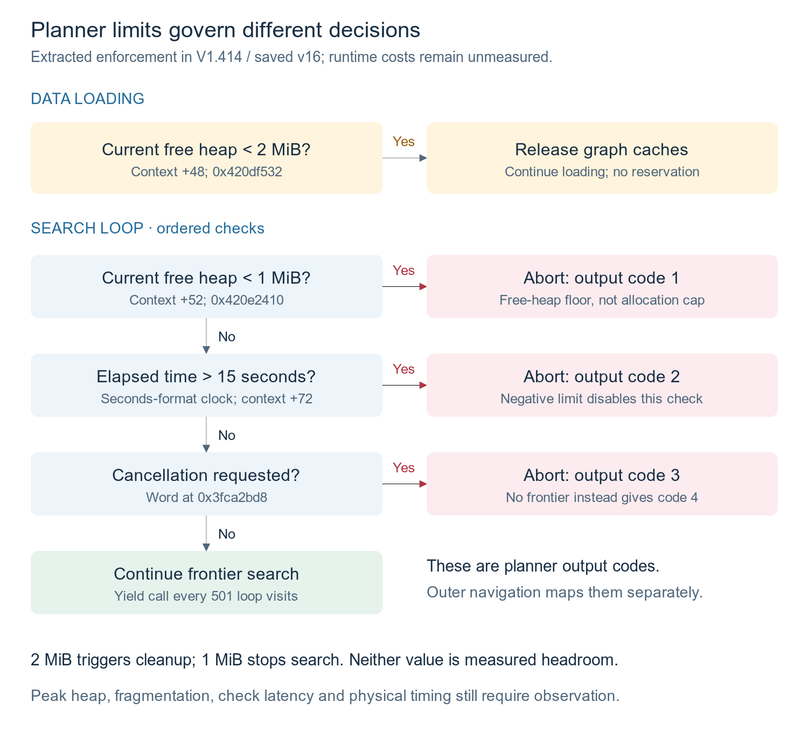

# CC700 remaining extraction and connected-device baseline

Evidence date: 2026-11-13. This extends the [firmware mining report](firmware-mining-2026-11-13.md).
It closes specific static dependencies and records the first connected-device
baseline. It does not establish full firmware coverage or simulated equivalence.

## Planner limits are policies, not available memory



The caller at `0x420534aa` supplies these values to `0x420e249c`:

| Value | Context field | Enforcement | Meaning |
|---|---|---|---|
| `0x200000` = 2 MiB | `+48` | `0x420df532..545` | Below this free-heap reading, invoke cache cleanup before continuing the data-loading path |
| `0x100000` = 1 MiB | `+52` | `0x420e2410..418` | Below this free-heap reading, abort search with output code 1 |
| double `15.0` | `+72` | `0x420de5a8..62f` | Abort search with output code 2 when elapsed time exceeds this limit |

The heap reader `0x421dbd00` queries capability `0x1000` through
`0x42003af8`. It measures current free heap for that capability; it does not
measure the largest contiguous block or historical minimum. The 2 MiB value
does not reserve a 2 MiB workspace, and the 1 MiB value does not cap total
planner allocations. Historical free-heap samples below 2 MiB make cache
cleanup relevant, but they are not current measurements.

The time helper subtracts a saved three-word timestamp and combines the whole
part with the fractional part multiplied by `0.000001`. The clock implementation
at `0x4037755c` divides its source by 1,000,000 and stores quotient plus remainder.
This establishes a seconds-format calculation; the configured limit is 15 seconds
in that representation. Actual elapsed behavior, clock accuracy and how promptly
each search step returns to the check remain unmeasured. A negative configured
limit disables this check.

In the search loop, checks occur in this order: heap floor, time limit,
cancellation word `0x3fca2bd8`, then frontier availability. Cancellation produces
code 3; no frontier produces code 4. Source/target lookup failure can also
produce code 4 before search. These codes are planner outputs, not the outer
navigation outcome codes. A separate loop counter calls `0x4038378c(10)` every
501 visits; it is a yield mechanism, not a search-count limit. Its RTOS delay
units and observed scheduling cost are not established here.

The cleanup calls at the low-heap branch are `0x420df338(ctx + 4)` and
`0x420df294(ctx)`. The wrapper also invokes these after search before result
construction, then releases additional context data. This identifies lifecycle
boundaries; it does not prove every allocation failure is safe. Complete graph
format, geometry construction, allocation-failure propagation and peak heap
remain open dependencies.

## Crossing arbitration has its own counter and road output

The helper at `0x4204abf4` receives selected index **I**, current road **R**,
speed, GPS angle, route angle, heading validity, two exact-position tie indices,
a candidate table, the previous 148-byte result, and an output-road pointer.
The selected index and output road can change independently.

Candidate records are 72 bytes: point index at `+0`, distance at `+4`, angular
difference at `+8`, then a 60-byte point payload. The candidate road/group field
at `+52` comes from payload `+40`; the selected point accessor exposes its road
at `+34`. These offsets belong to different representations.

The helper sorts candidates by distance, retains the nearest-distance window
of `+100`, and filters for angular difference `<= 90`. The first retained
candidate becomes **B**. If none is retained, it falls back to **I** and the
selected point's road. The temporary candidate-copy allocation has no visible
null guard before copying; this is a static failure exposure, not a reproduced
device crash.

The following table describes the subsequent arbitration in branch order:

| Condition | Selected index / output road | Counter at result `+132` |
|---|---|---|
| Selected point missing | Keep I / R | Unchanged by this return |
| Projection-context field `+108` is zero | Keep I / selected point road | Unchanged by this return |
| Selected point road equals R | Keep I / selected point road | Clear |
| Heading invalid | Previous exact-match lookup / R | Clear |
| Heading valid, speed `>= 3`, and `135 < abs(GPS angle − route angle) < 225` | Increment counter; apply the cases below | See below |
| Other valid-heading cases, B belongs to R | B.index / R | Clear |
| Other valid-heading cases, B belongs to another road | Keep I / selected point road | Clear |

The angle difference is raw subtraction, without circular normalization here.
For the large-angle case, after incrementing the uint16 counter:

1. If it exceeds 10, clear it and accept I / selected point road.
2. Otherwise, if tie[0] is nonzero, differs from tie[1], and tie[1] equals
   I − 1, return tie[0] − 1 / R and clear the counter.
3. Otherwise, if B belongs to R, return B.index / R and clear the counter.
4. Otherwise, return the previous exact-match lookup / R, retaining the counter.

The previous-point lookup is the already extracted `SearchLastPointIndex`:
first exact road-and-coordinate match, falling back to stored index `+108`.
Thus “11 qualifying increments” applies only to a particular retained-counter
path. It is not a universal eleven-sample road-switch delay, and neither it nor
the off-route counter establishes a duration in seconds.

The separate off-route repeat counter is at `+136`; it commits result byte
`+145`. Its rules remain in the [route-state report](route-state-extraction.md).

Normal road advancement at `0x4204fc30` additionally requires both input pointers,
result byte `+146`, and the needed previous/current point lookups. It compares
the current selected point's road `+34` with output road `result +134`; only
on equality does it call setter `0x4204f258`. That setter accepts a road number
only up to the maximum at `0x3c389338`, storing it at `0x3c38930c`.
An updated matched point alone therefore does not prove road progress advanced.

This closes local arbitration and advancement branches. It does not settle
every upstream candidate/geometry degeneracy or reproduce a historical failure
at a physical crossing.

## Native replay configuration is positional

Parser `0x420b51d8` opens
`/littlefs/ModuleDataTest/ModuleDataTest.cfg`. The ordinary accepted shape is:

```text
$Replay={0,Enable,true}
$ExampleValue={1,Value,123}
```

These names illustrate syntax; they are not recovered vendor defaults or an
activation recipe. Entry 0's Boolean query gates test-task creation in the
[replay chain](navigation-behavior-extraction.md).

The parser clears 40 slots of 16 bytes at `0x3c38eb14`:

| Slot offset | Field |
|---|---|
| `+0` | Signed 16-bit numeric ID; initialized to −1 |
| `+4` | Mode: 0 for an Enable-token match; 1 otherwise |
| `+8` | Allocated name pointer |
| `+12` | Boolean or numeric value |

Crucially, a parsed entry is stored by **row ordinal**, not by its numeric ID.
The query functions calculate `table + requested_ID * 16`, then require that
slot's stored ID to match. They also require a name pointer and the appropriate
mode. Consequently an ordinary usable file must keep each ID aligned with its
row ordinal. Skipped malformed rows still advance the parser's ordinal; a
correctly named entry later in the file need not be discoverable by ID.

The parser scans for `$`, reads a bounded line, accepts LF or CRLF, removes
ASCII spaces from the main fields, and splits name, numeric ID, mode and value.
It does not strictly validate an opening brace. Its `strncmp` calls use the
input token length, so prefixes such as `En` and `tr` can match `Enable` and
`true`. Numeric values collect digits while discarding other characters:
for small representable examples, `-12` becomes 12 and `1.5` becomes 15.
Multi-digit ID conversion has narrow intermediate operations, so arbitrary IDs
must not be treated as unrestricted decimal integers.

The table initializer has a 40-slot bound; the parsed-row store has no visible
matching bound. Name allocation also reaches a copy without an intervening
null check. These are reasons to treat malformed or oversized configurations
as unvalidated inputs, not as safe fuzzing material on the device. No replay
configuration was written or activated during this investigation.

## Magnetic data reaches the ESP32 through a framed UART path

The previously open transport now has a local producer/consumer connection:

| Stage | Compiled path |
|---|---|
| Read available bytes | `0x4203aed0` calls communication channel 1 adapters `0x421497ec` and `0x42149844` |
| Select UART | The read adapter maps channel 1 to low-level UART index 2, calling `0x4214c5e8` |
| Buffer | Copy received data into ring buffer `0x3c381850` |
| Frame | Consumer `0x4203afc0` checks `0xa5` at byte 0, `0x6f` at byte 2, byte 4 in 1..5, and length byte 1 `<= 15` |
| Validate | Read length + 4 bytes; compare helper `0x4214966c` result against the trailing little-endian 16-bit checksum |
| Dispatch | `0x4203bd08` routes frame byte 5 equal to 16 to `0x4203b9d8`, passing payload at frame +6 |

That last payload handler contains the previously extracted magnetic subpacket
path. This establishes the ESP32-side transport and distinguishes it from a
direct sensor-register read. It does not identify the peer processor, populated
sensor model, electrical pin assignment or the peer's sampling/calibration rules.
These remain board/peer dependencies, alongside physical activity validation.

## Connected device: what was actually observed

Claude history identifies Espressif USB JTAG and USB serial as CC700 access
paths. ADB was associated with the Android side; the present ADB inventory
contained no Android device. The CC700 was reachable through the Espressif
OpenOCD build and `/dev/cu.usbmodem1101`.

A sparse RAM/code sample used a bounded halt/read/resume sequence. It issued no
reset, breakpoint, flash write or storage write. Both cores were running before
the sequence and confirmed running afterward. The entire sequence took 144 ms;
this is an instrumentation interruption, not a firmware performance measurement.

| Observation | Meaning and boundary |
|---|---|
| Version string `CC700_V1.414-cc16` | Live version string confirms the reported build label |
| 16 bytes at iterator hook `0x42049670` match saved v16 | Confirms that sampled hook; not a full live firmware hash |
| Navigation state, canvas pointer and replay-active flag are zero | Those paths were inactive at the sampled instant |
| Raw magnetic axes, magnetic angles and acceleration vector are zero | No active sensor updates demonstrated by this sample |
| Magnetic status is 4 | Also the saved firmware's initializer; not evidence of calibration or sensor absence |
| Position record qualification word is 2, with zero coordinates | Consistent with the extracted no-raw-fix path |
| Replay configuration RAM is all zero | Not the parser's initialized −1-ID table; does not establish whether a config file exists |

The 12-second serial capture contained bootloader output and no running-app
logs. It reports USB-UART reset cause 21 and loading OTA slot 1. Its timing
relative to connection is not established: it may include buffered output, and
opening the serial path cannot be ruled out as the source of the observed reset.
No explicit reset command was issued. The inactive sample is not an explanation
of the current screen or power state; confirmation that the screen is awake was
requested before further physical observations. The user subsequently confirmed
the screen was awake; the follow-up below supersedes that pending condition.

Private live snapshots, serial identifiers and potential coordinates remain
outside the repository. No coredump was read.

### Follow-up with the screen awake

After the user confirmed waking the device, another sparse sample completed in
145 ms with both cores confirmed running before and after. Navigation state was
2, the map canvas pointer was nonnull, GPS validity byte `+1` was 1, published
speed `+24` was zero, and the position snapshot had qualification word 1 and
raw-fix byte 1. This is an active navigation context, unlike the first baseline.
Replay remained inactive. Magnetic axes, angles and acceleration remained zero;
magnetic status remained 4. Map heading was 90 degrees in its transformed frame.
No coordinates are included here.

The stationary display is consistent with the extracted selector: at zero speed,
magnetic fallback requires status 3; observed status 4 instead retains cached
heading. This does not prove why sensor data is unavailable or whether the
physical unit has a populated compass. A changing orientation plus repeated raw
observations is still needed to test activity.

The selector's threshold is 3000 in RMC speed ×1000, meaning 3 knots (about
5.56 km/h), not 3 km/h. This heading-source gate is not proof of an auto-pause
transition. Auto-pause, GNSS speed suppression, retained position and displayed
heading are separate mechanisms; their complete interaction remains to be traced.
Suppressing unstable stationary GPS direction is a plausible rationale, not
recovered evidence of the firmware author's intent.

### User-selected “hin” route and visible distance popup

The user subsequently reported navigation started on “hin”, the visible warning
“Current position is far from the new route”, no compass rotation and a responsive
device. A further sample completed in 145 ms, confirming both cores running
before and after. The active filename was not read, so “hin” is a user-reported
selection rather than a verified on-device filename.

Navigation state was 2 with a nonnull canvas. GPS validity and position
qualification were 1, while published speed was zero. The GPS course field had
changed from the preceding sample, but the selector ignores that source at this
speed. Map heading remained 90 degrees; magnetic status remained 4 with zero
magnetic and acceleration fields. This is consistent with cached heading, and
does not identify a freeze or establish physical compass absence.

Matcher selected index was 0, its distance field was 20, its completion byte
`+146` was 1, and its committed off-route byte `+145` was **0**. The independent
notice/planning step was 0. Thus the user-visible distance warning did not
coincide with a committed off-route state in this sample. The exact English
string exists at `0x3c31e579`. The older handoff addendum associates it with
startup popup type 1; that historical attribution is not a newly verified trigger
or threshold. The subsequent [popup and sensor follow-up](popup-and-sensor-followup.md)
now establishes notice type 8 inside popup type 4, the local start-helper trigger
and lifecycle boundaries, superseding that historical attribution. Do not use the visible popup as a proxy for matcher byte
`+145`, and do not assume its distance is the matcher's field `+112`.

## Coverage ledger

| Dependency | Current status | Evidence still required |
|---|---|---|
| Local road arbitration and road advancement | Branches extracted | Geometry edge cases, resets, cadence and physical reproduction |
| Planner memory/time limits | Enforcement extracted | Peak allocation, fragmentation, failure propagation and measured timing |
| Native replay configuration | Parser and indexed queries extracted | Fresh file inventory, vendor defaults and controlled activation |
| Device connection/build | USB JTAG works; label and one hook sampled; awake navigation context observed | Full-image identity if needed; dynamic activity and timing |
| Physical compass | Firmware magnetic path exists; activity unproven | Awake-state changing raw axes/angles and calibration behavior |
| Complete simulation | Not established | Remaining helper contracts and runtime observations, then equivalence checks |

These are explicit evidence gaps. They must not become assumed behaviors in a
simulator. USB access now permits stationary measurements without requiring a
test ride, but motion, reception, rendering load and riding behavior still need
representative inputs and comparison with the real device.

## Verification and decoder correction

The [sanitized evidence manifest](mining/remaining-extraction-evidence.json)
records source hashes, 17 half-open code ranges, exact stock/v16 byte equality,
reachable instruction counts and GNU verification runs. It contains no live RAM
dump. Boundary lengths and decoded direct branch targets were checked against
GNU Xtensa objdump for every instruction reached in those bounded extractions.
Semantic interpretation remains a separate analysis step.

The imported decoder's linear sweep missed backward-reached blocks, and its
BF/BT displacement handling treated signed displacements as unsigned. A private
bounded recursive walker corrects those displacements and follows both branch
paths. The containing planning function `0x42052b2c..0x42054684` now yields
2506 reachable instructions across 42 contiguous GNU runs, including 285
instructions missed by the earlier linear sweep. The node/queue helper at
`0x420e1e4c` yields 562, including 427 missed by that sweep. This corrects the
extraction method; instruction counts are not behavioral-coverage percentages.
