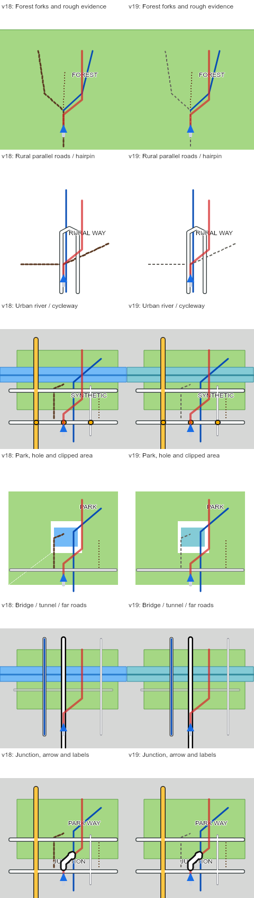

# Coherent rendering release, 2026-11-14

This release keeps street borders/interiors and the existing green/grey land colors, improves fill correctness and label consistency, and removes repeated firmware selection work. The route format remains compatible with v18; regenerating a GPX is necessary to receive the new geometry/anchor preparation and compact entry ordering.

## Implemented

- Display roads are prepared once before block selection, with exact same-grade shared vertices and semantic source endpoints retained. Reversed shared chains use identical sampling arithmetic. Clipping selects from this geometry without block-local RDP. No nearby-road snapping or invented crossing connectivity is added. The same preparation applies to railway/tram/water polylines.
- Road classification still samples along long segments, even when their rendered geometry has only two endpoints. A crossroad cannot become a distant thin road solely because its endpoints are far from the route.
- Label anchors are chosen globally from source display lines, with route-name priority, deterministic ties, printable/truncated device text and bounded block selection. Both open and closed reversed ways retain their anchors. Each block still contains at most 12 labels; candidate membership can change across blocks, but shared candidates retain their coordinates and priority.
- New files group entries in compact stable class/level ranges. The C iterator builds bounded index ranges during its existing first scan. Unsorted old files retain their original semantic dispatch order; predicates remain in place and no retained cache can outlive a route change. Interleaved signal/stop order, label priority, class-15 overlays, layer flags and allocation-failure behavior are preserved.
- The native fill and v19 preview use direction-independent pixel-centre intersections and coincident crossing cancellation. Doubled edges into holes no longer leave the false diagonal background seam.
- Native and preview label placement use the same edge/HUD exclusions and twelve-box collision budget, including halo padding. Actual font glyphs remain a preview approximation and the seven-pixel width estimate is inherited from v18.
- v19 uses cyan water, blue cycleways and neutral two-pixel ordinary path dashes. Known rough paths retain their separate brown marking. Street casings, green/grey land, bridge/tunnel cues, area outlines and route opacity 180/255 remain.
- The preview retains a v18 comparison profile and an explicitly separate cycling study. Acceptance rendering supports heading/scale overrides without changing stored route geometry. Cache v7 includes every new module for offline installation.

## Evidence and limits

Actual native C runs under AddressSanitizer and UndefinedBehaviorSanitizer. Frozen-iterator comparisons check dispatch and draw traces, including unsorted input, all classes/levels, flags, symbols, failed projections, scratch OOM, repeated frames and dense 4,000-entry blocks. That dense case inspects 12,000 entries instead of 248,000 with the same 8,000 projection calls. This is selection-work evidence, not an FPS improvement.

Direct cross-language tests compare **106 polygon masks** and **2,500 label candidates** between actual C and preview rules, including winding, clipping, negative slopes, holes, Unicode character counts, HUD, halo margins, collisions and the twelve-label cap. A matrix generates **108 native-size Canvas frames** across six scene types, three scales and three headings. Representative sheets were inspected; these are synthetic map views, not device screenshots or whole-device emulation.

The v19 executable uses 6,480 bytes text and 296 bytes rodata, leaving 8,120 bytes in the mapped code page. `cc_iter` static compiler frame is 512 bytes (v18: 80); no full-frame cache or new heap allocation is added. Static frames do not establish target stack high-water. Runtime heap/stack headroom and frame-time distributions remain unmeasured.

The existing noisy-track false turn TODO and historical noisy/sparse turn-count discrepancies remain. This work does not replace the navigation matcher: original source is preserved, but matching still uses generalized display lines. Polygon coverage-wide topology, common dash phase across independently clipped/chunked paths, additional bitmap caches and arbitrary new POIs are not claimed solved. Negative-space rendering remains an experimental option: existing measurements do not justify making it the default.

Run the public Node suites listed in README, `node tools/test_app_offline.mjs`, and `node --test tools/test_device_parity.mjs` when the private firmware source is present. `python3 -I tools/validate_local.py` records the wider private validation and its known failures separately. `node tools/render_map_acceptance.mjs` uses the existing optional local Canvas package to regenerate the synthetic matrix.

The candidate build and installation are documented in [v19 firmware report](v19-firmware-rendering-2026-11-14.md). Device readback/boot and Pages publication are recorded separately below.

## Release verification

Firmware v19 was installed to ota_1, verified against flash and automatically booted with RTS reset. The eight-second boot window contained one reset, the expected ota_1 app-load line and no captured panic. A fresh byte-exact v18 rollback partition is retained. No GPS injection, route transfer, storage write or stock ota_0 update was performed.

Final local validation: **114 Python tests passed; 81 Node tests passed with one executed known TODO; seven offline probes passed; historical fixtures remain 10/12; the real-ride full-loader coverage proxy remains 0/576 absent samples.** The known historical failures are GPS 3 m noise (25 turns versus 15) and every-eighth-point export (3 versus 15). Neither boot success nor that coverage proxy proves target map throughput or complete navigation behavior.
