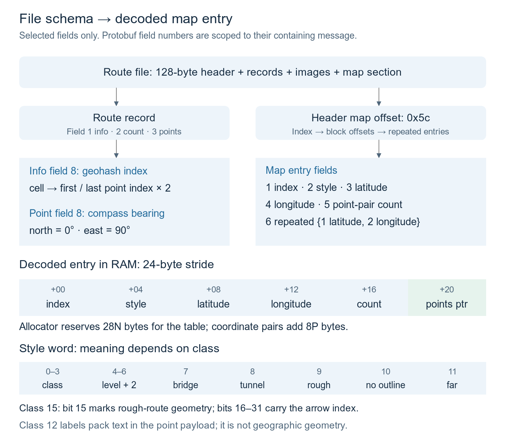
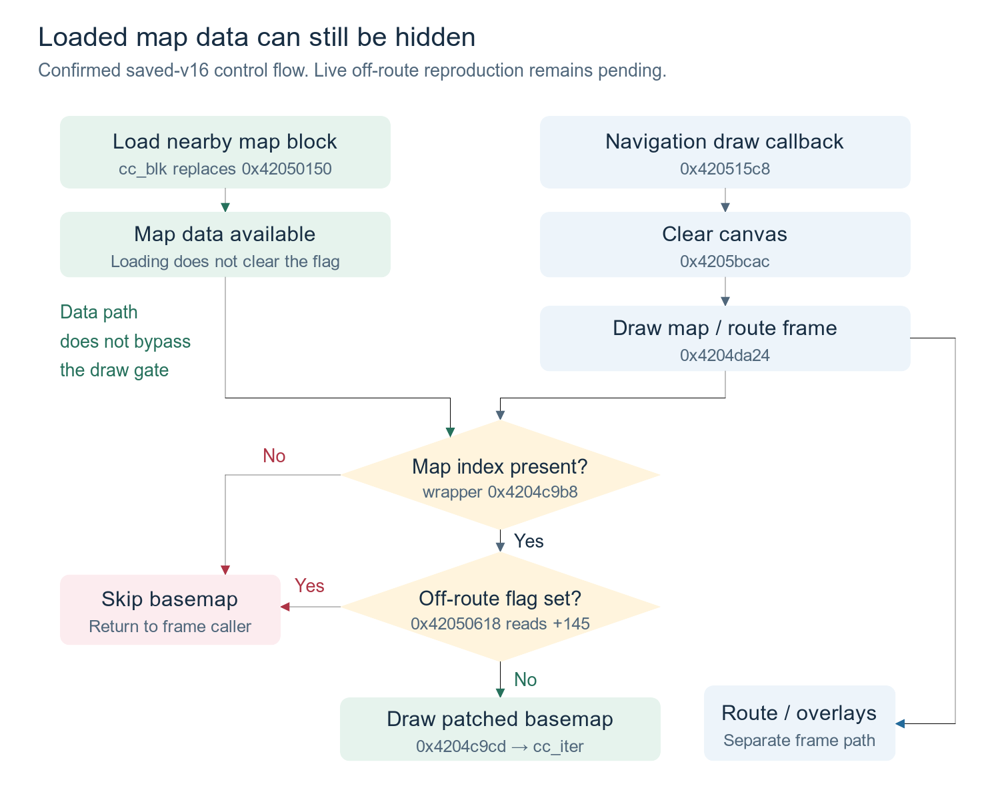
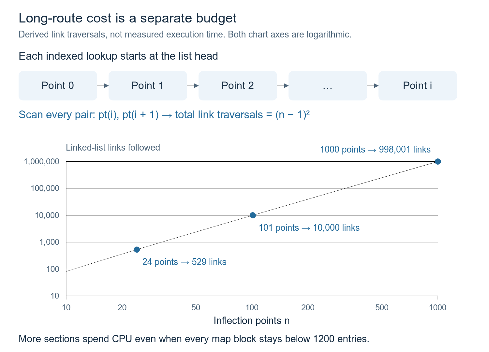
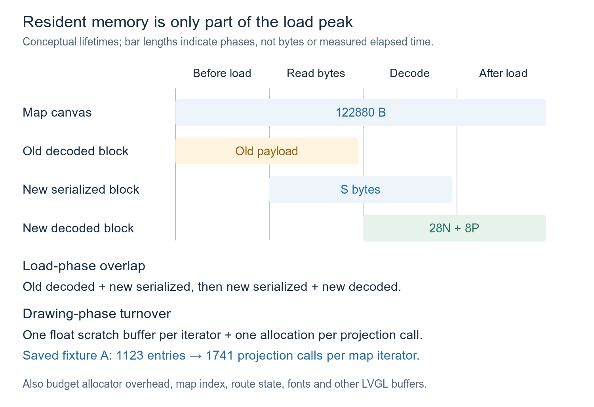
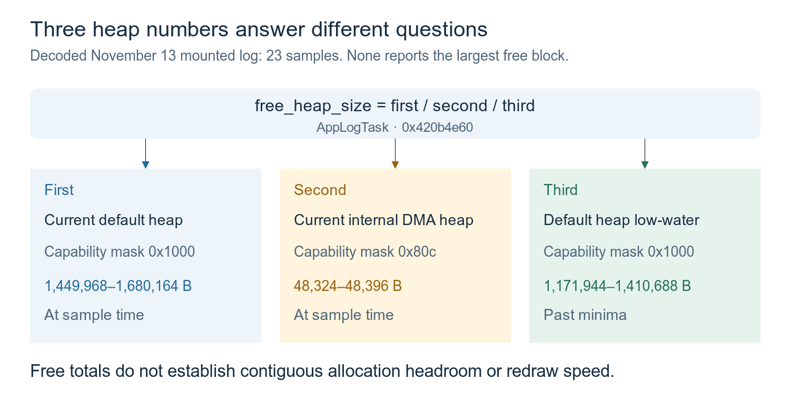
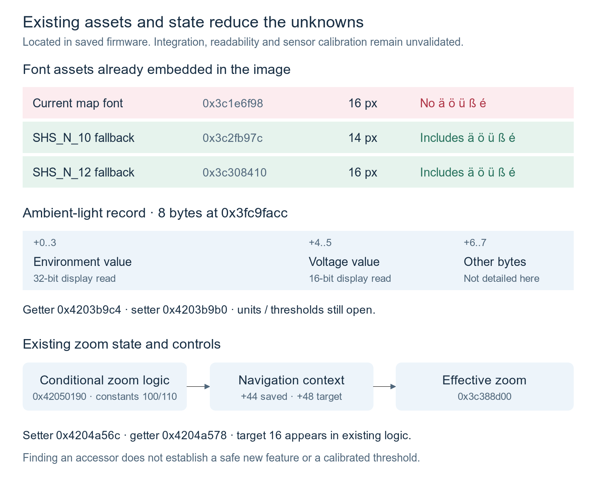
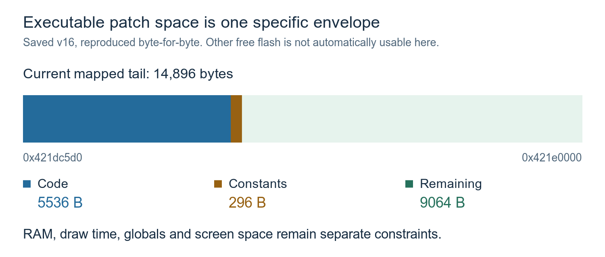

# Firmware mining: 2026-11-13

Latest status and report index: [mining closure](mining-closure.md). It integrates
the later geometry, lifecycle, sensor-boundary and local-validation audits.

Scope: offline analysis of the saved V1.414 firmware, current patch sources,
saved v16 image, route files, and the last saved storage snapshot. The initial
pass was offline. A [follow-up extraction and connected baseline](remaining-extraction-and-device.md)
adds road arbitration, planner limits, replay grammar and sparse USB JTAG
observations. No firmware/storage write or feature implementation was performed.

The linked [reverse-engineering catalog](https://github.com/morluto/awesome-reverse-engineering)
was reviewed as a tool reference. This pass used the already installed Xtensa
GNU compiler/objdump, the existing firmware parser/cross-reference tools, Python,
and the existing LittleFS environment. No new tools were installed and no
firmware was uploaded to an external service.

## Evidence quality

- **Binary:** control flow or data verified in the saved firmware.
- **Source + binary:** current patch source reproduced the saved v16 exactly.
- **Snapshot:** decoded from stored files, not read from the live device.
- **Inference:** a consequence of the implementation; not a measured device result.

Older notes must be read with these corrections. Especially, an existing file,
a successful build, or a stationary photo does not prove behavior while riding.

Figures are embedded PNG images with zoomable SVG copies. They do not require
Mermaid or another diagram plugin. Their sources are generated by
[`tools/render_mining_figures.py`](../../tools/render_mining_figures.py).

## Format reference: file fields and RAM are different schemas



[Zoomable SVG](../mining/02-format-schema.svg). This shows selected generator fields,
not the entire firmware schema. Header offsets and decoded RAM offsets are byte
offsets; protobuf labels are field numbers. Coordinates in the file use signed
semicircles, with degrees = value × 180 / 2³¹. A stored map entry's point count
excludes its separate center coordinate. The diagram's style meanings belong to
the patch; stock firmware does not render those classes.

## 1. Off-route map loading is implemented; off-route map drawing is still gated

Follow-up: [route-state extraction](../research/route-state-extraction.md) now resolves the
final off-route candidate thresholds, persistent commit counter and publication
to this gate. It also exposes a separate matcher allocation of 72 bytes per
route point and a potential null-destination copy after a second allocation
fails. This is static evidence, not a reproduced device crash. Progress,
rejoin and arrival extraction remains incomplete.

Further follow-up: [rejoin/planning extraction](../research/rejoin-planning-extraction.md)
separates matcher state from notice/planning state, traces response-specific
timeouts, local planning's native replay pause, and queued completion. The
navigation position path also consumes a separate 20-byte calculation record;
its freshness cannot be inferred from the replay-aware heading getter.

The [runtime follow-up](../research/navigation-runtime-extraction.md) now traces that
position producer, queue ownership, event 91 consumer and restart path. Ordinary
restart explicitly frees the current map allocations. The companion
[progress/arrival report](../research/progress-arrival-extraction.md) extracts distance
updates and arrival arming/completion; its course-record event differs from
ride stop. These are static findings, with 22 stock/v16 byte-range comparisons
recorded in the linked evidence manifest.

**Finding: confirmed binary control flow; no fresh device reproduction.**

The patch replaces the map loader at `0x42050150` with `cc_blk`. That loader
chooses a section by position and does not reject an off-route state.
However, loading is only one boundary:



[Zoomable SVG](../mining/01-offroute-flow.svg). Green traces data availability and
the permitted map pass; red identifies a skipped map pass. The separate route
path does not establish that a basemap was drawn.

The predicate at `0x42050618` returns whether byte
`0x3c3894f0 + 145` is nonzero. The navigation calculation produces that byte
from its yaw/off-route state: local offset 177 in the result buffer starting
at stack offset 32 becomes result offset 145; the 148-byte result is copied
into the global state at `0x420547e0..ec`.

Both the wrapper and predicate are byte-identical between stock and saved v16.
The v16 hook list does not bypass this gate. The canvas clear is unchanged too.

**Consequence:** with this flag set, the normal map pass does not reach
`cc_iter`, even if a valid nearby block has been loaded. Route/overlay drawing
is a separate path. The earlier claim that v16 fully preserves the basemap off
route is too strong and must be withdrawn. This is not simply a geographic
coverage problem. Slight deviations below the flag threshold are a different case.

No patch was made. A later fix needs a focused reproduction that checks the
loading, flag, and drawing boundaries independently.

## 2. The nearest-section scan has quadratic linked-list traversal

**Finding: source + binary; operation counts, not device timing.**

`cc_nearest_sec` scans every adjacent pair of inflection points. Each `pt(i)`
calls `0x4204922c`, which calls `0x421cfedc`. That implementation starts at
the list head and follows the link at node offset 4 until index `i` is reached.
It is not a constant-time array access. The count helper also traverses the list
(`0x42049200 -> 0x421cfef8`).



[Zoomable SVG](../mining/03-section-cost.svg). Both axes are logarithmic. This is an
operation-count model, not a benchmark. For `n` inflection points, summing the
two indexed accesses per segment gives **Σ[i + (i + 1)] = (n − 1)² links**,
for `i = 0 .. n − 2`.

| Inflection points | Link traversals per full nearest-section scan |
|---:|---:|
| 24 | 529 |
| 57 | 3136 |
| 101 | 10000 |
| 1000 | 998001 |

This excludes list counts, distance arithmetic, and other navigation work.
The scan runs in map loading and in the patched route overlay path. The overlay
path performs it even when the file contains no optional turn arrows.

**Consequence:** map-entry count and route-section count are separate CPU
budgets. A route can pass the map-entry guard and still impose substantially
more navigation work as it gets longer. Crossing/loop correctness remains a
separate validation question.

## 3. Drawing and loading cause substantial allocation turnover

**Finding: binary allocation paths and source-derived counts.**



[Zoomable SVG](../mining/04-memory-lifetimes.svg). This is a lifetime diagram, not a
measured memory trace. `N` counts entries, `P` counts stored coordinate pairs,
and `S` is serialized block size. Bar widths represent phases rather than bytes.

At `0x42049368`, allocation size for the entry table is `28 * entry_count`.
The stored entry stride used by callbacks is 24 bytes. At `0x420493e0`, each
entry allocates `8 * point_count` bytes for coordinate pairs. Both request
capabilities `0x404`: external RAM with byte access.

The serialized block is allocated before decoding (`0x420495f5..fe`) and freed
afterwards. The old decoded block is freed after the new serialized block has
already been allocated (`0x4204960f..24`). Thus peak load cost includes overlapping
phases, not just the final decoded block. There are allocator headers and
alignment costs per nonempty entry, not just one allocation for the whole map.

The index and block loader paths do not contain an unchanged-offset cache:
`cc_blk -> 0x420473f8 -> 0x420494d0` reloads when invoked, subject to the
surrounding navigation state. Avoid assuming that shared file blocks are also
retained across successive loader invocations.

Projection (`0x4204c1bc`) allocates `4 * projected_point_count` bytes and frees
them for each callback. A road typically projects twice for edge/core, areas
can project for fill and outline, and path/rail/cycle bridges add base passes.
The patch also allocates its temporary float-coordinate buffer once per iterator.

Decoded saved samples, with no street names or coordinates reproduced here:

| Sample / largest decoded block | Entries | Stored point pairs | Serialized bytes | Decoded allocation payload | Projection calls per map iterator |
|---|---:|---:|---:|---:|---:|
| Saved private route fixture A | 1123 | 4452 | 80626 | 67060 | 1741 |
| Saved public city fixture | 1149 | 2873 | 60526 | 55156 | 1774 |

Decoded payload is `28N + 8P`, before allocator overhead. Projection counts are
derived from v16 passes and the encoded styles, not recorded frame timings;
they exclude route/arrow work and LVGL's own allocations. For fixture A, the
iterator projects 8496 points across those calls. It holds the map-block mutex
through the drawing passes. Loading also takes this mutex.

**Consequence:** total free RAM and entry count alone cannot establish smoothness.
Allocation turnover, per-layer passes, polygon complexity, and mutex duration
are distinct costs. These traces identify where to measure; they do not establish
which one dominates on the device.

## 4. The current log already exposes a memory low-water mark

**Finding: binary masks and decoded mounted logs.**



[Zoomable SVG](../mining/05-heap-log-schema.svg). The ranges are observed snapshot
values; the three columns are not additive, independent memory pools.

`AppLogTask` at `0x420b4e60` prints values returned by:

| Wrapper | Capability mask | Interpretation |
|---|---:|---|
| `0x421dbd00 -> 0x42003af8` | `0x1000` | Current free default-capability heap |
| `0x421dbd14 -> 0x42003af8` | `0x80c` | Current free internal, DMA-capable, byte-accessible heap |
| `0x421dbd28 -> 0x42003b24` | `0x1000` | Minimum-free default-capability heap |

The two summing functions call different low-level heap getters. The masks
match [Espressif's capability definitions](https://github.com/espressif/esp-idf/blob/v4.4.8/components/heap/include/esp_heap_caps.h)
and the free/minimum-free distinction in [its allocator source](https://github.com/espressif/esp-idf/blob/v4.4.8/components/heap/heap_caps.c).
This supports identification; it does not identify the exact SDK revision in
the device image. The third value is an aggregate allocator low-water statistic,
not necessarily one simultaneous whole-system sample, and not the largest block.

In the mounted November 13 log of saved `storage41.bin`, 23 samples show:

- current default heap: 1449968..1680164 bytes;
- current internal/DMA/byte-access heap: 48324..48396 bytes;
- reported default minimum-free values: 1171944..1410688 bytes.

**Consequence:** “about 48 KB internal RAM” needs the narrower DMA-capability
qualification. “1.45 MB free” misses previous allocation dips. Neither number
establishes the largest available contiguous external allocation. Raw carved
strings were not used for the table because deleted/truncated fragments can
produce misleading minima.

## 5. Display buffer and nominal redraw cadence are now traced

**Finding: binary; actual timing and jitter unmeasured.**

- `0x42075f79` calls canvas setup with width 240 and height 256.
- `0x4205bbcc..d7` allocates `2 * width * height` bytes in `0x404` memory:
  **122880 bytes** for that RGB565 map canvas. This excludes LVGL display buffers,
  objects, fonts, and the other screen regions.
- `0x420507f0` creates a timer for `0x420515c8` with period 500 through the
  LVGL-style timer constructor `0x420223bc`.
- The draw callback increments a counter and returns on odd values
  (`0x420515cf..d5`), giving a nominal map draw opportunity every second timer
  callback: approximately **one second** with the normal millisecond timer base.

This is a scheduled opportunity, not measured refresh performance. Page state,
missing GPS, locks, processing time, and timer scheduling can skip or delay it.
Do not interpret this as a measured display-wide frame rate.

## 6. Fonts: smaller and accented text are not hardware impossibilities

**Finding: embedded descriptors, character maps, and font initialization code.**



[Zoomable SVG](../mining/06-font-and-state.svg). This joins the font findings here
with the light and zoom access paths in section 7. Assets and accessors are
located; a new feature's runtime behavior is not validated by that discovery.

The map label descriptor is initialized to built-in font `0x3c1e6f98`. It has
line height 16 and lacks `ä`, `ö`, `ü`, `ß`, and `é` in its character maps.
But `0x42069810` initializes two other font handles using built-in fallbacks:

| Built-in descriptor | Loader name | Line height | Accented characters checked |
|---|---|---:|---|
| `0x3c2fb97c` | `SHS_N_10` | 14 | All five present |
| `0x3c308410` | `SHS_N_12` | 16 | All five present |

These descriptors contain usable bitmap/glyph pointers in the firmware itself.
The saved storage snapshot has no `/FONT` directory; missing external font files
do not imply these built-in assets are absent. The loader stores handles at
`0x3fca0470` and `0x3fca046c`. Their exact live contents remain unobserved.

Character-map stride is **24 bytes in this binary**, and glyph-record stride
is 16. This was checked against `0x42020bac` and `0x42020cd0`; do not assume an
unmodified upstream LVGL header matches this firmware's structure layout.

The current map font is proportional: for example, `W` advances 15.75 pixels
while `i` advances 3.875. Patch text placement estimates width as `characters * 7`.
Consequently “fully on screen” is an estimate, not a guarantee for every name.

**Consequence:** smaller labels and accented map labels have concrete existing
assets to investigate. They need correct font selection, actual text metrics,
restoration of the shared label descriptor, and a readability check. No font or
route-name policy was changed in this pass.

## 7. Ambient-light and zoom state have concrete access paths

**Finding: static access paths; behavior and units still need validation.**

Ambient-light state is an eight-byte record at `0x3fc9facc`:

- `0x4203b9c4` returns its address;
- `0x4203b9b0` copies eight bytes into it;
- the diagnostic environment-light display reads a 32-bit value at offset 0;
- the voltage display reads a 16-bit value at offset 4;
- packet handling updates the record at `0x4203bcf9` and emits an event afterward.

This is stronger evidence than merely finding `EnvLight` strings. It does not
prove the first value's calibration, units, freshness, or a suitable night threshold.

Zoom state is also accessible:

- `0x4204a56c` sets, and `0x4204a578` gets, the value at `0x3c388d00`;
- the navigation render path applies context offset 48 through that setter;
- existing auto-zoom logic `0x42050190` uses near/far constants 100/110, a target
  value 16, saved context offset 44, target offset 48, and state flags;
- its distance input comes from `0x3c389340`.

**Consequence:** there is already conditional firmware zoom behavior to understand
before adding close-turn zoom. “No zoom variable found” is superseded; exact
transition semantics and interaction with manual zoom remain open.

## 8. Limits previously described too strongly

- **999:** `0x4204fca4` counts the linked inflection list, logs above 999,
  and then continues at `0x4204fcf8`. This location does not reject the route.
  Other count/truncation boundaries still need their own tracing.
- **50 points:** the constants near `0x4204bdb8` previously cited as point-count
  checks are fed by coordinate-distance calculations through `0x4204aa9c`.
  The adjacent 150 check also participates in angle/state logic. They do not
  establish a 50-point record ceiling. Keep the generator's 50-point safeguard
  until a separate boundary test justifies changing it.
- **Route slots:** the normal route transfer check at `0x4200c1dc` counts matching
  files and returns a limit condition at count >=5 (`0x4200c24e`). Existing-file
  handling and special names have bypasses. Separately, `UpdateRideBookList`
  permits its internal count to reach 7 (`0x4200e728`, `0x4200e7a2`). A transfer
  admission limit and an internal list capacity are different quantities; old
  “six routes” observations do not define a universal limit.
- **Storage:** the last saved snapshot has 1950 blocks, 305 allocated and
  1645 unallocated: **6737920 bytes** of unallocated blocks. This is snapshot
  accounting, not live free space or an allowance to fill the filesystem completely.

## 9. Current source reproduces v16 exactly



[Zoomable SVG](../mining/07-patch-space.svg). Segment widths are proportional to
actual byte counts. The 14896-byte envelope starts at `0x421dc5d0`; it is not
the entire OTA partition. Writable patch globals remain prohibited by the linker.

Using the installed toolchain and current sources, the rebuilt ELF and final
image are byte-identical to the saved v16 artifacts. This ties the source-level
findings above to the analyzed image, rather than relying on filenames alone.

| Artifact | Bytes | SHA-256 |
|---|---:|---|
| Saved stock partition | 4325376 | `7545ae4d4030b24b1f6198f481ce3a9a183a0e6eb3e5355b86ad2413aead2c31` |
| v16 ELF | 16204 | `c544041aae6713c9aec6ea96fd35cdd9dd2ca0a95e5b6ce3aa688c5a6947289f` |
| v16 image | 3749872 | `2af9c21a3c693c71fed1ffe26ed72ada545e7609c3a47c6dedcfe6c1e7fae8d5` |

Rebuild, from the extracted `patch/src` directory, with outputs kept outside git:

```sh
~/xtensa-esp-elf/bin/xtensa-esp32s3-elf-gcc \
  -Os -mlongcalls -mtext-section-literals -ffreestanding -fno-builtin \
  -nostdlib -Wall -Wextra -Wno-unused-parameter \
  -Wl,-T,patch.ld -Wl,--gc-sections -Wl,-e,cc_iter -s \
  -o /private/tmp/patch16-rebuilt.elf map.c blk.c arrow.c tramp.S -lgcc
python3 -I ../../tools/mkpatch.py ../../parts/ota_0.bin \
  /private/tmp/patch16-rebuilt.elf /private/tmp/ota_1_v16-rebuilt.bin \
  CC700_V1.414-cc16
```

The image checksum/SHA rebuild was already checked. A matching build is not a
device test. Sources and rollback data still need durable preservation outside
temporary storage.

## What remains dark after this pass

The main runtime unknowns are frame time, mutex wait time, largest contiguous
allocations, sustained dense/long-route behavior, actual sensor calibration, and
moving navigation outcomes. We now have concrete functions and separate budgets
to measure instead of treating “the device is limited” as one undifferentiated
constraint. No broad feature recommendation or device change is implied by this report.

## Simulation coverage: what can replace a ride

The existing `navsim.py` is a behavioral model, not the firmware running on a
PC. It takes the globally nearest route point and applies reconstructed rules.
It does not execute the firmware's complete geohash matching, heading rejection,
progress state machine, timer/lock behavior, or off-route drawing gate. The old
`simtest.py` also contains outdated count assumptions. Passing those checks is
useful evidence about the model, not proof of full device behavior.

| Environment | Existing capability | Boundary |
|---|---|---|
| Phone code on PC | Generate and decode real route files; check geometry, indexing, selected layers and input cases | Does not execute device navigation or measure device timing |
| Host build of patch drawing | Executes shared `map.c` logic | Host projection/rasterizer differs; text is stubbed; host locks and allocation behavior do not reproduce firmware |
| Recorded/synthetic input on desk device | Native FIT replay producer and navigation GPS-getter redirect traced statically | Activation, file compatibility, timing and assertions remain untested; magnetic state remains a separate input |
| Full binary emulation on PC | Feasibility candidate, not established for CC700 | CPU support does not establish board, display, sensor or radio compatibility; timing is not a silicon benchmark |
| Ride | Real GNSS reception, movement, sunlight and physical interactions | Keep for final validation and failures specific to real-world conditions |

Further static tracing found a built-in test subsystem:

- `0x420b51d8` parses `/littlefs/ModuleDataTest/ModuleDataTest.cfg`, including
  `Enable` / `true`, and registers callbacks;
- `0x420b5864` enumerates files under `/littlefs/ModuleDataTest/FitFile`;
- `0x420b4fd8` opens a selected file there and calls `0x420cc8a0`.

The subsequent [behavior extraction](../research/navigation-behavior-extraction.md) traced
the task at `0x420b59dc` through FIT decoding and 52-byte GPS publication to
the replay-aware getter at `0x420eeaa8`, which navigation uses. This establishes
the compiled connection; arbitrary FIT compatibility and successful activation
on the device remain untested. Replay derives course from position history and
does not replace the separate magnetic-heading state. The indoor trainer
`ImitateRouteProcess` is another distinct path and must not be assumed equivalent
to outdoor navigation.

Espressif documents [ESP32-S3 QEMU support](https://github.com/espressif/esp-toolchain-docs/blob/main/qemu/README.md)
and a [newer emulator with Xtensa support](https://github.com/espressif/esp-emulator).
Neither was installed or tested against the CC700 image in this pass. A complete
emulator would require a separate compatibility investigation.

Environment recommendations remain provisional until the behavior extraction
closes the relevant input and state contracts. In particular, the native replay
timing, activation and sensor substitution boundaries need extraction before
they can underpin a coverage claim.

### Full simulation requires the heading-source state, not just a GPS track

Additional tracing found a concrete magnetic-heading path:

| Producer / accessor | Binary evidence |
|---|---|
| `MagnetometerProcess`, `0x42141f34` | Writes a heading value to `0x3c3ae470` and a status to `0x3fc9a9d4` |
| `0x42141c04` | Returns the value stored at `0x3c3ae470` |
| `0x42141c10` | Returns the status stored at `0x3fc9a9d4` |
| Navigation heading selection, `0x4204dfe0` | Reads the GPS record; conditionally reads the magnetic heading when GPS status byte +1 is 1 and magnetic status is 3 |
| Heading setter, `0x4204a504` | Updates the map-heading value at `0x3c388d08`, with a mode-dependent filter path |

The selector compares GPS record float +24 with internal threshold 3000. Later
producer tracing identified that field as RMC speed multiplied by 1000:
the threshold corresponds to 3 knots (approximately 5.56 km/h). See the
[field and branch evidence](../research/navigation-behavior-extraction.md).
Its fast branch reads GPS heading from record
+48, converts by 1000, and retains previous heading when that value is zero.
The selected source then passes through the `450 - heading` conversion and
calls the heading setter in mode 1, bypassing its mode-zero rejection counter.
The old blanket claim that rotation simply freezes below 3 km/h is therefore
incomplete: conditional magnetic-heading fallback also exists.

This proves compiled support and a connection into navigation. It does not
prove that a magnetometer is populated, calibrated, or enabled on this physical
unit. The two mounted saved logs checked in this pass contain no matching
magnetometer diagnostic lines; their absence is not proof of absent hardware.

For full navigation behavior, the simulation contract needs at least:

| Input family | State / failure cases to cover |
|---|---|
| GNSS | Coordinates, fix validity, speed and units, heading, stale or missing fixes, noise, sudden jumps |
| Magnetic heading | Value, validity/calibration status, disagreement with GPS, wraparound at north, stationary rotation |
| Motion / inertial state | Still/moving transitions; firmware contains accelerometer and gyro processing, whose navigation dependencies need tracing |
| Light / display | Light value and status, settings, display/page state, zoom, overlays, buttons |
| Runtime | Clock/timers, task ordering, mutex contention, allocation success/failure, file availability and reload |
| App / route state | Transfer lifecycle, selected file, start/stop/resume, arrival, off-route/return, app reroute |

These are coverage requirements, not an implemented full simulator. A computer-only
solution must run the relevant firmware code or demonstrate equivalence for each
modeled boundary. A FIT position replay cannot establish that equivalence by itself.

Local working evidence is under `/private/tmp/cc700-mining-20261113/`: decoded
summaries, disassembly traces, and rebuilt artifacts. It contains private binary
material and is not part of this repository.

To regenerate just these report figures, without any private input or device:

```sh
python3 tools/render_mining_figures.py --png
```

The optional PNG step uses the installed ImageMagick command `magick`; omitting
`--png` produces SVG files using only the Python standard library.
