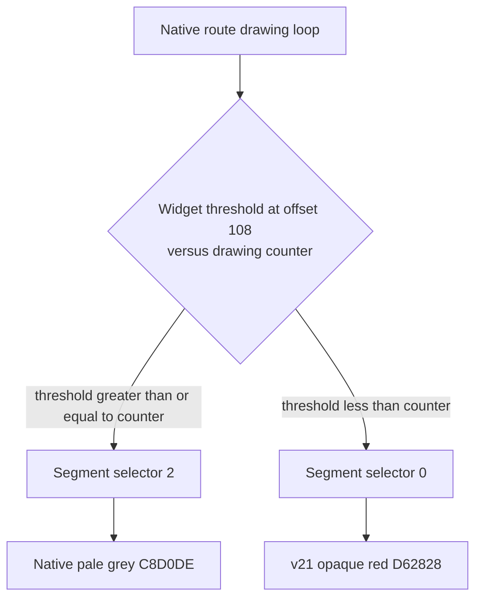
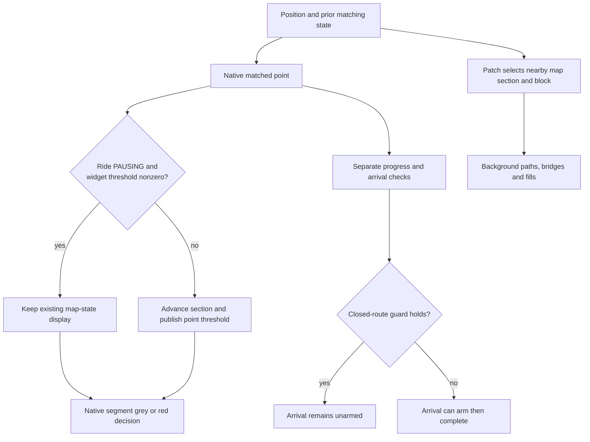

# Grey route: observed symptom and native selection

The owner opened navigation on ordinary v21 and reported grey lines “like I
finished route.” This happened before the subsequent measurement installation.
It is an observation, not a verified completion-state diagnosis. The owner later
identified yesterday's Leichlinger Strasse 23 km route. Current native progress
and a matching live state log are still absent.

Read-only inspection of the pinned firmware establishes this narrower mechanism:

This diagram describes the ordinary route branch with flag bit 16 enabled;
other branches and render modes exist. It does not assign a navigation-state
meaning to the widget threshold before its writers are traced.

| Evidence | Native address | What it establishes |
|---|---|---|
| Drawing counter reset | `0x420561c2..0x420561c7` | The 16-bit value at `0x3fc9fcf0` starts at zero for this drawing traversal; it is not itself proof of accepted navigation progress. |
| Counter advance | `0x42056324..0x4205632a` | The traversal advances the counter before the ordinary segment branch. |
| Threshold comparison | `0x42056397..0x420563ad` | Widget word at offset 108 is compared with that counter; the less-than branch goes to the selector-zero path. |
| Grey selector | `0x420563d3..0x420563e2` | Selector 2 is passed as the seventh argument to the native segment function. |
| Alternate selector | `0x4205640e..0x42056412` | The alternate path passes selector 0. |
| Colour dispatch | `0x4205bec0..0x4205bf08` | Selector 2 loads `0xc8d0de`; selector 0 takes the colour literal patched to red in v21. |
| Opaque line wrapper | v21 `cc_seg` | Changes opacity/width only for the red descriptor and restores it afterward; does not replace the selector-2 grey colour. |

Disassembly was restarted at the actual function entry `0x4205bdf0` and the
branch target `0x4205bedd`; linear decoding through intervening literal padding
is not reliable. Raw firmware and extracted disassemblies remain private.

The next investigation needs the selected route identity, an observed screen,
the live widget threshold and its producing branch, and the corresponding native
navigation/progress state. A completed route, retained progress, an overlap near
the finish, and another display mode must not be treated as interchangeable
without that evidence. Changing all grey segments to red would conceal the
symptom without establishing correctness.

## Threshold producers traced afterward

The threshold is no longer an unexplained widget field. The map-update consumer
at `0x42051656..0x4205165e` copies snapshot word +68 into widget word +108.
Its snapshot comes through `0x4204f01c`, which drains a queue into the destination;
the queue is created for five 84-byte records at `0x4204efb4`. The producer calls
`0x4204f004` at `0x420548fb` with the record at `0x3c38939c`.

At least two producing paths exist:

- `0x4205044c..0x42050466` copies a 16-bit input-state field +108 to snapshot
  word +68 and directly to the widget threshold.
- `0x42054a5d..0x42054a63` copies getter `0x4204b118()` to snapshot word +68.
  That getter reads the separate 16-bit value at `0x3fc9fc24`.
- The teardown path `0x4204cecc` clears the widget threshold at `0x4204cf01`.

The display-index updater `0x4204b048` has an early return when its current index
is already at least list-count minus one. Its other path calculates an index
from list count and the float at `0x3fc9fc1c`. This is a static branch observation,
not proof of a stuck-finish bug: the active producing mode, initialization,
reset writers, and input meaning must be established before proposing a fix.
In particular, neither `0x3fc9fc24` nor the drawing counter should be relabelled
as accepted route progress without tracing that relationship.

## Owner hypothesis: finish selection and missing map detail

The owner reports that the details were present at the start and suggests that
a finish-like state selected coverage too far away. This connects two observed
symptoms and is a testable hypothesis, not yet a confirmed cause.

The v21 loader uses `cc_map_road`: nearest route geometry in the selected file,
with a 25 m distance preference for the firmware-selected section. If start and
finish are close or overlap, a finish section can retain that preference and
select a different block with different surrounding geometry. Without a usable
position, `cc_blk` falls back to the supplied section (clamped to the index).
Conversely, a finish section clearly farther than the preference should lose to
nearby geometry, assuming valid position, file resolution and list state.

Grey colouring uses a separate native widget threshold. Therefore grey route
colour alone does not establish that the loader selected a finish block. The
next comparison should record both the selected block/file-local section and
the native colour threshold at the same position, then compare the two blocks'
path/bridge entries. This should precede changing layer inclusion or budgets.

## Additional initialization trace

Entry-aligned decoding confirms `0x4204b100` is a 16-bit setter for
`0x3fc9fc24`. The raw direct-call scan found one candidate caller, verified
in the surrounding instruction stream at `0x42075f88`. In that widget-creation
path, when getter `0x42044b90()` returns 5, it calls `0x4204d048`, then getter
`0x4204b10c`, then setter `0x4204b100`, before attaching an event callback.
This identifies a possible state-transfer initialization path. Entry-aligned
decoding of `0x4204b10c` confirms its source is uint16 `0x3fc9fc26`, written
alongside the display index by `0x4204b048`. Getter `0x42044b90` reads a different
mode byte at `0x3fc9fb38`; it is not the navigation dispatcher state. The meaning
of its value 5 remains open. A raw direct-call scan
does not exclude indirect calls or direct stores.

The float feeding the separate display-index updater is set by `0x4204b0d8`.
Its verified direct caller `0x4204fd92` computes a ratio using values returned by
`0x420478d0(3)` and `0x4204b0f4`, choosing 1.0 when the latter is at least the
former. It also stores a nonnegative difference at `0x3c389344`. This is another
concrete route to a finish-like display value, but the units and active mode are
not yet established. No live RAM was read and no firmware fix is justified by
these static observations alone.

## Shared start/finish reproduction and captured block fingerprint

The owner identifies the open route as yesterday's **Leichlinger Strasse 23 km**
ride. The acquired route's final block matches every captured work counter:

| Work counter | Start block | Final block | All 131 captured samples |
|---|---:|---:|---:|
| Entries | 819 | 491 | 491 |
| Input geometry points | 4,035 | 2,342 | 2,342 |
| Fill vertices | 1,815 | 1,003 | 1,003 |
| Label storage bytes | 216 | 192 | 192 |

Only the final block in that saved route has 491 entries. This is strong evidence
that the capture drew the final block. It does not establish the native progress
index or colour threshold; neither was included in the measurement record. The
owner's route-name identification is not a fresh device-file byte comparison.

The acquired file's encoded endpoints are about 55.1 m apart, even though they
represent the same departure/return place for the owner. Executing the actual
loader C at the encoded start chooses section 0 with either input section 0 or
111. At the encoded finish it chooses section 111 with either input. Thus final
block selection can be appropriate for current physical location even when
grey completed-route colouring is inappropriate for a newly started session.
The final block fingerprint alone must not be labelled a loader bug.

A separate synthetic closed square with exactly coincident endpoints exercises
the actual C, using nonzero coordinates to avoid the no-position sentinel:

| Position relative to shared endpoint | Supplied section | Selected section |
|---|---:|---:|
| Shared endpoint | Start (0) | 0 |
| Shared endpoint | Finish (3) | 3 |
| 10 m along outgoing leg | Finish (3) | 3 |
| 50 m along outgoing leg | Finish (3) | 0 |
| 50 m along incoming leg | Finish (3) | 3 |

Two characterization regressions now protect this distinction: exact-overlap
selection preserves the supplied section, and the finish preference releases
after sufficient outbound separation while retaining a legitimate arrival.
These tests characterize existing behavior; they are not a fix or evidence
that the native matcher starts with the finish index. All 22 loader tests pass.
Private experiment receipt records source SHA256
`054f9ec908b996a3055e35e24afb136e11f116b841f5f4033997a11d004189e2`.

The next boundary to resolve is the active dispatcher state and the native
matcher/display threshold during this fresh-start case. Prior extraction shows
that states 3/5 take a display path, while 2/4/8/9/10/11 run the matcher; broad
initialization also depends on ride state. The device remains untouched during
this local investigation. Forcing start-block selection or repainting grey red
would erase these distinctions and can break actual arrival behavior.

## Paused map-state update and arrival are separate mechanisms

The entry-aligned branch at `0x4205041a..1d` tests ride-state getter
`0x4203c020()` for value 4. Its target `0x42050470..7e` reads widget word +108:
if nonzero, it returns; if zero, it rejoins ordinary processing at `0x42050420`.
That processing includes section advancement (`0x4204fc30`), camera selection
and publication of the matched point to the display threshold. Thus this is a
hold of the map-state update, not merely a colour override. It does not establish
that the independent matcher stops running.

The stock ride-state table identifies 4 as **PAUSING**, as already extracted in
[the replay contract](../current/native-replay-contract.md). The getter reads raw word
`0x3fc9fb44`, maps 8 to 0, then truncates to eight bits. This is separate from
the navigation state at `0x3fc9fc34` and mode byte at `0x3fc9fb38`.

The photographed pause overlay makes this hold a relevant hypothesis for why
the grey display persists while stationary. It does not measure ride state,
prove how the nonzero threshold arose, or establish behavior after resuming.

Actual arrival has an existing closed-route guard in
[the progress/arrival extraction](../research/progress-arrival-extraction.md). With arrival
state 0 and remaining distance at most 100, the guard holds state 0 when all
four conditions hold: endpoint separation at most 200, current-position distance
sum at most endpoint separation plus 200, total route length greater than that
sum allowance, and ridden distance since baseline at most endpoint separation
plus 100. For this file the last allowance is approximately **155.1 m**.
This protects arrival, not necessarily the matched point or grey display.
An old ride baseline or already-armed arrival state would require different
analysis; neither has been observed here. Grey colour is not evidence of arrival
state 2, and the final block fingerprint is not evidence of a faulty loader.

This shows the ordinary matcher path, not every dispatcher mode. The same screen
can therefore contain a valid nearby map block, a retained grey route display,
and an arrival state that has not completed. The diagnostic must identify which
combination is actually present.

## Bounded state diagnostic prepared locally

The new optional measurement mode `navigation` adds separate `CC7N1` records
after the iterator interval. It reads only fixed scalar storage: raw ride state,
navigation and arrival states, firmware section, matched point/road and flags,
display indices, and the producer snapshot threshold. Repeated navigation,
point and threshold reads can expose some concurrent updates; equal repeats
do **not** make the observation atomic. It deliberately avoids following the
widget pointer, so the producer threshold is not claimed as the live widget word.
No GPS/speed injection, route-state writes or allocation is added.

This mode runs only when the map iterator and existing readiness, bounded boot
window and stack gates permit it. It cannot recover RAM from the current ordinary
v21 session. Installation resets the device and needs one coordinated reopening
of this route, followed by the existing exact full-partition restoration. The
candidate is not a navigation fix. Its subsequent controlled installation and
restoration are recorded below.

## Controlled on-device state capture

After the owner confirmed availability, the exact live v21 partition matched the
saved full backup. The temporary cc21n01 image was installed and verified. The
owner reopened navigation after the test boot and confirmed it had started.
The runner stopped automatically after **20 checksummed navigation records**,
alongside 20 iterator records, with zero parser rejections.

| Fixed scalar observation | All 20 records | Interpretation |
|---|---:|---|
| Navigation dispatcher state | 2 | Matcher branch is active; not the alternate 3/5 display branch |
| Raw ride state | 4 | PAUSING |
| Arrival state | 0 | Not armed or completed in these samples |
| Firmware section / matched road | 112 / 112 | End-like section selection; do not equate global IDs with file-local array indices |
| Matched point | 720 | Same value in repeated point reads |
| Producer snapshot threshold | 720 | The ordinary matcher-to-display path is publishing this value |
| Separate display/retained indices | 0 / 0 | The fractional-progress display-index path is not producing 720 here |
| Matcher committed off-route / validity / candidate | 0 / 1 / 0 | Normal valid matching, no committed off-route state |

Repeated fields agreed in every record; observations remain non-atomic. Scalar
read brackets were 21–25 microseconds. These are not complete frame timings.
Iterator work remained 491 entries, consistent with the previous final-block
fingerprint. The historical log contains multiple native list sizes, including
721 and 870; its `PIndex:720` event occurs with count 870. Therefore **720 alone
must not be called the final point**. Native point indices belong to a changing
loaded list, not a fixed whole-file point array. The present capture does not
read the active list count or fresh file bytes. The end-like section and map
fingerprint remain relevant, but do not close this identity/domain gap.

The startup log additionally records `SetNavigationStartRidingDistance` with
both route cycling baseline and total distance equal to 0. This makes an old
nonzero ride-distance baseline unnecessary to explain this reproduction; it is
not a continuous measurement of those values throughout the sample interval.

This closes an important boundary: **native valid matching publishes 720 to the
grey/red progress threshold while arrival remains 0**. The separate display-index
getter and actual-arrival completion are not the source in these samples. Pause
retention can sustain the already nonzero display threshold. The stationary
position/heading, exact first-match transition and native overlap arbitration
still need an explicit departure-versus-arrival contract before patching progress.
Do not force red, section zero or unconditional matcher reset: each can break
legitimate arrival, mid-route entry or ride resume.

Raw capture SHA256:
`132be9f51546a3bd6883ec03181c2c3001d5605da3bf4bff3027aa9f0088c189`.
The runner restored the **exact full ordinary v21 partition**, verified readback
and unchanged OTA metadata, and observed its normal app boot without a captured
crash. `ordinary_restored` is true. No simulation input or route/ride storage
writes were performed by the tools. Ordinary v21 remains installed; this capture
is diagnosis, not a deployed fix.

## Fresh file and first-match evidence acquired during cc22 installation

The subsequent read-only storage acquisition contains the selected route file
with exactly the saved 23 km file's SHA256
`87a8ac2ea0a4a7d599cb1407b1020fddb5c8506367ea712e919a8b6d35032a75`.
The route identity gap is now closed for this acquisition. The current log names
that file and records 112 sections and 113 basic inflection points at fresh start.

The first matcher update records `AllPointNum:721,road:0,Start:0,End:721`, then
`PIndex:720` and selected-point distance 23. The ride then enters automatic pause.
Later entries repeatedly pair active count 721 with section 112 and point 720.
This establishes final-loaded-point selection for this fresh reproduction;
unlike the earlier historical comparison, the count and selected index now occur
in the same startup sequence. It also shows that a previously retained section
112 is not required: the first matcher input is section 0. Inflection-list count,
full decoded-point count, file-local section and global section remain separate.

The matching policy must distinguish fresh departure near the shared origin
from legitimate return, resume or nearby mid-route entry. Painting grey red or
forcing a loaded-list point zero would bypass this requirement. The cc22
installation applies only the separately verified stale-guidance fix; this
endpoint-association defect remains open. Device firmware is now ordinary cc22,
with no diagnostic collector; its readback and boot are verified.
