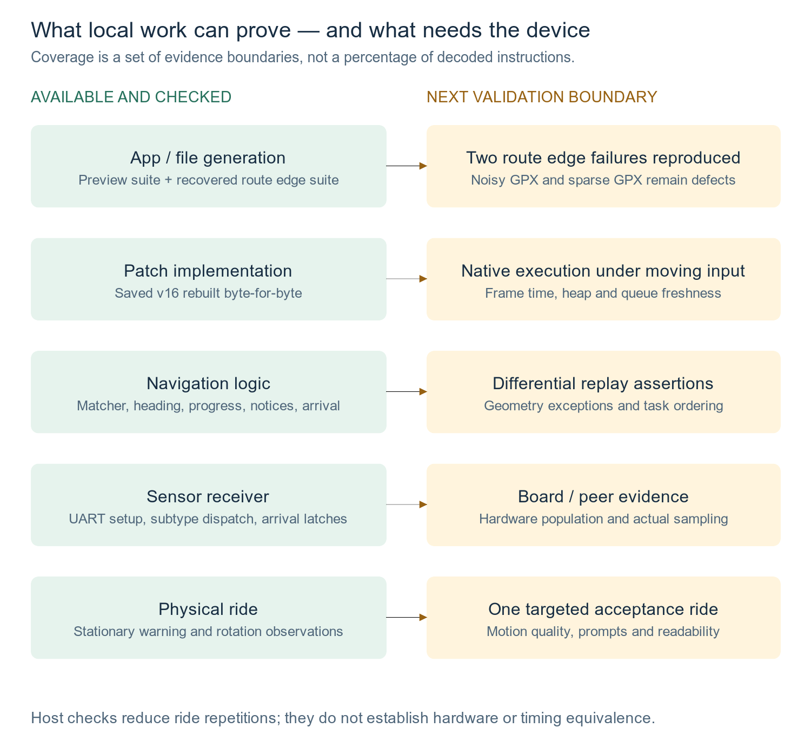

# CC700 mining closure and validation order

**Map-budget continuation, 2026-11-14:**
[behavior and tuning budget](../current/map-limits.md) provides current settings, actual
block costs and a reusable `tools/map_budget.py` calculator. The acquired route's
largest decoded block payload is 56444 bytes; the conservative map load-overlap
plus canvas component is 246744 bytes before allocator overhead and other
subsystems. Iterator work counts are cross-checked against actual map C. Current
entry/point/span thresholds are generation policies, not proven device ceilings;
frame/lock time and largest available allocation remain target measurements.

**Development-loop continuation, 2026-11-14:**
[current local-validation boundary](../current/repeatable-validation.md).
Original OSM node identities and geometry are now preserved separately from
visual generalization. Recovered raw input proves the disputed short right
turn is real; suppressing it would be a regression. Fresh offline app startup
is tested including every local static dependency. The broad firmware-emulation
experiment booted v18 but stopped at an unmodeled LCD completion event; it is
kept outside the routine development loop. Native tracing has a tested private
core and allocation candidate, not an installed full collector. No physical
device access occurred in this continuation. Feature work can use the bounded
local loop, with targeted device acceptance for physical/performance outcomes.

**Repeatable-validation continuation, 2026-11-14:**
[one-command local checks and the remaining target boundary](../current/repeatable-validation.md).
Actual renderer C now runs under memory sanitizers, extracted state contracts
are executable, and native replay observations have explicit identity/latency/EOF
checks. The combined command preserves known failures. Bounded generator changes
preserve the reference route's full 15-turn vector; general noisy/sparse cases
remain unresolved. New static mining establishes that the native activation's
resume path can truncate recording FIT/lap files, so replay needs an isolated
recoverable activity. No device access/write occurred in this continuation;
installed firmware remains v18. This supersedes earlier generator-restored and
local-test-count statements below.

**Implemented continuation, 2026-11-14:** [v18 implementation and release state](../releases/v18-implementation-2026-11-14.md).
The two v17 loader failures and the related arrow-domain/lifetime defects are
corrected in a reviewed cc18 candidate. All 31 Python and five preview checks
pass. The acquired ride executes the full loader/gate through host adapters with
zero absent vertex-coverage samples, three block switches and no indexed point
lookups. Source is promoted and v16/v17 artifacts preserved. The owner approved
installation: v18 is now written to `ota_1`, readback verified, and booted through
RTS with no captured panic or repeated reset in the eight-second observation.
A fresh byte-exact v16 partition backup is retained. Target timing and motion
acceptance remain runtime checks.
The generator investigation did not produce a reliable complete fix; its
candidate remains unshipped and the original noisy/sparse failures remain open.

**Prior review, 2026-11-14:** [v17 mining, review and offline corrections](../releases/v17-review-2026-11-14.md).
The ride identifies a point/section mismatch and the off-route map gate, but v17
still has two reproducible loader selection failures. Its build is reproducible;
it is not ready for flashing. Replay callback/FIT parsing and missing-evidence
accounting were corrected locally, with 10 passing regressions. The immediate
work order is now: correct section-domain selection with sequential traversal;
exercise the actual loader across normal/combined file types; then measure target
rendering costs and do acceptance validation. The older generator failures remain
open. No device access occurred in this latest review; v16 remains the last
reported installed firmware.

2026-11-13; application `24b8617`, stock V1.414 and saved patch v16.
This is the current entry point. Earlier reports retain their evidence dates;
the follow-ups linked here supersede their older “not yet extracted” statements.

Previous continuation: [route incident, verified cleanup and current replay boundary](../research/native-replay-current-storage.md),
with [exact configuration/activation guards](../current/native-replay-contract.md),
[synthetic FIT candidates](../research/native-fit-fixture.md), and [current-storage access limits](../current/device-storage-access.md).
The nominal RTOS rate is established. The three-file replay fixture initialized,
but the generated route was geographically remote: the owner reported a 5,138 km
label and restart. All three test files were removed from a fresh storage sync;
three changed blocks and the full partition checksum verified. RTS reset booted
the app. The crash cause and FIT decoding remain unconfirmed/untested.

The necessary local mining pass has been consolidated: recovered history and
tests, reproducible patch preservation, navigation branch extraction, geometry,
popup/reset/replay lifecycle, and the ESP32 sensor transport boundary. This is
**not full firmware or simulation coverage**. Known defects remain, and hardware
population, concurrent execution and runtime budgets require different evidence.

## Results that change development decisions

| Finding | Evidence | Consequence |
|---|---|---|
| Stock off-route draw gate remains in v16 | [Firmware mining](firmware-mining-2026-11-13.md) | Position-based block loading alone cannot guarantee detour map visibility. |
| Stationary heading selects GPS/magnetic/cache through separate validity rules; GPS threshold is 3 knots | [Heading extraction](../research/navigation-behavior-extraction.md) | A single assumed “3 km/h pause” rule cannot represent this behavior. Automatic pause is a separate mechanism. |
| All three sampled magnetic/inertial arrival latches were zero after rotation | [Sensor boundary](../research/sensor-boundary-audit.md) | No functioning compass has been demonstrated. Compiled algorithms and allocated IMU context do not prove hardware population. |
| `ImuDisable.txt` affects downstream cycling processing | [Sensor boundary](../research/sensor-boundary-audit.md) | It is not a justified sampling-enable switch. No sensor activation write is prepared or recommended from that evidence. |
| Startup warning has separate notice, popup, matcher and timer lifetimes | [Popup observations](popup-and-sensor-followup.md), [lifecycle](../research/lifecycle-audit.md) | Current on-route state does not automatically remove the earlier warning. The ordinary +2 GUI clock path never reaches the max-period expiry value. |
| Arrival notice 9 can end navigation on timer expiry | [Lifecycle](../research/lifecycle-audit.md) | The immediate course-record event and the later navigation-end action must both be represented. Neither proves ride recording stops. |
| Geometry includes zero-component rejection, endpoint omissions and an unguarded fit division | [Geometry audit](../current/geometry-boundary-audit.md) | A conventional robust nearest-segment model changes behavior and cannot serve as a firmware oracle. |
| Replay's 1000 delay is RTOS ticks; EOF can retain active GPS redirection | [Lifecycle](../research/lifecycle-audit.md) | File playback needs explicit timing, EOF and freshness assertions. It is not proven one-record-per-second motion. |
| Existing app edge suite still fails two cases | [Local validation](local-validation-audit.md) | Noisy GPX yields 46 prompts versus baseline 15; sparse GPX yields 5. These need generator work rather than more firmware speculation. |
| Current patch sources reproduce saved v16 exactly | [Preservation below](#preservation) | There is now a preserved, reproducible baseline for a controlled change. |

## What ran locally

- Preview tests: **5/5 pass**; current JavaScript syntax checks pass.
- Recovered historical route cases: **10/12 pass**, with the two failures above.
- Offline cache/failure probes: **4/4 pass** for the stated cases.
- Stock/styled synthetic approximately 70 km builds round-trip 117 records,
  at most 31 points per record, each with geohash field 8, below the 4 MB guard.
- Actual patch nearest-section C function: **9/9 policy probes pass**, including
  hysteresis, ties, parallel sections and a degenerate chord. These are checks
  of its policy, not proof that the chosen branch is correct for every ride.
- Actual patch host renderer compiles and renders a synthetic entry. Fonts,
  target projection, allocation, stock UI and timing remain outside that bench.
- Geometry, sensor-boundary and lifecycle additions have independent GNU
  instruction-boundary/direct-branch checks and stock/v16 range equality.

Details, commands, input provenance and exclusions are in the linked audits.
No app or firmware behavior was changed to make these checks pass. No additional
device halt, reset, packet injection, storage write or firmware write occurred
in this closure pass; existing post-rotation records already covered the arrival
latches, so another stationary sample would add little information.

## Finite work order from here

| Order | Work and observable exit condition | Why it comes here |
|---|---|---|
| 1 | Fix the two deterministic generator cases against labelled expected junctions; retain both as reproducible regressions. | Cheap host iterations; these failures are already reproduced and do not need rides. |
| 2 | Build a narrow differential harness around the extracted state transitions and existing C host seams. Assert selected point/road, candidate and committed off-route, notice/popup, heading source, arrival and reset separately. | Avoid spending effort on a whole-board emulator before an oracle exists. A model must disclose unsupported branches and float/scheduler differences. |
| 3 | Validate native FIT replay on the device with known records; establish tick rate, decoded/published/consumed record identity, queue drops and EOF/deactivation behavior. | Executes real firmware and reduces repeated rides. Activation requires the storage workflow below. |
| 4 | Run a dense replay/load matrix and measure frame duration, allocation peaks, largest blocks and queue freshness while exercising start/end/restart and off-route transitions. | Existing heap samples and host timings cannot establish device capacity. Thresholds become measured budgets here. |
| 5 | Resolve compass capability from board-specific information, matching peer firmware or observed subtype traffic; keep this independent of GPS replay progress. | No further ESP32 mathematical routine can reveal an absent peer image or establish physical board population. |
| 6 | Perform one targeted acceptance ride covering unresolved motion/physical outcomes after replay assertions hold. | Reserve the ride for GNSS quality, real heading behavior, prompt usability, finish behavior and sunlight readability. |

This order does not require finishing optional night colors, fonts, POIs, auto-zoom
or map retention across reroutes. Those are feature choices, not prerequisites
for understanding current behavior. It also does not require disassembling every
unrelated firmware subsystem.

## Native replay acceptance cases

The following is the bounded runtime matrix; it has **not yet run on target**.
Use known input identities and compare stage outputs, not just a moving screen.

| Input or transition | Required observations |
|---|---|
| Monotonic forward track and close turns | Decoded record identity, consumed position, point/road progress, prompt order and text, selected block |
| Stationary, threshold speed, exact north, invalid fix | GPS units/qualification, heading source and cache, separate pause state; magnetic validity kept explicit |
| Detour and rejoin | Raw candidate, repeat counter, committed flag, map load and draw visibility, notice/planning state |
| Reverse/parallel/crossing/loop/curved section | Point/road arbitration and block selection independently; identify ambiguous expectations before judging output |
| Duplicate/gapped timestamps, replay pause, EOF | Logical time, retained versus fresh records, queue delivery and active getter redirection |
| Arrival, dismiss, expiry, restart and route replacement | Notice/popup/timer, arrival, navigation and ride state separately; map teardown/reload and allocation lifetime |
| Dense/long file, interrupted operation and allocation pressure | Completion/error propagation, frame duration, heap minima/peaks/largest blocks, cleanup and responsiveness |

A replay must fail explicitly on missing evidence or an unsupported branch.
GPS replay does not cover physical magnetic input, BLE radio reliability,
sunlight readability, or every possible task interleaving.

## Preservation

Private sources, stock/saved images, rollback blocks, mining scripts/traces and
local validation inputs/results are preserved under
`.local/cc700-evidence-20261113/`, excluded by `.gitignore`. Its manifest records
file lengths and SHA-256 values; copying was byte-verified. The preserved sources
were rebuilt from that directory: both the **16,204-byte ELF** and **3,749,872-byte
image** match their saved v16 artifacts byte-for-byte. Image SHA-256:
`2af9c21a3c693c71fed1ffe26ed72ada545e7609c3a47c6dedcfe6c1e7fae8d5`.

This is durable local preservation outside temporary storage, not an independent
off-machine backup. Historical rollback blocks contain old storage state and
are **not a safe current restore plan**. Never apply them without reconciling
fresh device storage. The public reports/manifests contain no private tracks or
live heap pointers.

## Authorization boundary

Native replay activation is not a read-only observation: it can require device
configuration/files and initialization changes. The owner's existing workflow
requires approval for firmware/storage writes, fresh storage synchronization
before editing, and changed-block verification. The owner subsequently approved
the specific storage-read interruption and requested reset recorded in the latest
report. The owner then separately approved the six-block installation, one final
reset and initialization checks; that installation verified successfully.
Coredump contents, breakpoints, function injection and synthetic replay into an
unfinished ride remain outside those approvals.

A current-state file/block diff, compatible FIT/config fixtures and paired
rollback were prepared and the approved installation is complete. Physical
power-on/initialization, activation and runtime validation remain outstanding.
A later write must still abort if current storage differs from its prepared base.
