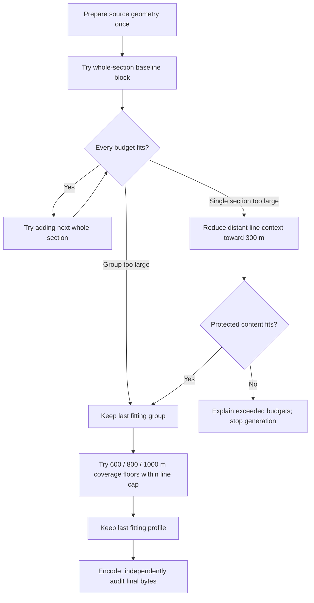

# Adaptive map budgets

The Pages generator now admits styled map blocks by their encoded bytes,
extracted target allocation layout and drawing-work estimates. The ordinary
800/1,200-entry policy still applies to stock-compatible maps; it no longer
rejects a styled block solely because of its entry count. Firmware remains v21.
Regenerate and transfer a route to use the new block selection.

## What is protected

- Native route points, maneuver decisions, names, captions and rough-route
  association use the original mandatory OSM cells. Optional display cells
  cannot change that navigation input.
- Nearby enabled line geometry retains its existing resolution and widths.
  Baseline class ranges are tried first. If a single native section exceeds a
  budget and cannot be split, only distant line context is reduced, through
  800/600/450/350/300 m caps. The page reports these dense areas.
- Area windows retain at least their original 600 m extent. Reducing a polygon
  window can remove real shoreline/green-area outlines, so area clipping is
  not used to rescue an overloaded dense section. Geometry is not simplified
  further to make it fit.
- Arrows, rough overlays, labels and symbols count before block admission.
  An overloaded protected minimum produces an explicit error, not silent
  omission. Existing routes on the device are not rewritten.

The 300 m line minimum is a selection policy, not a promise that missing OSM
features or every possible detour have been covered. Missing optional cells
are reported and do not break an otherwise cached route. Interpolated points
request optional display cells between sparse GPX points; the original endpoint
cache dependencies remain sufficient for baseline offline navigation.

## How spare capacity is used

Each budget must fit independently. Spare memory cannot compensate for excessive
projection work. Nested expansion uses spare capacity for outer cycleways,
waterways, roads and areas, with unchanged geometry resolution and styling.
A dense block may have no spare capacity for expansion. More/smaller blocks also
repeat overlapping context and can increase the route file size; the existing
4 MB app guard remains.

| Constraint | Working limit |
|---|---:|
| Serialized block, including record prefix | 65,536 B |
| Decoded entry/coordinate payload | 57,344 B |
| Decoded payload plus iterator/projection scratch | 65,536 B |
| Iterator scratch | 4,096 B |
| Projection callbacks, including conservative overlay allowance | 1,400 |
| Projected points | 7,000 |
| Total fill vertices | 2,304 |
| Packed label bytes | 384 B |
| Any old/new block transition plus map canvas | 245,760 B |

These are conservative engineering targets near the inspected ride, **not
hardware maxima or measured frame-time guarantees**. The estimator uses 28 B
per entry and 8 B per stored coordinate pair. It reports the largest projection
and iterator scratch, fill-edge work bound and separate overlays. It excludes
allocator headers, unrelated native allocations, pixel rasterization time,
locks and scheduler behavior. The source is
[`js/map_budget.js`](../../js/map_budget.js); the independent existing Python
calculator is [`tools/map_budget.py`](../../tools/map_budget.py).

The initial implementation protected every old outer radius. A real cached
section then required 69,389 serialized bytes and 1,408 projection callbacks,
so even one section failed the new targets. The implemented minimum-first
policy adapts distant line context rather than raising those targets. A second
review caught and fixed optional-source navigation contamination, sparse-cache
breakage and polygon outline loss before release.

## Validation and remaining boundaries

Synthetic regressions exercise blocks with 1,250 cheap entries, independently
binding budgets, dense-section fallback/rejection, full-resolution nearby
geometry, preserved area outlines, expansion to 1 km, arrows/rough overlays,
arbitrary block jumps and deterministic encoded readback. Source tests include
long crossing roads, containing polygons, missing optional cells and native
record isolation.

Final local results: **129 Node tests pass, one known noisy-GPS TODO remains;
121 Python tests pass**. All seven offline probes pass, including stock/styled
70 km generation/readback. The actual loader replay has zero absent coverage
proxies across 576 samples; this is not proof of rendered visibility.

Three cached real-source cases—outbound, reverse and out-and-back—are regenerated
and decoded. Their native navigation/name bytes remain identical to the previous
generator. Independent Python decoding agrees on every JS allocation/work cost,
including the additional conservative class-15 allowance. The stock-compatible
comparison remains byte-identical except for its generation timestamp.

| Cached case | Blocks before → after | Route bytes before → after | Dense blocks with reduced distant lines |
|---|---:|---:|---:|
| Outbound | 4 → 9 | 299,008 → 524,288 | 4 |
| Reverse | 4 → 9 | 299,008 → 520,192 | 4 |
| Out-and-back | 8 → 17 | 589,824 → 999,424 | 8 |

These dense cases have **no spare capacity for expanded coverage**. They now fit
the separate working budgets through smaller blocks and reduced distant line
context. The maximum transition payload estimate is 237,317 B. The synthetic
sparse regression does reach the 1 km profile and retains outer cycleway/waterway
geometry. Wider coverage is conditional, not a promised gain on every route.

The combined local validator keeps the existing noisy-GPS TODO and the two
historical noisy/sparse maneuver failures visible. It also runs Python/host-C,
map/preview/source tests, offline 70 km generation/readback and the 576-sample
real-ride loader replay. Browser checks preserve the 240×320 display and its
separate 240×256 map at three widths. These checks do not certify whole-device
simulation or 70 km device endurance.

Target frame/lock/allocation measurements remain open. Detour guidance,
rejoining decisions, noisy maneuver association and live phone rerouting are
separate work; adaptive map budgeting does not resolve them.
