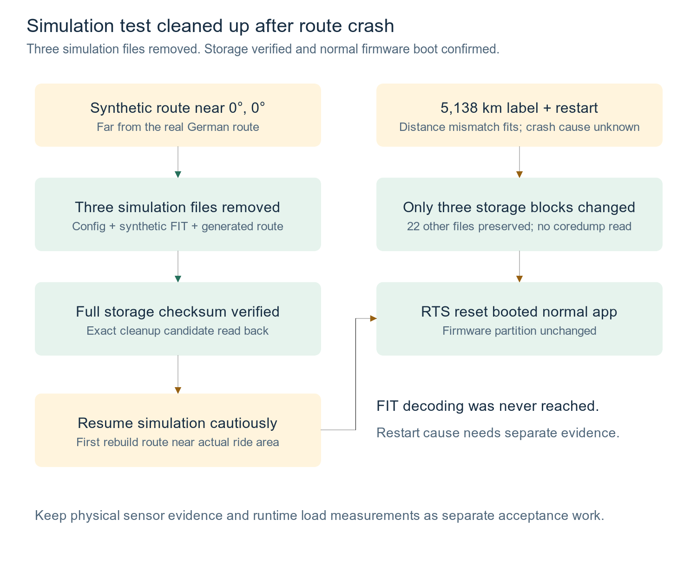

# Native replay: installation, incident and cleanup

## Latest status: simulation files removed, device booted

After `00-replay-probe.fit` was selected with a 5,138 km distance and the
device restarted, the synthetic route coordinates were checked. They are near
0° latitude/longitude, far from the real German route. A distance in the
thousands of kilometres is consistent with that mismatch. The exact displayed
distance depends on live position and firmware calculations. The restart's
cause is still unconfirmed. The synthetic route should not have been offered
for a live navigation test before it was placed near the actual route.

The owner approved cleanup. I acquired a fresh full-storage image, verified that
the three test files still matched the installed copies, and built a removal
candidate against that image. It removed only the test config, FIT and route.
All **22 other non-crash file contents** were hash-checked unchanged; coredump
contents were not opened. Only **three 4 KiB blocks** changed, with an exact
rollback to the fresh pre-cleanup image. The device read back all three blocks,
the full partition checksum matched, and the documented RTS reset reported
“Loaded app from partition at offset 0x440000”. The simulation files are now
cleaned from storage and normal firmware boot is confirmed.

The firmware itself was never changed. Do not reuse the cleanup rollback image
if storage has since changed; synchronize before any future storage write.

## Previous status: initialized, FIT selected, replay inactive

The owner subsequently approved installation. The first freshness check refused
the old base **before any device write**. Read-only synchronization updated 59
local blocks and verified the complete current partition checksum. That newer
state had neither recovery-session file, 383 allocated blocks and 36 existing
file/directory metadata entries. The same three additions were rebuilt against
it; 20 existing non-crash content hashes and all existing metadata were preserved.
The revised candidate still changed six blocks, with exact paired rollback;
allocation became 386 blocks.

**Installation then succeeded.** All six programmed blocks were read back
byte-for-byte, and the complete storage-partition checksum matched the revised
candidate before the one final reset request. Firmware partitions were not
programmed. Raw transfer logs and the installation receipt remain private.

The hard reset left the device off. The owner pointed out that its documented
RTS reset starts it. Using that procedure produced the boot-ROM line
“Loaded app from partition at offset 0x440000”. A bounded debugger sample then
found both cores running before and after the read, with a 131 ms halt/read/resume
window. All five configuration slots were populated as intended, all seven
replay buffer pointers were nonnull, and the source table contained exactly one
entry, selected index zero: `00-replay-probe.fit`. The replay-active flag was
zero. This confirms parser/buffer/source enumeration initialization, not FIT
decode, record delivery or replay activation.

An earlier sample, taken before the RTS reset, did not find normal application startup:
CPU1 examination failed, external-RAM reads returned the debugger's invalid-read
sentinel, and replay buffer globals were zero. The sampler reported CPU0 running
and CPU1 halted/unexamined afterward; this is not a healthy dual-core application
sample and cannot prove parser failure or initialization success. No further
activation was attempted from that pre-boot state.

The historical six-block candidate and acquisition are retained under private
`previous-base/`; they must not be used to restore this installation. Current
paired blocks correspond to the synchronized base. No recovery-file edit or
synthetic ride activation was performed. Target decoding remains untested.

## Earlier acquisition and preparation record

2026-11-13. The owner approved the prepared interrupting storage read. It
completed successfully: **7,987,200 bytes** from `0x860000`, followed by
esptool's requested RTS reset. No flash/storage programming or erasing was
performed. Application restart has not been observed; the recorded long-press
power procedure may still be needed.

## Current-state findings

| Check | Acquired state | Meaning |
|---|---|---|
| Replay configuration | Absent | Replay is not configured by this file. |
| Replay FIT directory | Present, empty | There is no current replay source here. |
| Primary and backup recovery files | Both present, 468 bytes each | A resume prerequisite exists; validity and successful loading remain untested. Contents were hashed for preservation, not parsed. |
| Filesystem block accounting | 378 / 1,950 blocks allocated | 6,438,912 bytes, about 6.14 MiB, are unallocated blocks. This is not a guarantee of equivalent writable payload capacity. |
| `/APP`, `/TMP` | Empty | No peer-firmware candidate was found in these directories. This does not establish physical sensor population. |

The private acquisition has exact-length and SHA-256 records. The offline
inventory mounted successfully and left its in-memory image byte-identical.
No coredump contents were opened or decoded. Private route names, storage bytes
and device identifiers remain in ignored local evidence.

## Exact proposed file changes

These were the temporary simulation additions, now removed as described above:

| Path | Bytes | Purpose |
|---|---:|---|
| `/ModuleDataTest/ModuleDataTest.cfg` | 145 | Five positional rows: replay gate true, both optional prescans off. |
| `/ModuleDataTest/FitFile/00-replay-probe.fit` | 1,339 | The CRC-checked minimal 61-fix synthetic track; one source avoids multi-file selection ambiguity. |
| `/NAVIGATION/route_26111301.bin` | 4,096 | Matching quantized coordinates and right/left prompts. Name bitmaps are blank test stand-ins. |

The installation candidate changed **six 4,096-byte storage blocks**, including filesystem
metadata. Candidate allocation is 381 blocks. The offline checks established:

- All 37 existing file/directory metadata entries retain their type and size.
- All 21 existing non-crash files retain their content hashes.
- Exactly the three intended paths were added, with exact content readback.
- No coredump contents were included in content comparisons.
- Replacing the six changed blocks with their paired original blocks reproduces
  the entire acquired storage image byte-for-byte.

Private artifacts and reproducible scripts are in
`.local/native-replay-readiness/`: `inventory.py`, `prepare_delta.py`, the
acquisition, candidate image, paired before/after blocks and manifest. No device
writer had been invoked at this preparation stage. No recovery file is edited
by this candidate. See the latest status for the subsequent approved install.

## Installation and rollback conditions

The owner handoff (private: `~/cc700-backup/HANDOFF.md`) explicitly says:
“Before a flash or storage write, ask the owner.” Installation approval has been
requested separately from the approved read. It covers the six-block candidate,
one requested reset and initialization checks, not replay activation or alteration
of an unfinished ride with synthetic GPS.

Before any write, compare current full storage with the acquired base while
the application is stopped. **If it differs, abort and synchronize/rebuild the
candidate; do not write the stale blocks.** Verify local candidate/block hashes,
physical storage bounds and all preconditions before programming. Read back and
verify every programmed block and the resulting partition before restart.

The paired original blocks are an exact local rollback for this candidate,
not a general future restore. If the application has changed storage after the
candidate was installed, restoring old blocks can damage filesystem metadata
or discard newer activity. Synchronize and prepare a fresh logical removal
instead. Partial-write failure also needs a stopped-device reconciliation,
not a blind reset or automatic rollback.

## Remaining acceptance boundary

After an approved installation, first observe parser/configuration state,
allocation pointers, filename count and selected source. Do not assume a
successful boot demonstrates FIT decoding or replay activation.

The [activation contract](../current/native-replay-contract.md) requires successful
resume/loading. A normal new ride deactivates replay. The files needed for a
synthetic test are now removed. No recovery-file edit, injected function call
or forced activation was included.

To test replay, firmware must reach its `LOADING`/resume branch. A normal new
ride explicitly deactivates replay, and current storage has no recovery-session
files. No valid resume path is presently established. Therefore native
decode/publish/consume identity, route progress, heading selection, off-route
transitions, EOF/deactivation, queue freshness and runtime load remain
unvalidated. Do not call fixture initialization full simulation coverage.
