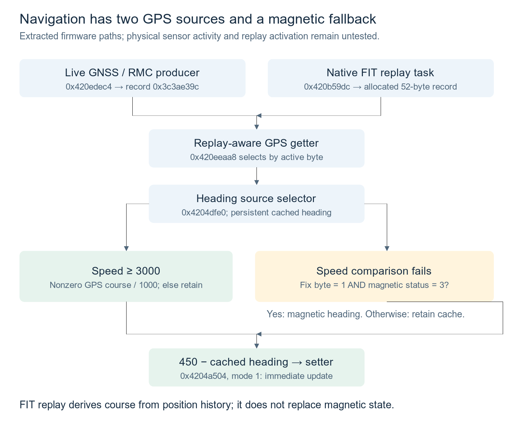

# CC700 navigation behavior extraction

Follow-ups: [geometry](../current/geometry-boundary-audit.md), [timer/reset/replay lifecycle](lifecycle-audit.md),
[sensor/peer boundary](sensor-boundary-audit.md), and [consolidated status](../reports/mining-closure.md).
These supersede the corresponding earlier unresolved local branches below.

Evidence date: 2026-11-13. This is an extraction ledger, not a claim that the
whole firmware has been understood. It supplements the
[firmware mining report](../reports/firmware-mining-2026-11-13.md). No device was accessed.

The immediate correction to the earlier simulation discussion is methodological:
extract producers, consumers, branches and persistent state before replacing them
with a model. A plausible simulator rule is not evidence of device behavior.

## Evidence and scope

The reference is the imported stock `ota_0.bin`, SHA-256
`7545ae4d4030b24b1f6198f481ce3a9a183a0e6eb3e5355b86ad2413aead2c31`.
The saved v16 image has SHA-256
`2af9c21a3c693c71fed1ffe26ed72ada545e7609c3a47c6dedcfe6c1e7fae8d5`.
Addresses below are virtual firmware addresses. Names inferred from strings are
labels; addresses and instructions are the evidence.

Stock and saved v16 bytes were compared over these half-open intervals and match:

| Interval | Mechanism |
|---|---|
| `0x4204a504..0x4204a55e` | Heading setter |
| `0x4204dfe0..0x4204e04c` | Heading source selector |
| `0x420eeaa8..0x420eeabc` | GPS getter and replay redirect |
| `0x420b4fcc..0x420b5e40` | Replay accessors, configuration, control and task body |
| `0x4203b9d8..0x4203bd08` | Sensor packet dispatcher |
| `0x42141f34..0x421423b5` | Magnetic processing and input wrapper |
| `0x42148620..0x421489bc` | Magnetic status progression and parameter restore |

GNU Xtensa objdump was used alongside the local cross-reference decoder. A
missing direct caller does not establish dead code: the magnetic input wrapper,
for example, is invoked indirectly through a literal-loaded function pointer.



## GPS is already replaceable through a native getter

The getter at `0x420eeaa8` implements this selection:

```c
if (replay_active())                 // 0x420b4fcc: byte at 0x3c38edb8
    return replay_gps_record();      // 0x420b51c0: pointer at 0x3fca27e4
return (GPSRecord *)0x3c3ae39c;
```

Navigation heading selection calls this getter. Therefore the compiled replay
path can supply that consumer's GPS input; this is stronger evidence than merely
finding a test filename. File compatibility, configuration and successful runtime
activation have not been tested on the device.

The record is 52 bytes. Only the following fields are assigned meanings here:

| Offset | Representation | Extracted use |
|---|---|---|
| `+0` | byte | Altitude-related validity; replay tests a source `uint16` against `0xffff` |
| `+1` | byte | Position validity; selector requires exactly 1 for magnetic fallback |
| `+4` | signed integer | Replay altitude conversion: integer division of source by 5, minus 500 |
| `+12` | signed integer | Longitude in degrees × 100000 |
| `+16` | signed integer | Latitude in degrees × 100000 |
| `+20` | 32-bit integer | Replay timestamp plus `0x259d4c00` |
| `+24` | float | Live RMC speed × 1000, subject to producer filtering |
| `+48` | integer | Course/heading in degrees × 1000 |

Unlisted bytes remain unresolved here. The full GNSS producer has additional
fix qualification, speed suppression, altitude and quality gates; this table
does not imply every parsed fix is published unchanged.

### Live speed producer and heading units

`0x420edec4` processes received GNSS sentences. The RMC branch at
`0x420ee51d` calls `0x420ef998`, whose parser format is `tTcfdfdffDfd` and whose
sentence check is `RMC`. The field at parsed-record `+36` is converted to float,
multiplied by 1000 at `0x420ee570`, and stored at GPS `+24` at `0x420ee5a0`.
The next field, parsed `+44`, is multiplied by 1000, truncated and stored at
GPS `+48` at `0x420ee5f8`.

This layout and format match the RMC parser in the primary
[minmea implementation](https://github.com/kosma/minmea/blob/master/minmea.c).
The parser identity is an inference from matching implementation structure;
the firmware field accesses and multiplications are direct binary evidence.
The [RMC speed field is in knots](https://docs.novatel.com/OEM7/Content/Logs/GPRMC.htm),
making the selector's threshold 3000 correspond to
3 knots, approximately 5.56 km/h, rather than 3 km/h. The firmware itself uses
the coefficient **1.854** in its speed arithmetic; preserve that literal when
reproducing its behavior instead of substituting the conventional 1.852.

The replay producer independently writes:

```c
gps.speed = (float)((double)fit_speed_raw * 3.6 / 1.854);
```

The double constants and ROM arithmetic calls are visible at
`0x420b5b8f..0x420b5bc1`. ROM helper identities are checked against
[Espressif's ESP32-S3 libgcc symbol map](https://github.com/espressif/esp-idf/blob/v4.4.8/components/esp_rom/esp32s3/ld/esp32s3.rom.libgcc.ld).

## Heading selection: complete local branch table

Function `0x4204dfe0` preserves a cached source heading at `0x3c38933c`.

| Condition, in evaluation order | Action |
|---|---|
| GPS float `+24 >= 3000`, GPS integer `+48 != 0` | Cache `float(course) / 1000` |
| GPS float `+24 >= 3000`, course equals 0 | Keep cached heading |
| Speed comparison fails, GPS byte `+1 == 1`, magnetic status equals 3 | Cache magnetic heading from `0x42141c04` |
| Speed comparison fails and either fallback condition fails | Keep cached heading |

Every path then writes navigation context byte `+78 = 1`, context float
`+40 = 450 - cached_heading`, and calls `0x4204a504` with **mode 1**.
The fast branch does not separately test GPS validity in this function.
A course of exactly zero is treated as no update by this consumer, even though
zero is a geometrically valid north bearing. This is an extracted edge case,
not a proposed correction.

IEEE comparisons matter: a NaN speed does not satisfy `>= 3000`, so follows the
fallback branch. A future reproduction must preserve floating-point semantics.
Cache initialization and every other writer to the cache remain to be audited.

### Setter behavior is mode-dependent

At `0x4204a504`, a heading greater than 360 has 360 subtracted **once**.
There is no general modulo operation or negative-value normalization here.

For nonzero mode, the resulting value is written directly to map heading
`0x3c388d08`. The source selector above uses this path: its updates are not
subject to the mode-zero rejection counter.

For mode zero, let `previous = *(float *)0x3fc9fc18` and
`count = *(uint8_t *)0x3fc9fc14`:

| Condition | Output and state |
|---|---|
| `abs(trunc(new - previous)) <= 150` | Output new; reset count to zero |
| Difference exceeds 150 and count < 6 | Output previous; increment count |
| Difference exceeds 150 and count >= 6 | Output new; set previous to new; set count to 6 |

The small-difference branch does not write the `previous` location within this
function. Do not replace this with an ordinary rolling-angle filter. All other
callers and writers must be enumerated before interpreting the state globally.

## Magnetic input reaches navigation through an actual packet branch

`0x4203b9d8` dispatches incoming packets. For packet byte `+0 == 0xf1` and
byte `+1 == 0`, `0x4203bb29..0x4203bb71` packs three little-endian 16-bit axes
from bytes `+2..+7`, calls `0x42141c1c` with auxiliary bytes `+8/+9` and the
packed axes, then calls `0x42142160` with the axes.

`0x42142160` stores those axes at `0x3c3ae43e` and follows an initialization /
processing path. `MagnetometerProcess` at `0x42141f34` reads an accelerometer
vector through `0x42141498`, writes heading to `0x3c3ae470`, and copies library
status into `0x3fc9a9d4`. The navigation accessors are:

| Address | Result |
|---|---|
| `0x42141c04` | Heading at `0x3c3ae470` |
| `0x42141c10` | Status at `0x3fc9a9d4` |

Status 3 is not merely a string-derived guess. The processing library stores
status 1/2/3 after successful fits at accumulation counts 12/24/32 in
`0x42148620`; failed fitting clears status. Another fitting path,
`0x42148790`, can set 3 directly. Parameter restoration at `0x42148928` can
also set 3 for non-default parameters. Consequently, status 3 alone does not
prove that fresh physical calibration samples have just been collected.

This establishes compiled sensor input, processing and navigation consumption.
The upstream transport, board sensor model, physical population, axis transforms,
calibration fit internals and runtime activity on this unit are not fully
extracted. A compass UI is not established by these findings.

## Native FIT replay: control, data and coverage boundary

| Stage | Extracted behavior | Address |
|---|---|---|
| Configure | Read `/littlefs/ModuleDataTest/ModuleDataTest.cfg`; populate a 40-entry table with Boolean/numeric modes | `0x420b51d8` |
| Start task | Require configuration parser success and Boolean entry 0 enabled before creating `AppModuleTestManage` task | `0x42009484` |
| Initialize | Allocate decode/state/GPS buffers; enumerate and sort up to 30 FIT filenames | `0x420b5864` |
| Request activation | Require allocated buffers and Boolean entry 0; ignore unchanged active state | `0x420b5764` |
| Open source | Open selected file under `/littlefs/ModuleDataTest/FitFile`; initialize FIT reader | `0x420b4fd8` |
| Decode | Process FIT messages, retain previous/current 100-byte record structures | `0x420b5068` |
| Pump | Require active state, zero result state, clear pause byte and required buffers | `0x420b59dc` |
| Publish | Populate 52-byte GPS record and send calculation event type 8; also conditionally emit other sensor data | `0x420b5d2a` |
| Consume | GPS getter selects replay record while active | `0x420eeaa8` |

The decode pump returns 0 when it has a record and decode state remains zero.
It closes the file and returns 1 for decoder states 2, 4 or 5; other nonzero
states close it and return 2. A null file/buffer also returns 1. The external
meanings of the decoder's numeric states still need a separate decode audit.

Deactivation clears the active byte, resets decode/result state, timestamps,
position history and buffers, and closes the file. Failed opening during
activation clears the active byte. Calls from the ride-state function include
activation at `0x42042702` and deactivation at `0x42041bb2` / `0x42043903`;
the surrounding ride-state enum and all transition guards are not yet decoded.

The replay loop derives heading from a position history, calling
`0x4204a7d8` with three history entries, then converting and scaling its result
into GPS `+48`. It does not publish a recorded magnetic heading through that
field. At low speeds, the navigation selector can still consult the separate
magnetic-status/value path. Therefore replaying a FIT track does not by itself
make heading behavior deterministic or cover stationary rotation.

The task calls its delay-until helper with 1000 and has additional preskip and
timestamp logic. This is not yet a proven wall-clock playback contract: tick
rate, pauses, gaps, duplicate timestamps and end-of-file transitions need tracing.
Configuration grammar and valid file fixtures remain to be validated before
writing any configuration or attempting activation.

## Extraction ledger: what is and is not closed

“Local branches extracted” describes one function, not the whole subsystem.

The subsequent [route-state extraction](route-state-extraction.md) now traces
the off-route candidate decision through persistence and publication to the
draw gate, including its main allocation cost. It does not establish the full
progress, rejoin or arrival contract.

The [rejoin/planning extraction](rejoin-planning-extraction.md) adds the separate
notice/planning steps, request response branches, local-planning replay pause
and asynchronous completion boundary. Subsequent [runtime extraction](navigation-runtime-extraction.md)
resolves the 20-byte position producer and event 91 consumer through route
teardown/reload. The [progress/arrival extraction](progress-arrival-extraction.md)
adds the distance-update branches and arrival state machine, including its
closed-route guard and conditional course-recording event.

| Area | Current evidence | Remaining extraction |
|---|---|---|
| Heading source selection | All local branches, source offsets and output call | Cache lifecycle, every caller, upstream validity/staleness guarantees |
| Heading setter | Both modes and counter branches | Every state writer/caller and reset sequence |
| Magnetic path | Packet branch → processing → getters → navigation | Transport, board binding, complete transforms and fit algorithm |
| GNSS | RMC producer fields and replay-aware getter | Full fix/speed quality state machines, other sentence paths, timeouts |
| Native replay | Task gate, allocation, opening, decoding, publication, getter redirect, queued position producer, local-planning pause/release and [positional config parser/queries](../reports/remaining-extraction-and-device.md) | Vendor defaults, controlled activation, file compatibility, measured timing/freshness and complete ride transitions |
| Route matching/progress | Candidate thresholds/persistence; notice/planning branches; queued completion and route teardown/reload; local progress/arrival; [road arbitration and planner limits](../reports/remaining-extraction-and-device.md) | Geometry edge cases, reset/cadence audit, complete planner and transport contracts, malformed-input and concurrent behavior |
| Map/display | Draw gate, allocation lifetimes, font lookup and patch logic traced | Full page/zoom transitions, lock ordering, errors and invalidation |
| Runtime/resources | Static costs; matcher allocation/null-copy path; raw/GUI queues and pointer ownership; map teardown; saved heap samples | Other allocation failures, failure-path reachability on device, task interleavings and measured execution times |

No full-coverage simulation is claimed. The unresolved rows are work to extract,
not assumptions to silently fill in when building a simulator.

The last four named dependencies now have static producer-to-consumer reports:
position publication, event 91 dispatch, route replacement, and progress/arrival.
Runtime validation remains distinct from that extraction. In particular,
physical sensor population, task timing, replay activation/file compatibility,
queue pressure and observed prompt/display behavior require device evidence.
The [connected baseline](../reports/remaining-extraction-and-device.md) confirms USB JTAG
access, the cc16 version label and one matching hook; its inactive sensor fields
do not close the physical-sensor question.
