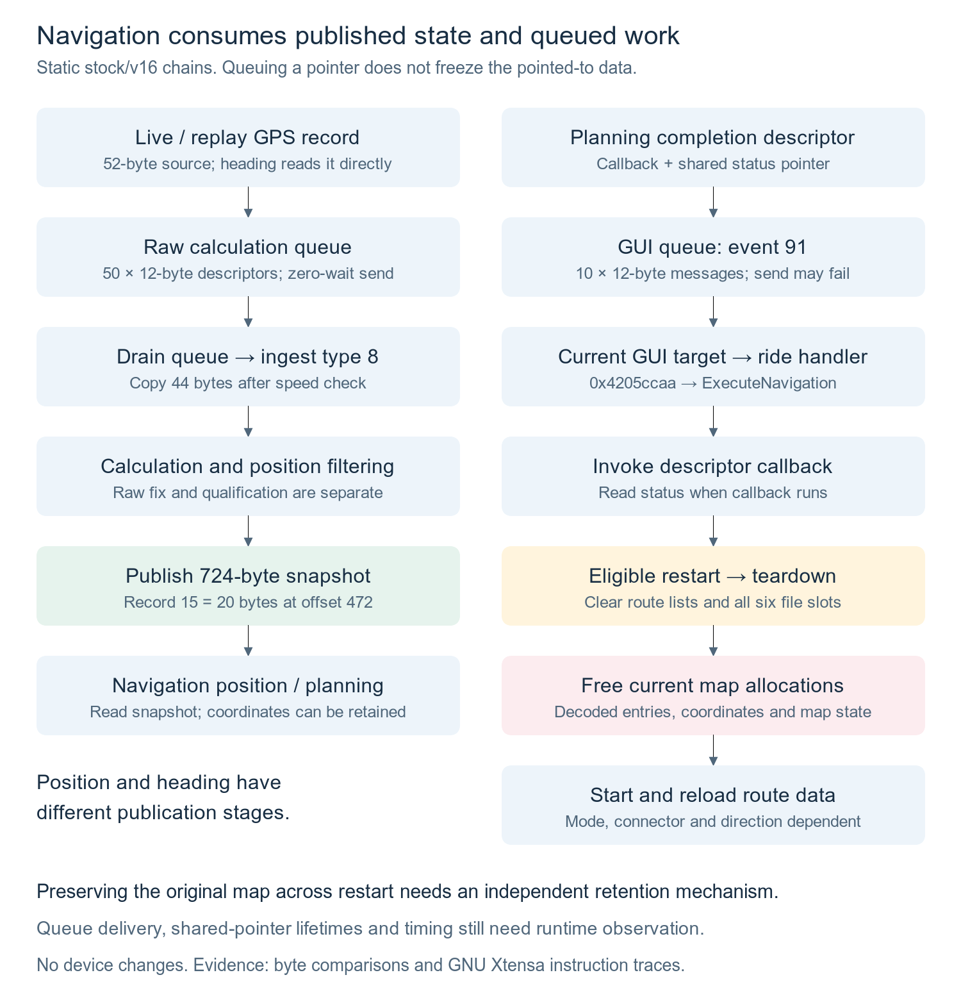

# CC700 position publication, queued completion and route replacement

Evidence date: 2026-11-13. Offline extraction from the imported stock firmware
and saved v16. This follows the [planning report](rejoin-planning-extraction.md)
and resolves the previously missing producer/consumer chains. No device was
accessed; instruction traces are not runtime tests.

## GPS reaches navigation through a queue and a calculation snapshot

The complete compiled connection is:

| Stage | Extracted operation | Address |
|---|---|---|
| Submit | Replay publishes source type 8 with its 52-byte GPS buffer | `0x420b5d2a` → `0x420b3964` |
| Queue | Copy a 12-byte descriptor containing source type, data pointer and uint16 length | `0x420b39b4..0x420b3a01` |
| Drain | Receive descriptors without waiting until the raw queue is empty | `0x420b346a..0x420b3481`, `0x420b3549..58` |
| Ingest | Type 8 adapter copies the first 44 GPS bytes into calculation input at `0x3c3ae95c + 80`, after its speed check | `0x42143792..cb`, `0x421438be` |
| Calculate | Run processing with argument 100 after the queue is drained | `0x420b3481..87` → `0x42143e70` |
| Publish | Copy 724 bytes from internal state `0x3c3aedbc` to exported snapshot `0x3c3aeae8` | `0x421457ac..b8` |
| Read | Record getter type 15 copies 20 bytes at snapshot `+472`, address `0x3c3aecc0` | `0x42143674..79` → copy at `0x42143538` |
| Consume | Navigation converts record `+12/+8` to its two coordinate floats | `0x42050330` |

The input adapter does not copy GPS course `+48`; navigation's heading selector
separately reads the replay-aware GPS getter. Position and heading can therefore
observe different publication stages.

The speed check computes `(double)gps.speed / 1000 * 1.854` and rejects values
greater than 140 or unordered comparisons before copying. Its comparison call
is `__ledf2` at `0x400023b8`, confirmed against
[Espressif's ROM symbol map](https://github.com/espressif/esp-idf/blob/v4.4.8/components/esp_rom/esp32s3/ld/esp32s3.rom.libgcc.ld).
It does not publish a special invalid record on rejection: the previous
calculation input remains. This is a separate limit from heading selection.

### The 20-byte record has two different status fields

Snapshot `+472` corresponds to internal-state `+472`. Its fields are:

| Record offset | Internal offset | Extracted meaning |
|---|---|---|
| `+0`, uint32 | `+472` | Position qualification state: 1 on accepted path; 0 on excessive-jump path; 2 when raw fix byte is zero |
| `+4`, byte | `+476` | Copied from calculation input `+81`, originally GPS `+1` |
| `+5`, byte | `+477` | Copied from input `+82`, originally GPS `+2`; physical meaning not assigned here |
| `+8`, int32 | `+480` | Retained longitude × 100000 |
| `+12`, int32 | `+484` | Retained latitude × 100000 |
| `+16`, float | `+488` | Converted speed, updated only through its own acceptance branch |

Bytes not listed are not assigned semantics. Raw-fix bytes are copied at
`0x421440dd..ef` through base `0x3c3aeebc + 220/221`; these are the same
internal addresses `+476/+477`.

The position qualification flag at `0x3fca2d4d`, prior coordinate pair at
`0x3fca2d50/54`, and counter at `0x3fca2d58` drive additional filtering:

- With a raw fix and qualification not yet established, nonzero prior coordinates
  and separation `< 100` through helper `0x4214242c` increment the counter.
  The fifth accepted comparison sets qualification. That branch updates prior
  coordinates but does not itself take the retained-coordinate update branch.
- On subsequent qualified input, separation `< 100` reaches acceptance. On
  first transition of internal state to 1, copy current coordinates. Thereafter
  speed `> 0.000001` also allows copying current coordinates. At zero speed,
  the retained pair can stay fixed while prior raw coordinates are updated.
- A qualified excessive jump clears record `+0` and increments a rejection
  counter; it does not zero retained coordinates. After repeated rejection,
  the prior-coordinate reference can be updated.
- Without a raw fix, clear qualification and set record `+0` to 2, retaining
  the coordinate pair.

Relevant branches are `0x4214414d..0x42144211` and
`0x4214459f..0x42144667`. Other sensor, drift, stillness and ride-state
calculations exist in the larger processing function; the list above describes
the retained-coordinate path, not every calculation performed there.

The navigation planning gate checks **record byte `+4`**, not the qualification
word `+0`. This distinction is now established by comparing the producer and
consumer. A raw valid fix is not proof that navigation is using that fix's
current coordinates.

### Queue capacity, ownership and freshness

The normal raw queue is created with 50 items of 12 bytes at
`0x420b2ab4..c8`. Submission uses zero wait. Null data returns 0; normal
success returns 1; queue-full returns 2. A special device state 12 redirects
submission to a different queue at `0x3c38a3dc`.

The queue copies the **descriptor**, not the GPS record. The consumer passes
the queued pointer directly to the adapter; it does not pass the descriptor's
length field to that adapter. Replay reuses its allocated GPS buffer. Thus
preserving the buffer until a call returns is not a sufficient ownership
contract: it must remain suitable until consumption. If reused before the
descriptor is consumed, the consumer can see later contents. This is a static
ownership consequence, not a reproduced scheduling failure.

The consumer drains the raw queue before running calculation. Multiple GPS
descriptors can overwrite the same calculation input before one processing
pass. Conversely, a continuously nonempty queue can defer that processing
point. A snapshot is copied only after reaching the processor's publication
path; some early exits bypass publication. A successful enqueue therefore does
not prove a fresh type-15 snapshot.

This closes the compiled replay → position connection while explaining why
timestamps, queue scheduling, invalid fixes, jumps and stationary intervals
remain necessary runtime observations.

## Event 91 is consumed by the ride UI handler

The previously unresolved continuation chain is now traced:

| Stage | Extracted behavior | Address |
|---|---|---|
| Create GUI queue | 10 items, each 12 bytes | `0x4208e6f4` |
| Send | Copy the three-word event into the queue, with zero wait | `0x4208e714` |
| Receive | Remove one event without waiting | `0x4208e74c` |
| Forward | GUI loop sends event code and pointer payload to its current target | `0x4208df70`, final event send `0x4208e05b` |
| Register ride handler | Register callback `0x4205cb54` on ride root object | `0x4205d174..17f` |
| Handle 91 | Match event 91, read event parameter, call `ExecuteNavigation` | `0x4205ccaa..ce6` |
| Invoke | Require nonnull descriptor and callback; call `descriptor[0](../descriptor[1])` | `0x42054b1c`, indirect call `0x42054bab` |
| Complete | Planning descriptor calls `NavigationYawPlan` with address `0x3c389200` | `0x4205095c` |

The current-target forwarding is conditional on GUI state. When neither target
getter provides a target, the already-received event is skipped rather than
requeued. Registration on the ride root establishes a consumer; it does not
prove that consumer is reachable in every possible page/modal state.

The sender returns -10 for a null input, -1 without a queue, -3 when queue send
does not succeed, and 0 on success. `AsynExecuteNavigation` does not check that
return. These are concrete failure boundaries for completion events.

The static callback descriptor contains a pointer to the shared status word,
not a copied status value. The callback reads the word at execution time.
An exact replay of completion must preserve that scheduling distinction.

## Applying a plan resets and reloads navigation

`NavigationYawPlan` handles status 2 by moving the local result pointer into
another retained slot, and status 5 through the shared success continuation.
It sets plan type 1, reads the current direction flag, then calls
`0x4204d9c0`. It finally sets notice/planning step 0. Unexpected statuses log
and still enter part of that continuation; the callback is not a strict
success-only gate.

The restart helper at `0x4204d9c0` is eligible for navigation states 4, 9 or
11, or when the canvas getter `0x4205bcc4` is nonzero. Otherwise it clears
`0x3fc9fc38` and returns 0. On the eligible path it:

1. Marks `0x3fc9fc38` and calls navigation teardown `0x4204cecc`.
2. Takes the navigation synchronization object through `0x4204c794`.
3. Resets request-response state, sets byte `0x3c389354` to 1, obtains plan
   type and calls `StartNavigation` with file type 1 or 5 and the direction flag.
4. Releases synchronization through `0x4204c7a8`, then returns 1.

That return means the branch was taken; it is not a checked acknowledgement
that every file open, allocation and point load succeeded.

Teardown, when old navigation state is nonzero, sets that state to zero,
clears route progress and graphics flags, deletes its navigation object,
clears point lists through `0x4204c500`, and uninitializes all six file slots
through `0x420488b4`.

The file teardown calls `0x4204976c`, which frees the map allocation at
`0x3fc9fbec`, frees every decoded map entry's coordinate allocation through
`0x4204944c`, frees the entry array at `0x3fc9fbe8`, and clears the 32-byte
map-block descriptor at `0x3c3887d4`. It also resets the separate cache at
`0x420498f8`. This is stronger evidence than the historical observation that
rerouting changes filenames: **the existing in-memory basemap is explicitly
discarded on this ordinary restart path**. New map content may subsequently
be loaded; the path does not preserve the old map independently.

`StartNavigation` then chooses numeric state 2, 8 or 10 according to plan/back
flags, initializes drawing and file context, calls
`LoadNavigationAllRoadPoint` at `0x4204d8fd`, rebuilds associated lists, stores
the direction byte, optionally initializes parameters, and dispatches an
initial navigation update. Loading is mode-dependent: original route and
connector slots can be combined; it is not simply replacing one flat array.

The parameter initializer at `0x420506c4` performs its large reset only when
ride-state getter `0x4203c020()` is zero; it always invalidates one cached
index before that guard. Its full-reset branch zeros both matcher results,
progress and display context. A restart while riding cannot be modeled as
unconditionally zeroing every field through this initializer.

## What is resolved, and what still needs execution

Resolved statically: replay's queued connection into the navigation position
snapshot; producer/consumer status differences; queue capacities and pointer
ownership; event 91's handler and callback dispatch; restart gates; and map
teardown before route reload.

Runtime-only questions remain: actual task ordering and freshness, callback
delivery under page changes, queue saturation, file/allocation failures,
measured timings, and physical sensor activity. Full sensor filtering and every
route loader helper are larger subsystem audits; they are not silently treated
as understood by the chains above. The next companion report traces
[progress and arrival](progress-arrival-extraction.md).

## Verification

The [machine-readable evidence manifest](../mining/navigation-runtime-evidence.json)
records source hashes and 22 half-open code ranges. Every listed stock range
matches saved v16. Disassembly was checked with GNU Xtensa objdump, splitting
instruction runs around padding; private traces remain outside the repository.
No source binary, private coordinates or ride files are included in the manifest.
