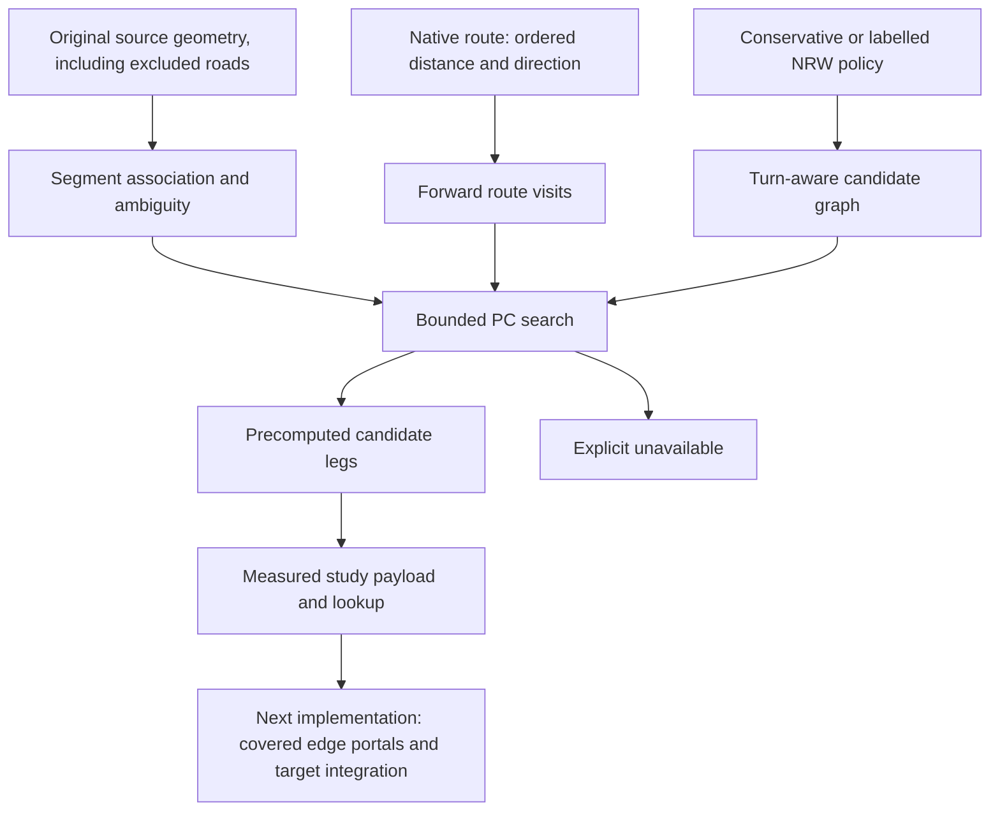

# Recovery feasibility: complete PC pass and implementation decision

**Prefer generation-time recovery computation and bounded device lookup.** The
new segment-based, ordered-visit planner finds 13 structural candidates in 30
real detour scenarios under the conservative policy. In actual spatial samples,
generation-time search finds 13 candidates among 24 origins in the 2–3 km band;
the smaller 4,096-state search finds none in that band. These results support
precomputation, not a general 3 km recovery release.

All four PC study steps are implemented: original-segment association, a named
regional policy comparison, real and spatial replay, and actual representation
encoding. **No firmware, route file, production map budget, generator or deployed
app changed.** cc24 remains withheld after its earlier native map-view crash.



## What is now implemented

[Association](../../tools/recovery_association.mjs) projects onto original source
segments within 25 m rather than choosing the closest original node. It examines
nearby geometry before access filtering, so a denied road does not silently turn
into an allowed neighbour. Segments within 5 m of the best distance compete;
parallel roads stay ambiguous. Past movement supplies a bearing only with at
least 5 m displacement within 10 s; this is a study heuristic without GPS accuracy
metadata. Crossings can be distinguished by that bearing, but uncertain heading,
near endpoints within 2 m and competing geometry remain unavailable.

[Planning](../../tools/recovery_planner.mjs) splits only the same original segment at
selected projections. Direction, original junction identity, local barrier cuts
and turn rules survive. It checks the direction of arrival at the target against
route continuation. A fix on an excluded segment is not moved to another road.
Distances cover the projected network path; lateral GPS and route offsets are
excluded, not represented as rideable connectors.

The native route decoder validates section/point boundaries, coordinate fields,
ordered native distance and conflicting duplicates. Route visits are spaced at
100 m, with direction derived from the route ahead. Targets fall more than 25 m
and no more than 3 km ahead of the last trusted historical entry. There is no
future observed rejoin in this target selection. Repeated and reversed visits
retain their ordered identities. Missing/stale entry or an exhausted forward
window gives unavailable; proximity to a shared start/finish cannot infer arrival.

These association and entry rules are PC proposals. They do not replace native
matching or prove live progress/heading correctness.

## Regional access research and explicit inference

The [NRW firm-path profile](../../tools/recovery_access.mjs) is a labelled sensitivity
study alongside the unchanged conservative comparator. It can infer admission
for path/track with a listed firm surface, absent denial, conditional/directional
access, and designated foot/horse-only meaning. Explicit bicycle access still
has its existing precedence. NRW mode excludes motorroad; footways and steps do
not become cycling links merely because a rider passed nearby.

The [OSM routing defaults](https://wiki.openstreetmap.org/wiki/OSM_tags_for_routing/Access_restrictions#Germany)
are guidance for routing fallbacks, with warnings about local signs and rules.
The current [NRW forest law §2](https://recht.nrw.de/lrgv/gesetz/30102026-landesforstgesetz-lfog/)
distinguishes roads and fixed ways, with restrictions elsewhere in that law.
A surface tag is only our imperfect proxy for that distinction; ownership,
forest/protected-area context, signs and closures remain unestablished. The
[OSM path definition](https://wiki.openstreetmap.org/wiki/Tag:highway%3Dpath) and
[track definition](https://wiki.openstreetmap.org/wiki/Tag:highway%3Dtrack) also
separate geometry/physical description from access. **No profile is certified
legal cycling access.**

Comparator caveat: conservative mode retains the earlier policy's motorroad
semantics, while NRW mode explicitly excludes it. Auditing candidate ride paths
found no `motorroad=yes` traversal in either profile. This preserves the old
comparator without claiming it is a complete production access profile.

## Real ride: better candidates, remaining ambiguity

Inputs are the same original snapshot, 4,035 recorded fixes, timeline and native
22.56 km route. The source timestamp postdates the ride. All private coordinates,
original IDs, trial details and packets stay under `.local/`.

| Result | Conservative | NRW firm-path inference |
|---|---:|---:|
| Sampled real detour scenarios | 30 | 30 |
| Structural candidates | 13 | 9 |
| Candidates using newly inferred access | 0 | 1 |
| Candidates in scenarios without recording gaps | 5 | 5 |
| Ambiguous origin segments | 15 | 15 |
| Origin edge excluded | 2 | 0 |
| Search work limit | 0 | 5 |
| Unreachable | 0 | 1 |
| Candidate payload bytes, all legs | 10,532 | 4,724 |
| Largest active candidate packet | 1,404 | 884 |

The earlier nearest-node/observed-rejoin study found one candidate. The new study
changes both origin association and target selection, so this is **not** an
isolated measurement of either change. More roads do not automatically improve
bounded search: the wider inferred graph exhausts the same work cap more often.

The recording-gap flag is a historical scenario property and can extend through
a later observed rejoin. It is not solely information available at the candidate
timestamp; “without gaps” is not a live acceptance claim. Future rejoin evidence
is not used to select planner destinations.

## Real 1/2/3 km spatial samples

The sampler scans 4,096 deterministically hashed original source nodes **before
access filtering**. It excludes 255 near the source rectangle boundary and finds
2,936 eligible nodes 50 m–3 km from the whole route polyline. Within each distance
band, local original-segment counts within 100 m are ranked into thirds; eight
nodes per tier produce 24 samples per band, 72 in total. The strata are measured
density ranks, not asserted city/village/forest land cover.

Each origin here is an exact known network node, not a noisy GPS fix. Its nearest
ordered route projection supplies a hypothetical prior-progress anchor. Competing
route visits remain unavailable. These samples test structural feasibility, not
continuous area coverage or an online method of discovering prior progress.

| Disjoint distance band | Samples | Candidates under 4,096-state cap | Candidates after bounded generation retry |
|---|---:|---:|---:|
| 50 m–1 km | 24 | 11 | 12 |
| >1–2 km | 24 | 1 | 7 |
| >2–3 km | 24 | 0 | 13 |
| Total | 72 | 12 | 32 |

Both profiles produce these totals. Failures remain visible: 18 ambiguous
hypothetical progress anchors, 16 origins absent from admitted topology, three
without an associated admitted forward visit, and three unreachable. Twenty
work-limited trials per profile are retried with generation caps of 50,000 states,
800,000 examined edges and 50,000 queue entries; 15 km and 2,048 path-point caps
remain. Worst observed work is 31,268/34,394 settled states and 64,139/71,594
examined edges for conservative/NRW respectively. These are PC work counts,
**not measured on-device time or stack use**.

Synthetic urban, village and forest controls each retain 12 connected candidates
and reject their disconnected island after graph round-trip. Their graph packets
are 56,256, 9,600 and 4,416 bytes respectively. They validate known topology and
codec behaviour, not regional access or real environmental coverage.

## Actual storage and ownership accounting

[Study codecs](../../tools/recovery_graph_packet.mjs) produce binary bytes, not just
JSON estimates. CSR graph arrays use dense identities and preserve supported
turns; ordered visit indices include source-edge fractions and continuation
bearing. A separate source-association packet includes **excluded road geometry**,
cell tables and references, so adjacent denied roads remain distinguishable.

| Whole snapshot component | Conservative bytes | NRW bytes |
|---|---:|---:|
| Compact directed graph | 2,992,116 | 3,285,684 |
| Ordered route-visit index | 2,800 | 2,848 |
| Original-source association geometry/index | 6,020,588 | 6,020,588 |
| Combined | **9,015,504** | **9,309,120** |

Six selected real spatial queries, one per band/profile, preserve candidate
status and target visit after actual graph encoding/decoding. Distance changes
are under 10 cm from centimetre edge-length quantization. Source-association and
visit packets have structural tests; they are not implemented as native readers.

Local circles at route quarter/half illustrate density costs. Including graph,
visits and all relevant source association geometry, the conservative packets are:

| Radius around sampled route anchor | Quarter point | Half point |
|---|---:|---:|
| 1 km | 64,944 B | 179,184 B |
| 2 km | 516,204 B | 794,872 B |
| 3 km | 1,745,604 B | 1,963,424 B |

These circles are separate from whole-route distance sampling. Boundary-crossing
edges are excluded, never joined by clipping. A 25 m source-association margin is
included. The current 65,536-byte encoded map working target is already for map
content, so even the smallest combined circle does not establish spare capacity.
These transparent uncompressed codecs are not information-theoretic lower bounds;
sharing coordinates, contraction, compression and streaming could reduce costs,
but have not been implemented or accepted on target.

The **32 sampled precomputed legs** serialize to 36,056/36,200 B; their 32-byte
lookup rows plus header add 1,040 B, giving **37,096/37,240 B**. The largest active
leg is **2,868 B / 356 vertices**. Lookup plus one leg is a 3,908 B payload; lookup
plus the two largest legs is 6,104 B. These are actual declared payload ownership
amounts, excluding reader/search state, allocator overhead, existing map/canvas,
transport and native rendering. They are not measured target peaks or stack use.

**These alternatives do not provide equal coverage.** The precomputed lookup has
zero area tolerance and represents exact sampled origins/progress windows only.
It does not replace the six-megabyte general source locator or support arbitrary
GPS positions. Its smaller size demonstrates the value of selective computation,
not a compression ratio for equivalent 3 km navigation. Vertices and line counts
are known; native projection/raster time and visual admission remain unmeasured.

## Implementation decision and remaining production gates

Proceed with **generation-time recovery legs, explicit covered edge portals and
bounded target lookup** as the next implementation package. Keep ordinary nearby
map detail protected and recovery geometry separate. Do not port the broad
Dijkstra search or raise production map budgets based on this experiment.

The next package is implementation, not another open-ended research prerequisite:

1. Define directed covered source-edge intervals, portal connections and nearby
   conflict exclusions; bind package identity to route/source/policy. Support
   only origins actually covered by that representation. The current exact-point
   study lookup is insufficient for real GPS activation.
2. Add bounded reader/ownership/overlay admission and state handling. Off-route
   unavailable must keep the basemap and suppress stale route cues; distance must
   come from a usable path. Invalid GPS/heading/progress must not invent a turn or
   arrival. Restore ordinary guidance only after a stable ordered rejoin.
3. Verify native allocation, task stack, projection/raster timing and restoration
   through a causal bounded device test. The rejected cc24 renderer experiment
   remains a separate release concern. PC success does not clear it.

Normal result in this study is a labelled candidate. Missing source/access/state,
ambiguous association, exhausted limits or absent forward visits yield explicit
unavailable. Device restoration is unnecessary because nothing was written.
Validated legal/physical cycling paths: **zero**. Device acceptance: **unvalidated**.

## Reproduction and review

Study config keys are `snapshot`, `track`, `timeline`, `route`. Spatial evaluation
runs by default; set `"spatial": false` for ride-only evaluation. Use a new output
directory; existing output is refused before source access. Outputs include private
trials, graph/association/visit packets, sampled leg payloads and exact-origin
lookup tables. Do not publish them.

```sh
node tools/recovery_feasibility.mjs --input STUDY.json --output NEW_DIRECTORY
node --test tools/test_recovery_association.mjs tools/test_recovery_planner.mjs tools/test_recovery_feasibility.mjs tools/test_recovery_spatial.mjs tools/test_recovery_graph_packet.mjs tools/test_recovery_study.mjs tools/test_recovery_transitions.mjs tools/test_routing_snapshot.mjs tools/test_recovery_leg_packet.mjs tools/test_recovery_ride_study.mjs
```

**76 focused tests and all 270 registered Node tests pass.** Packet byte counts
and source/packet hashes were independently checked against the actual files.
Independent review found one Important near-finish
exhausted-window case that aborted replay. A regression reproduced it, then the
single fix pass restored unavailable fallback. The complete real ride/spatial/cost
summary reproduced exactly afterward. The [sanitized aggregate](../mining/recovery-feasibility-20261115.json)
records counts, code/input/packet hashes and codec controls without coordinates.

Deferred review minors: comparator motorroad asymmetry and retrospective scope
of the recording-gap flag are documented above; no additional code changes were
made for them. Source completeness, legal/physical access, live state, arbitrary
GPS coverage and target resource acceptance remain explicit evidence boundaries.
