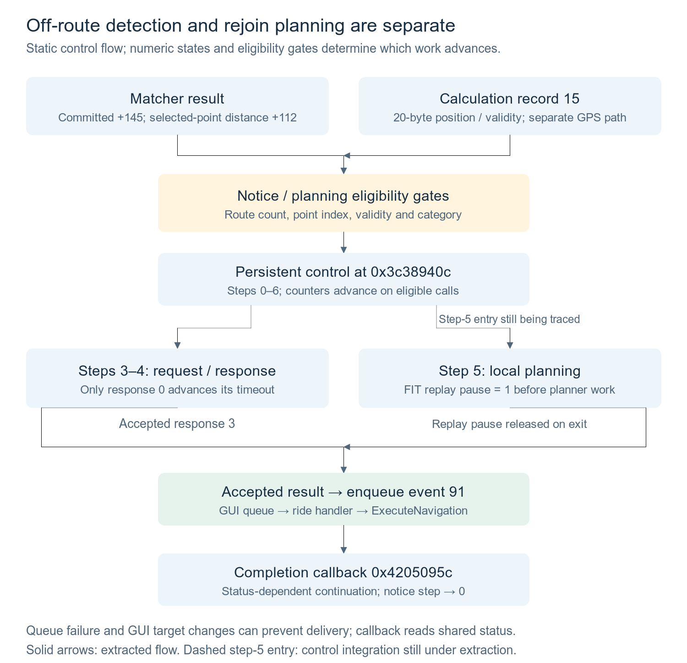

# CC700 off-route notices and rejoin planning

Evidence date: 2026-11-13. Offline stock/v16 extraction, continuing the
[route-state report](route-state-extraction.md). No device accessed.



## Separate state machines, separate inputs

The dispatcher calls `NavigationRideYawTip` at `0x42054842`, after publishing
the matcher result. The function is at `0x42052b2c`; its inputs are the
148-byte matcher result and a persistent control structure at `0x3c38940c`.
The latter is not the matcher's repeat-counter structure.

The entry checks at `0x42052b32..b8d` require:

1. Both input pointers nonnull.
2. Route point count nonzero.
3. Selected point index `>= 2`, or byte `0x3c389354` nonzero.
4. Byte `+4` of calculation record type 15 nonzero.
5. The navigation category at `0x3fc9fcd4` not equal to 2.

Before checks 2–5, it passes the committed off-route byte to `0x4204ee10`.
After the checks, it publishes matcher distance `+112` into display-context
`+72`, and Boolean off-route into context `+76`. A remaining counter at control
`+22` is decremented if nonzero. Only then does the state dispatch run.

Consequently, planning counters can stop advancing even if another subsystem
continues updating its position or display. They count eligible invocations,
not elapsed seconds.

### Position does not come from the heading getter

`0x421434dc(15, destination)` copies a **20-byte** record from `0x3c3aecc0`.
`0x42050330`, used by the navigation dispatcher to obtain position, reads
that same record. It converts signed integers `+12` and `+8` by dividing by
100000, in that order, into the two navigation coordinate floats.

If record byte `+4` is zero **and both coordinates are zero**, it instead
uses getters `0x4200e110` and `0x4200e100`. An invalid byte with nonzero
coordinates does not activate that fallback. It stores the resulting pair
at `0x3c3893bc`.

The heading path separately uses the replay-aware 52-byte GPS getter at
`0x420eeaa8`. Establishing that replay reaches the heading getter therefore
does not by itself establish freshness or equivalence of the 20-byte position
record. Follow-up [runtime extraction](navigation-runtime-extraction.md) now
traces that publication: queued source type 8 → calculation input → filtering
→ 724-byte exported snapshot containing record 15. It also identifies retained
coordinates and distinct raw-fix/qualification fields.

## Persistent control fields

Offsets below are relative to `0x3c38940c`. Names describe observed use;
numeric state values remain authoritative.

The later [startup-warning audit](../reports/popup-and-sensor-followup.md) traces notice 8
inside popup 4 and verifies live coexistence with an on-route matcher at index 0.
That early-index case returns before the main planning state machine below.

| Offset | Type | Use within the extracted function |
|---|---|---|
| `+0` | uint32 | Notice/planning step, handled values 0–6 |
| `+4` | uint32 | Countdown value in step 2 |
| `+10` | uint16 | Request-start wait counter in step 3 |
| `+12` | uint16 | Request retry counter |
| `+14` | uint16 | Planning-response wait counter |
| `+16` | uint16 | Repeated-notice counter in step 1 |
| `+20` | uint16 | Cooldown counter in step 6 |
| `+22` | uint16 | Decremented once per eligible invocation |
| `+24` | uint16 | Used with `+26` by the packed-word condition in step 0 |
| `+26` | uint16 | Incremented on accepted planning-success branches |

Other independent state locations are:

| Address | Role established here |
|---|---|
| `0x3fc9f608` | Request response value; getter `0x4200f0fc`, setter `0x4200f108` |
| `0x3c389200` | Route-plan status shared with cancellation and completion |
| `0x3c389204` | Local planner status |
| `0x3c3892b4` | Local planning result code |
| `0x3c389588` | Busy/in-progress guard checked before applying a result; complete lifecycle unresolved |
| `0x3c3892c0` | Stored local planner result pointer |

These numeric statuses are not interchangeable with the notice step or the
matcher off-route state.

## Notice/planning transition table

`offroute` means matcher byte `+145`; `P` means matcher uint32 distance `+112`
to the selected center route point. Thresholds retain firmware literals;
the full distance-helper contract remains in the geometry audit.

| Current step | Extracted conditions and transitions | Branch addresses |
|---|---|---|
| 0 | If on-route, remain 0. If off-route, emit an initial notice and enter 2 with its wait counter cleared. Special packed word at `+24 == 0x00030000` increments `+24`, sets countdown `+4 = 10` and emits countdown parameters; other values use the simpler notice path. | `0x42052cec..d4a` |
| 1 | If on-route, call `0x4204fe14(0)` and set step 0. Otherwise, only `150 <= P <= 10000` reaches request eligibility checks. Helpers `0x420d3608() == 1`, `0x420d2f34() != 0`, and navigation-mode helper `0x42050be4()` in `{1,4}` reset counters `+16/+10/+12`, set step 3 and route-plan status 4. Without that transition, increment `+16`; values above 19 reset it and emit another notice. | `0x42052d4d..e06` |
| 2 | If countdown `+4 != 0`, decrement it and publish updated parameters through `0x4204fbc4`. Otherwise set step 1. This branch does not inspect `offroute` again. | `0x42052e09..e2b` |
| 3 | If on-route, clear through step 0. If `P < 150`, enter 1. Otherwise, with wait counter zero, attempt request only when busy guard is zero; if `0x42050540()` succeeds, emit notice and enter 4. A failed/blocked initial attempt advances the wait counter. Subsequent values above 14 clear it, reset cooldown and enter 6 with a notice. | `0x42052e30..ede` |
| 4 | If on-route, clear through step 0. Otherwise inspect request response, detailed below. | `0x42052c20..ce8`, `0x42052eed..fa4` |
| 5 | If on-route, clear through step 0. Otherwise run/poll the local-planning path, detailed below. Entry into this step from external controls is not fully extracted. | `0x42052fa9..0x4205463e` |
| 6 | If on-route, call `0x4204fe14(0)` but continue cooldown. Change route-plan status 4→6 or 1→3. Increment `+20`; on reaching 5, clear it and enter step 1. | `0x42054641..67e` |

Unhandled step values return. “Emit notice” describes calls into the notice
subsystem; visible text, dismissal rules and durations require that subsystem's
full audit. In particular, notice arguments 5000/10000 are not assigned seconds
or milliseconds solely from their values.

### Step 4: response handling

The response getter returns the word at `0x3fc9f608`.

| Response | Effect |
|---|---|
| 0 | Increment `+14`; values above 15 clear it and cooldown, emit a notice, enter step 6. |
| 2 or 4 | Increment `+12`. Below 3, clear request-start wait and enter 3. At 3 or above, clear retry/cooldown counters, emit a notice and enter 6. Clear `+14` on either branch. |
| 3 | Change route-plan status 4→5. When busy guard is zero: update notice parameters, clear response via setter `(0)`, clear `+14`, increment success counter `+26`, then enqueue asynchronous continuation. |
| 1 and other values | Return without the response-zero timeout increment. |

A generic “time out after 15 updates regardless of response” model would be
wrong: response 1 does not take the zero-response timeout branch. Whether the
producer guarantees eventual change requires tracing its writers.

## Request path and asynchronous continuation

`0x42050540` builds a request using calculation record 15 and the selected
route's path/name. It creates a 64-byte payload starting with byte 9, followed
by the two 32-bit coordinate fields. If `0x420d3608()` is nonzero, it invokes
`0x420b760c` with argument tuple `(128, 4, 1, 242, 64, payload)` and returns 1.
Transport semantics, delivery acknowledgement and all response producers have
not yet been extracted. A return of 1 is not established proof of delivery.

Both successful planning paths call `0x42052ae0`, labelled
`AsynExecuteNavigation` by its log. That wrapper constructs an event with
first word 8, event number **91**, and a pointer payload, then calls
`0x4208e714`. The two static pointer payloads (`0x3c1f01e4` and `0x3c1f01ec`)
both contain the word pair:

```c
{ 0x4205095c, 0x3c389200 }  // callback address and status-address payload
```

The callback at `0x4205095c`, logged as `NavigationYawPlan`, reads the pointed
status. Status 2 moves the local result pointer into another retained slot;
status 5 shares the success continuation. Both call
`SetYawRoutePlanType(1)` at `0x420509c8`. Unexpected statuses log an error but
still branch into later continuation, bypassing that type-setting call.
The continuation calls `0x4204d9c0`, conditionally emits a notice, and writes
notice step 0. A null callback parameter follows a separate error path.

Follow-up [runtime extraction](navigation-runtime-extraction.md) resolves the
event 91 consumer, ten-slot GUI queue, ride-handler dispatch and subsequent
restart/teardown/reload chain. Queue failure and target selection can prevent
delivery; the callback reads shared status when executed. Enqueueing therefore
still cannot be equated with successful navigation replacement.

## Local planning and native FIT replay interaction

Step 5 starts local work when route-plan status is 1 and local status is not 1.
Within that work it checks local status 4, calculation position validity and
nonzero coordinates, cancellation, the selected original-route access point,
and whether target point information exists. Failures record distinct numeric
results; these are not all the same “no route” failure.

Once a target has been obtained, `0x42053458..45a` calls the native replay
pause setter `0x420b51cc(1)`. The subsequent planner call at `0x420534aa` goes
to `0x420e249c`, with literal limits `0x200000`, `0x100000` and double 15.0
among its arguments. The [subsequent extraction](../reports/remaining-extraction-and-device.md)
resolves them: 2 MiB is a free-heap cleanup trigger; 1 MiB is a free-heap
search-abort floor; 15.0 is the elapsed-time limit in its seconds-format clock.
They are not available-memory measurements or reserved buffers.

Returned geometry undergoes additional checks and construction. For example,
distance from the current position to the returned first point is compared
against 150.0 at `0x42053570..57e`; `>= 150` produces result code 10,
logs “Current Location No Route”, and releases the returned object. There are
also coordinate removal, additional allocations, segment processing and a
second cancellation check. The whole planner/geometry pipeline remains open.

The common local-work exit at `0x420531ee` stores the result code and calls
`0x420b51cc(0)` to release the replay pause. Local result 2 maps to outcome 3;
result 1 maps to outcome 0; other results map to outcome 4. If the local-work
entry condition was not taken, outcome starts at 0.

| Local outcome | Next outer action |
|---|---|
| 0 | Increment planning-response wait `+14`; above 15, clear wait/cooldown and enter step 6. |
| 4 | Increment retry `+12`; at 3, clear retry, write packed word `+20 = 0x001e0000`, emit notice and enter step 6. This clears cooldown `+20` and sets decrementing field `+22` to 30. |
| 3 | Change route-plan status 1→2; when busy guard is zero, increment success count and enqueue continuation. If busy, a nonnull stored result can be released and route-plan status reset instead. |

This is a compiled interaction between planning and replay: replay advancement
is explicitly paused around local planning. The acquisition of a target occurs
before that pause. Wall-clock duration, live-GNSS behavior while planning,
failure cleanup and all concurrent state writers still require verification.

## Reset paths and unresolved integration

Direct references already show that several UI/control handlers can set notice
step 0 or 1 and clear countdown. `NavigationEndParaInit` at `0x42050030` clears
the packed `+24/+26` fields and `+22`, among other navigation globals; it does
not by itself clear every control field in the shown body. The completion
callback separately writes step 0. Treating any one as a full reset would be
premature.

The next extraction pass now documents the [position producer, queue dispatch
and route replacement](navigation-runtime-extraction.md), plus the local
[progress and arrival branches](progress-arrival-extraction.md).

Remaining dependencies include control/UI entry into step 5, every response
producer, complete planner cleanup/failure propagation, geometry/helper contracts,
and runtime ordering/failure observations. The four linked chains no longer
need placeholder rules, but this does not close the whole firmware.

These are narrower dependencies exposed by extracted branches, not behavior to
invent in a simulator.

## Verification

Stock and saved v16 bytes match over half-open ranges
`0x42052b2c..0x42054684`, `0x42050330..0x420503b4`,
`0x420b51cc..0x420b51d8`, and `0x4205095c..0x42050a48`.
The initial notice/planning trace covered 2221 decoded instructions and 40 GNU
runs. A [recursive control-flow audit](../reports/remaining-extraction-and-device.md)
corrected the imported decoder's sweep and signed BF/BT displacements, reaching
2506 instructions across 42 GNU runs. These counts describe extracted code,
not complete behavioral coverage.

The local index incorrectly identifies an internal boundary at `0x42053470`.
The extraction explicitly overrides that boundary to follow the containing
function through `0x42054684`. This is why a short indexed disassembly is
insufficient evidence for this state machine. Findings remain static until
validated against runtime observations.
