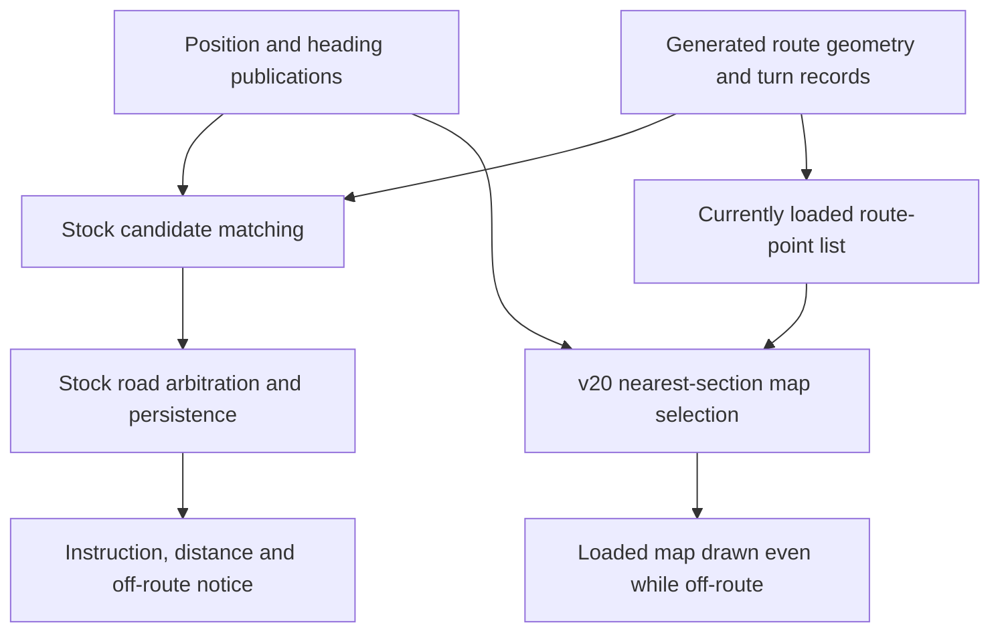

# 23 km ride review — 14 November 2026

This review separates recorded observations, offline reconstructions and unresolved
causes. It does not declare detour guidance fixed or the preview a firmware emulator.
Private device bytes, positions, ride files, recovered logs and plots remain under
`.local/ride-20261114/`, outside Git. Firmware remains v20; this investigation
performed a storage read and an RTS restart, with no device programming or GPS injection.

## Evidence preserved

A fresh 7,987,200-byte storage snapshot was acquired and hashed before analysis.
The established reset procedure then loaded the ota_1 application once with no
crash captured during the bounded boot observation. Both navigation files and
recorded FIT files were extracted offline. Configuration secrets and coredump
files were not opened by the filesystem extractor.

The current visible log begins at 17:42:04. Scanning the raw snapshot recovered
**70,958 complete dated fragments, representing 43,300 distinct lines** for the
date, including earlier ride events. These counts include other activity that
day. Original byte offsets are retained. Physical flash order is not execution
order; duplicated copies and conflicting same-second records cannot be treated
as independent or ordered events. Overwritten data is not recoverable this way.

The OEM logger stores literal escaped `\\t` and `\\r\\n` characters. The recovery
tool recognises those separators as well as real control characters. It excludes
binary-corrupted or unterminated tails: one damaged heap fragment ended in `99`,
which must not be mistaken for a 99-byte low-water measurement. Tests cover these
boundaries, duplicate provenance and interleaved prefixes.

Reproduce offline, using a private output directory:

```sh
python3 tools/ride_evidence.py /path/to/storage.bin --date 20261114 --output .local/recovered
```

## Ride and file integrity

| Item | Observation |
|---|---|
| FIT recording | 4,035 position records, 16:44:27–17:59:14 local time |
| Elapsed interval | 1 h 14 min 47 s |
| Recorded distance field | 23,046.39 m |
| Distance summed from recorded positions | About 23,090.7 m; a different measurement, not a discrepancy by itself |
| Planned route | 22,561.29 m, 112 sections |
| Encoded section points | 2,197 including repeated boundaries |
| Direction codes | 50 nonzero: 18 left, 16 right, 12 slight turns and 4 U-turns; correctness needs path labels, not a count target |
| Map | 17 distinct blocks, 112 index references; largest block 871 entries |
| Bearing convention | Median error to the following point is 0.0°; the old `90 − bearing` convention is not present |

All eleven FIT gaps of ten seconds or longer coincide with recorded pause/continue
events. They are not evidence of eleven freezes. The longest is 90 seconds.
This does not identify the auto-pause threshold or prove whether each pause was
manual or automatic. FIT structure was decoded; this reader does not validate
its CRC, and its recorded positions are not a capture of every internal filtered
navigation position or heading.

## The supplied photo is correlated

The combination **666 m / Go straight / 7.37 km remaining** matches 17:32:38:

- nearest original-route progress ≈15,192.58 m;
- total 22,561.29 m minus that progress ≈7,368.71 m;
- section 78 ends at 15,281.84 m, section 79 at 15,591.02 m;
- the next nonstraight maneuver, section 80, is at 15,858.00 m;
- that maneuver is ≈665.42 m ahead, consistent with the logged 666 m after
  point-distance/position rounding; current-section remainder alone is only ≈89 m;
- the recovered line explicitly reports `pos:78` and `StrghtDst:666`.

Thus the photo's 666 m distance is consistent with distance to the next maneuver,
not evidence of a stuck countdown. It exposes a **preview bug**: the page used
only the current subdivision's end distance. The stock `GetDirIcon` function at
`0x4204dcd4` also gates the maneuver icon at an inclusive 300 m cached-distance
threshold. The preview correction follows these observed on-route presentation
rules; it does not reproduce the stock position filter or detour state machine.

The actual C fill code under ASan/UBSan and the JavaScript fill produced identical
240 × 256 masks for all **97 area entries** in the photographed block (11 touch
the visible canvas), using the same desktop projection. The private host-input
fixture was enlarged to accept the actual polygons; firmware code was unchanged.
This supports fill parity for this scene, not native projection/line/font parity.

A local rendering of this exact encoded map scene is saved privately as
`photo-scene-map-v20.png`. Its shoreline shape agrees with the supplied scene.
Its default heading comes from planned route geometry, whereas the device uses
its selected heading source; those are not interchangeable inputs.

## Rejoin and detour findings

For comparison, position distance below is the shortest distance from the FIT
coordinate to the **original route's line segments**. It is not the firmware's
selected-point distance. Complete unique log records were available at the exact
FIT second for 3,273 road/yaw samples; absent or conflicting records are unknown.

| Time | Original line distance | Recorded state | Interpretation |
|---|---:|---|---|
| 17:05:52 | 1.39 m | matched road 33, output road 31, selected-point distance 165 m, off-route=1 | The nearest candidate and accepted progress disagree after a route deviation/rejoin. The warning is not explained by raw distance to the original line. |
| 17:26:07 | 0.97 m | matched road 68, output road 61, selected-point distance 173 m, off-route=1 | A second clear arbitration/progress hold, seven sections behind the nearby original section. |
| 17:31:05 | 2.14 m | road 76, selected-point distance 3 m, off-route=1 | A different case: persistence, angle/local geometry or upstream inputs require examination. A stale road index alone does not explain this sample. |
| 17:32:38 | 0.45 m | road 78, off-route=0, countdown 666 m | The photographed scene is internally consistent at this moment. |
| 17:45:36 | 67.65 m | candidate/output road 13 while nearest original section is 97 | Nearby/repeated route branches make a globally nearest pass ambiguous here. A jump to an early route section is observed; intended traversal must be established. |
| 17:48:59 | 663.30 m | road 102, selected-point distance 664 m, off-route=1 | A genuine large deviation, distinct from the earlier on-line warning cases. |
| 17:53:28 | 92.30 m | road 102, off-route=0 | Recorded recovery state; not a universal 92 m rejoin threshold. |

Across the recorded ride, 90 exact-second samples have off-route=1 while the FIT
position is within 10 m of the original line. The largest actual deviation from
that line is about **910.69 m**. Around 1,071 samples have another original-route
pass more than 500 m away in route progress but within 25 m of the best geometric
distance. This is a geometric ambiguity indicator, not proof the firmware chose
the wrong pass on every such sample.

The logs record navigation starts/reloads at 16:43:55, 17:10:13 and 17:47:09.
These calls are not by themselves proof of device resets or successful phone
reroutes. The inspected fragments do not show a successful asynchronous planner
continuation. The planned file on the device is preserved; a file alone cannot
establish all transient route slots that existed during navigation.

### Why the renderer patch does not fix guidance



The matched candidate, accepted road, selected point and committed off-route
flag can change independently. Existing extraction identifies the arbitration
and advancement branches at `0x4204abf4` and `0x4204fc30`. The new ride supplies
physical cases for them. Forcing the nearest candidate into accepted progress
would bypass those safeguards at crossings and out-and-back sections; it is not
a justified fix from these logs alone.

Some debug lines retain `%f` literally and print unusable position integers.
They cannot recover missing internal angles or positions. FIT geometry, stock
filtered position, cached heading, route-angle input and candidate table must
remain distinct evidence sources.

## Map, memory and preview limits

The v20 map blocks are valid and below current entry limits. The largest decoded
map payload is 51,884 bytes; the largest serialized block is 62,338 bytes. A
conservative any-block transition plus the 122,880-byte map canvas is 237,102
bytes, excluding navigation, LVGL, allocator overhead and other subsystems.
The busiest block is estimated at 1,353 projection callbacks/6,630 projected
points; these are counts, not target frame times.

There are 217 complete heap readings during the reviewed navigation interval:
minimum observed current default-capability free heap is 1,263,328 bytes;
minimum observed internal/DMA/byte-capable free heap is 47,792 bytes. The reported
default low-water statistic reaches 991,892 bytes. Those columns are not additive,
and none measures the largest free block or task-stack high-water mark. No
allocation-failure or panic message was found in the recovered ride text;
incomplete logs cannot establish that none occurred.

The largest detour exceeds the generated corridor for several map classes
(areas 600 m, cycleways 350 m, waterways 450 m). Keeping drawing enabled does not
create map data beyond that coverage. A return to incomplete background layers
far off-route is therefore an expected coverage boundary to test, separate from
a loader fault. Logs alone do not prove rendered visibility or frame smoothness.

The local C loader replay remains useful but supplies an explicit single-file
resolver and reconstructed point list. Actual logs show changing active point
counts, for example 473 at 17:26:07, while the complete original file has 2,197
points including repeated boundaries. A full-file replay must not be represented
as a capture of these live windows or native stock navigation.

The full display is **240 × 320**, confirmed by the
[manufacturer specification](https://geoid.com/products/geoid-cc700-bike-computer).
The extracted map buffer is **240 × 256**. The page now scales the complete
screen and overlays together; see [geometry verification](preview-display-geometry-2026-11-14.md).
Water/cycleway RGB565 values were not changed by this review. Exposure, display
transfer characteristics, viewing angle and browser rasterization mean a device
photo is not a calibrated colour reference. README's older comparison artwork
must be identified as historical rather than current exact firmware output.

## What remains and the order to resolve it

1. **Rejoin fixtures from this ride:** preserve raw candidate versus output road,
   point identity, heading validity and counter transitions for the two on-line
   holds; examine the separate 3 m/off-route case. Confirm which deviations were
   deliberate before assigning route-generation errors.
2. **Conservative rejoin handling:** implement only after the relevant arbitration
   inputs can be reproduced. Validate crossings, reversed travel, route start/
   finish overlap, skipped short connectors and return from a substantial detour.
3. **Generator association:** the known synthetic noisy-GPX failure persists.
   Short-chord smoothing did not fix it. Multiple noise seeds produce false
   prompts, including U-turns. Require sustained support for the traversed incoming
   and outgoing mapped arms, rather than raising angle thresholds and hiding
   legitimate 25° forks or 22–27 m close turns.
4. **Sparse GPX:** every-eighth-point input removes about 189.5 m of historical
   fixture geometry. Filtering cannot recover the missing route choices; this
   needs explicit uncertainty or connected-path evidence.
5. **Detour coverage and performance:** measure screen behaviour on the existing
   captured excursion before increasing map corridors/block sizes. Target frame
   timing, contiguous RAM and stack headroom remain unmeasured.

No new firmware patch is justified solely by this first audit. The immediate
preview corrections are testable locally and do not require another test ride.


## Verification and deployment boundary

- Python: **120 passed**, including recovery boundary tests, label-payload geometry
  exclusion and actual C rendering tests under sanitizers.
- Node: **91 passed**, zero non-TODO failures, one existing executed noisy-track TODO.
- All seven offline app probes pass, including synthetic 70 km generation/readback.
- Real browser layout measurements pass at 180/252/360 CSS-pixel bezel widths.
- Fresh review found no critical preview integration issue. The new guidance
  tests were added to the documented standard suite and local wider validator.
- The wider validator still reports **incomplete**: the existing noisy-side-street
  TODO and two historical aggregate failures remain (25 versus 15 turns with
  noise; 3 versus 15 with sparse points), and target acceptance is not complete.
  Its old-ride C loader coverage proxy passes; that does not close this ride's
  native navigation gaps.

The app changes are limited to preview layout/countdown and offline caching;
route generation, device firmware and stored ride/route files are unchanged.


## Follow-up: distance visibility on the navigation page

The owner reports that ridden kilometres are hard to see and a distance field
sometimes appears blank. These are retained as two distinct observations.
In the supplied photo the flag's 7.37 km is **remaining route distance**; the
lower cells contain speed and GPS heading, so they do not show the trip counter.

The underlying distance counter was active during the ride: automatic lap events
occur at approximately 5, 10, 15 and 20 km (17:02:54, 17:18:52, 17:34:24 and
17:49:15). The 20 km event occurs during the large detour. This supports continued
recording of ridden distance, rather than disappearance of the underlying value.

The recovered text has 33 invalid/zero prompt-record samples during navigation
startup, ending at 16:44:29, and one zero straight-distance sample at 16:44:30.
It does not capture every widget's rendered value or visibility. No subsequent
blank-field incident can be confirmed from those samples. Identify the affected
field and correlate its timing before assigning it to the trip counter, remaining
route distance, instruction distance or UI visibility state. No firmware display
field was changed by this review.


### Clarified remaining-distance placeholder

The owner clarified that the value beside the finish flag sometimes showed only
punctuation/dashes and “km.” A new static trace identifies a direct mechanism:

- Getter `0x4204fd98` returns `0xffffffff` (unavailable) when committed off-route
  is nonzero, when position-record byte +4 is zero, or in several inactive/
  completed navigation states. Simulated-navigation states 6 and 7 bypass these
  validity restrictions and return the retained remaining-distance word.
- `GetDataValueDisplay` at `0x42060540` checks this sentinel. It selects the
  localized **`--`** placeholder instead of formatting the kilometre number.
- The inspected placeholder is identical in all twelve language-table slots.
  A separate unit label can remain visible. The observed “. km” is compatible
  with this path, but its exact glyph appearance was not captured in a screenshot.
- Getter and formatter instruction bytes are **identical in stock and v20**.
  This suppression was not introduced by the colour/width patch.

For ordinary real navigation with an off-route flag, hiding the unavailable
route-distance estimate is therefore explained by stock code. This does not
prove the exact time of the owner's observation. It also makes the earlier
on-line/off-route arbitration cases a plausible source of unnecessary hiding.

The correct fix is not to treat `0xffffffff` as zero kilometres or to present an
old retained value as current. Improve rejoin confidence first; consider an
explicit “off route / distance unavailable” presentation separately. Keep trip
kilometres independent from remaining route distance. The private instruction
extracts and byte comparisons are saved with the ride evidence.
