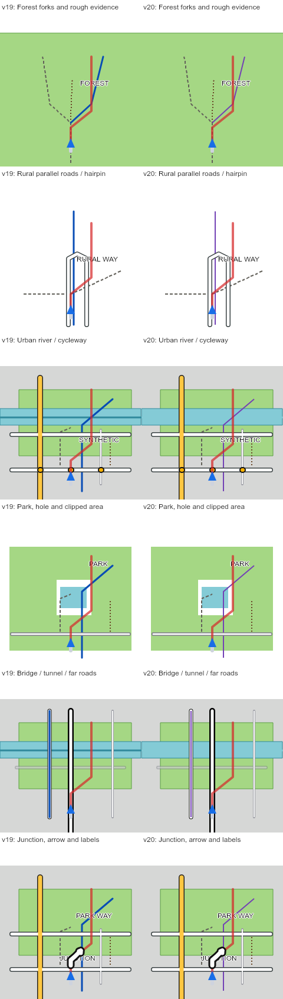

# Water and cycleway distinction — v20

Status: built, tested and installed to ota_1 with flash readback verification.
The Pages preview selects v20; v19 remains available for comparison and rollback.

The device photo at 14:18 shows a waterway stroke over water fill, with a nearby
dark-blue cycleway. At the user's current 100 m navigation scale these should be
distinguished directly by colour and width.

## Design and scope

Use the existing light water fill (#82cbd5) for river/creek strokes too. Keep
waterway width 3 px. Cycleways become violet (#7040b0), width 2 px. RGB565
quantization applies to both firmware and preview. Keep shoreline strokes
(#378b98), bridge bases, roads, tram cues, route opacity, all geometry and turn
behaviour unchanged. Existing polygon clipping/hole flags still control shoreline
visibility; there is no new lake-versus-river classification.

This follows the user's requested palette distinction. Suppressing water lines
inside polygons could save calls, but requires geometric coverage handling and is
outside this small change. Equal opaque water colours remove the dark centreline
without adding that complexity. No drawing-call savings or measured speedup are
claimed. There is no new zoom feature.

## Implementation and validation

- Private `patch/src/map.c`: only OPS[4] colour and OPS[13] width/colour change.
- All ELF sections match v19 byte for byte except **7 bytes in .rodata**; executable
  code, loader, arrows, headers, trampolines and linker inputs are identical.
- Text 6480 B; rodata 296 B; mapped-page room 8120 B: unchanged.
- Candidate: `.local/patch-v20/ota_1_v20.bin`, 3,750,816 bytes.
- SHA256: `807688211332f7b86a2a2ae157d7d492faf0f99a1e77f86a95696bd8ba3880e5`.
- Private source snapshot and manifest in `.local/patch-v20/`; versioned image
  also saved as `../cc700-backup/patch/ota_1_v20.bin`. v19 artifacts retained.
- `tools/build_render_candidate.py` now builds named v20 from the pinned v18 base
  with the current private patch source. No serial access in that tool.
- Node suite: 82 pass, zero non-TODO failures, one existing executed TODO for a
  false slight-left on a synthetic noisy straight road near side streets.
- Python suite: 114 pass, including actual C rendering under ASan/UBSan.
- All seven offline app probes pass, including synthetic 70 km stock/styled
  generation and readback; this is not a device endurance test.
- New preview regression checks water fill/stroke equality, 2 px violet cycleways,
  bridge/shoreline/tram retention, route opacity and unchanged v19 comparison at
  headings 0/45/90.
- 108 synthetic comparison frames generated across six scenes, three scales and
  three headings; representative 2.5 m/px, north-up sheet inspected below.
- Browser fonts/rasterization/projection remain approximations. No device-photo
  comparison of v20 yet. Installation saved a fresh full ota_1 rollback, verified
  the written image and automatically booted via RTS. Stock ota_0, OTA metadata
  and route/ride storage were not written. No GPS injection.
- Boot observation: expected ota_1 app loaded once, one reset, no captured crash
  during the eight-second observation. This is not an endurance test.
- [Sanitized installation receipt](mining/v20-install-observation.json).

Existing styled route files remain compatible: the change lives in rendering,
so regenerating GPX files is not required to use these colours after installation.

Known noisy/sparse-GPX guidance failures and target endurance/headroom limits from
[the v19 release](rendering-release-2026-11-14.md) remain open.
